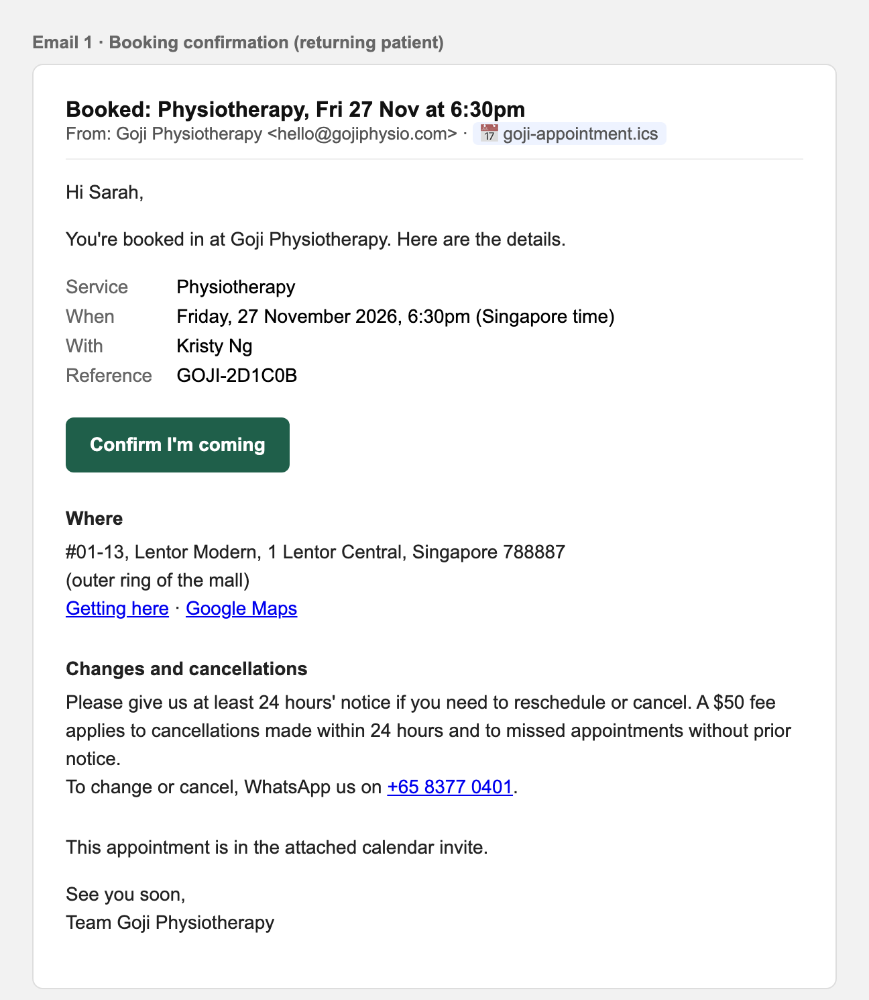
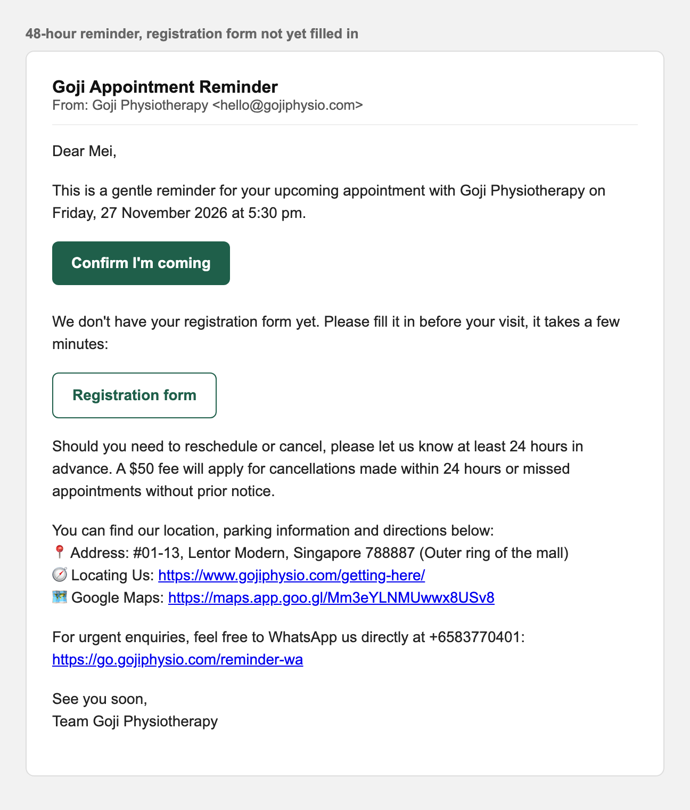
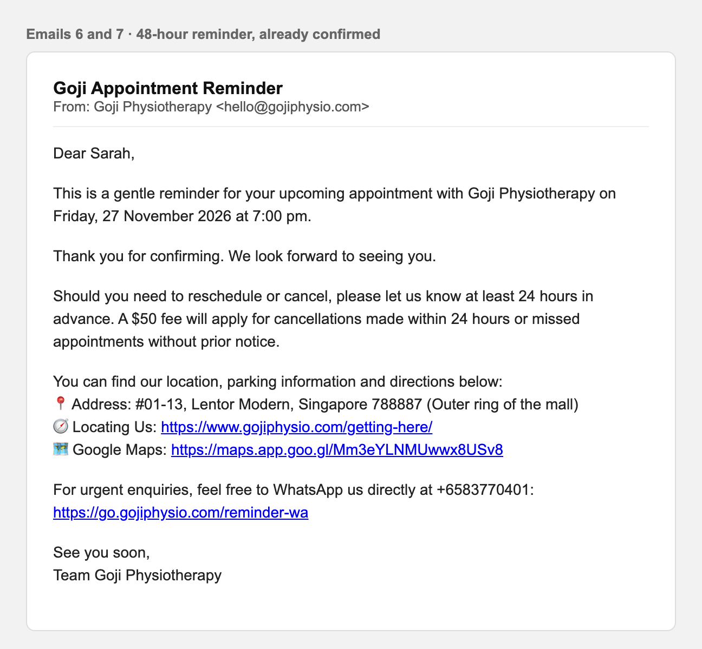

# Booking emails and WhatsApp messages: for Chris to approve

25 Nov 2026 · prepared by Charles

Every booking gets one confirmation by email and one on WhatsApp, whether it was made on the website, on WhatsApp or by the front desk. Two days before, the patient gets the reminder email and a WhatsApp reminder, unless they've already confirmed. A patient counts as confirmed once they tap Confirm in an email or on WhatsApp, or the front desk marks them confirmed in Plato. A cancellation sends nothing. Today's Plato confirmation and Plato's own 48-hour reminder both stop on go-live day, the same day all of this starts.

## What the test did

On 25 Nov we ran the new emails for real, with two test bookings on Fri 27 Nov with Kristy. Both went to Charles's personal email and were deleted afterwards. Everything worked.

1. **Booked a returning patient**, the way the WhatsApp assistant books: **email 1**, the booking confirmation.
2. **Moved that booking** from 6:30pm to 7:00pm: **email 2**, "your appointment has moved". The calendar entry moved too, so there was no second entry.
3. **Booked a new patient** through the website: **email 3**, the confirmation with Plato's registration form.
4. **Ran the 48-hour reminder** for both bookings: **emails 4 and 5**, each with a Confirm button.
5. **Confirmed both bookings:** one through Plato's Confirm link, one the way the WhatsApp Confirm button will. Plato showed both as Confirmed.
6. **Ran the 48-hour reminder again:** **emails 6 and 7** now thank the patient instead of asking again. WhatsApp was skipped for both, as planned.
7. **Deleted both bookings.** No email goes out on a cancellation.

We also checked that the same booking never gets a second confirmation, and that only new patients get the registration form.

## The messages

The test sent seven emails, in five designs. The samples below use made-up patient names.

| # | Email | Sent when |
| --- | --- | --- |
| 1 | Booking confirmation | Right after any booking: website, WhatsApp or front desk |
| 2 | Appointment moved | When the time changes |
| 3 | Booking confirmation, first visit | Any booking where the patient hasn't yet filled in Plato's registration form; adds the form |
| 4, 5 | 48-hour reminder, not yet confirmed | 12:00, two days before |
| 6, 7 | 48-hour reminder, already confirmed | Same, once they've confirmed |

Every booking confirmation also adds the appointment to the patient's calendar, with no alert. If the time moves, that calendar entry moves with it.

**New since the test:** if the patient still hasn't filled in Plato's registration form, the 48-hour reminder email asks again, with the form button under the Confirm button. "Filled in" means the patient has signed the Clinic Consent Form at the end of Plato's form, which Plato records on their profile. Both emails stop asking once that's signed. The WhatsApp reminder can't carry the form link, because its wording is fixed by Meta.

### Email 1: booking confirmation

### Email 2: appointment moved

### Email 3: booking confirmation, registration form not yet filled in

### Emails 4 and 5: 48-hour reminder, not yet confirmed

### 48-hour reminder, registration form not yet filled in

### Emails 6 and 7: 48-hour reminder, already confirmed

### WhatsApp confirmation (approved by Meta)

It goes out with the confirmation email for website and front-desk bookings. Bookings made in a WhatsApp chat are confirmed in that chat instead. Patients who don't have an email on file still get this message.

> Hi Sarah, your physiotherapy appointment at Goji Women's and Family Physiotherapy is confirmed for Fri 27 Nov, 7:00pm with Kristy.
>
> Reply here if you need to change it.
>
> 📍 Lentor Modern
>
> [Get directions]

### WhatsApp confirmation, registration form not yet filled in (with Meta for approval)

Same as above, with a form line and a button. Until Meta approves it, these patients get the version above, and the form comes in their email.

> Hi Sarah, your physiotherapy appointment at Goji Women's and Family Physiotherapy is confirmed for Fri 27 Nov, 7:00pm with Kristy.
>
> Please fill in your registration form before your visit, using the button below.
>
> Reply here if you need to change it.
>
> 📍 Lentor Modern
>
> [Registration form] [Get directions]

### WhatsApp reminder (approved by Meta)

It goes out at the same time as the reminder email:

> Hi Sarah, a reminder of your physiotherapy appointment on Fri 27 Nov, 7:00pm with Kristy at Goji Women's and Family Physiotherapy.
>
> If you need to reschedule, please let us know at least 24 hours before.
>
> [Confirm] [Reschedule]

### WhatsApp reminder, registration form not yet filled in (with Meta for approval)

> Hi Sarah, a reminder of your physiotherapy appointment on Fri 27 Nov, 7:00pm with Kristy at Goji Women's and Family Physiotherapy.
>
> We don't have your registration form yet. Please fill it in before your visit, using the button below.
>
> If you need to reschedule, please let us know at least 24 hours before.
>
> [Confirm] [Reschedule] [Registration form]

Every message asks for the registration form until the patient has filled it in: the confirmation email and WhatsApp, and the 48-hour reminder email and WhatsApp. "Filled in" means they've signed the Clinic Consent Form at the end of Plato's form. The form button always opens the right Plato form for that patient. If they've already done it, it shows "You're all set".

Patients who have already confirmed and have an email don't get the WhatsApp reminder. Tapping Confirm marks them confirmed in Plato. Tapping Reschedule starts a reschedule in the chat. The wording of both WhatsApp messages is fixed by Meta's approval: changing it means resubmitting the message for approval, which takes a few days. Both were test-sent to Charles's phone on 25 Nov.

## Please approve

Reply to Charles on each point:

- [ ] The booking confirmation wording and layout (emails 1 and 3)
- [ ] The "moved" email (email 2), and the WhatsApp confirmation going out alongside the confirmation email
- [ ] The 48-hour reminder: today's Plato wording, plus a Confirm button or a thank-you (emails 4 to 7)
- [ ] Reminders go out by email and WhatsApp together, and confirmed patients get no WhatsApp reminder
- [ ] Cancellations send nothing to the patient
- [ ] Every message, email and WhatsApp, asks for the registration form until it's filled in
- [ ] Go-live date: _______

On go-live day, the front desk stops sending Plato's confirmation by hand, and Plato's own 48-hour reminder is switched off. Our emails and both WhatsApp messages start that same day.

---

[How our reminder compares with Plato's today](README.md)
