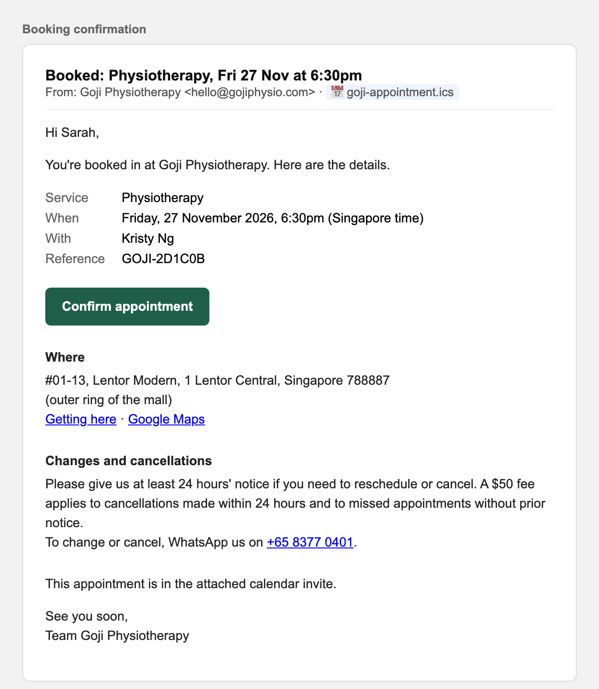
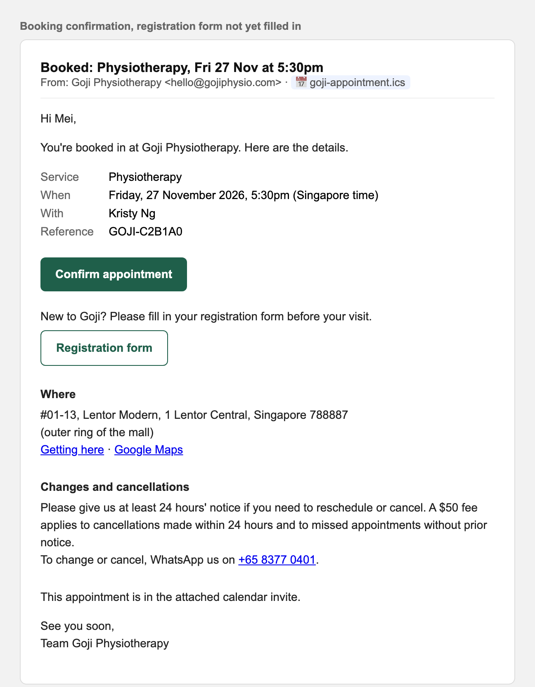
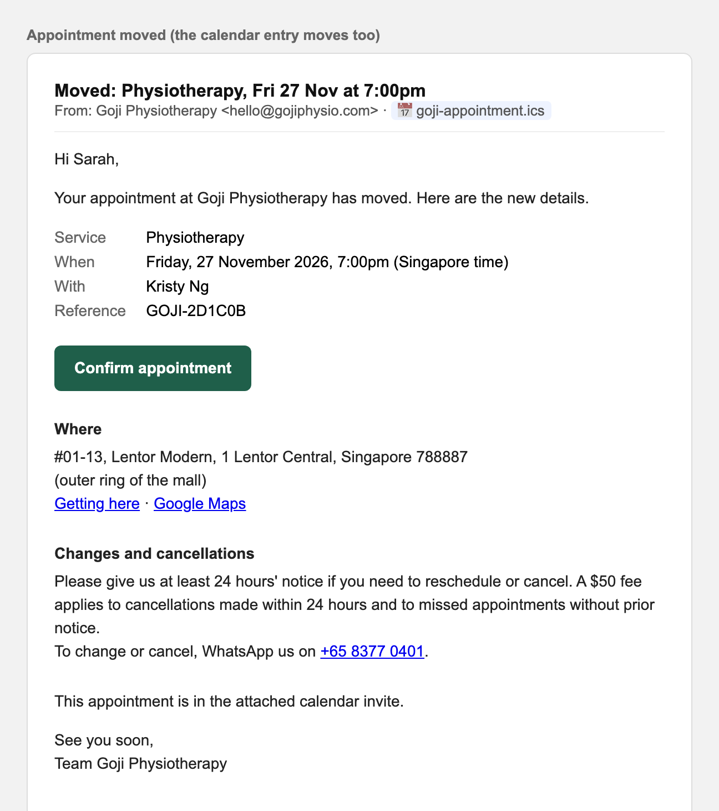
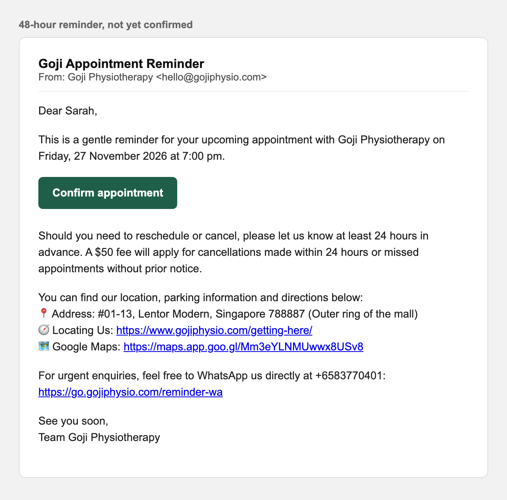
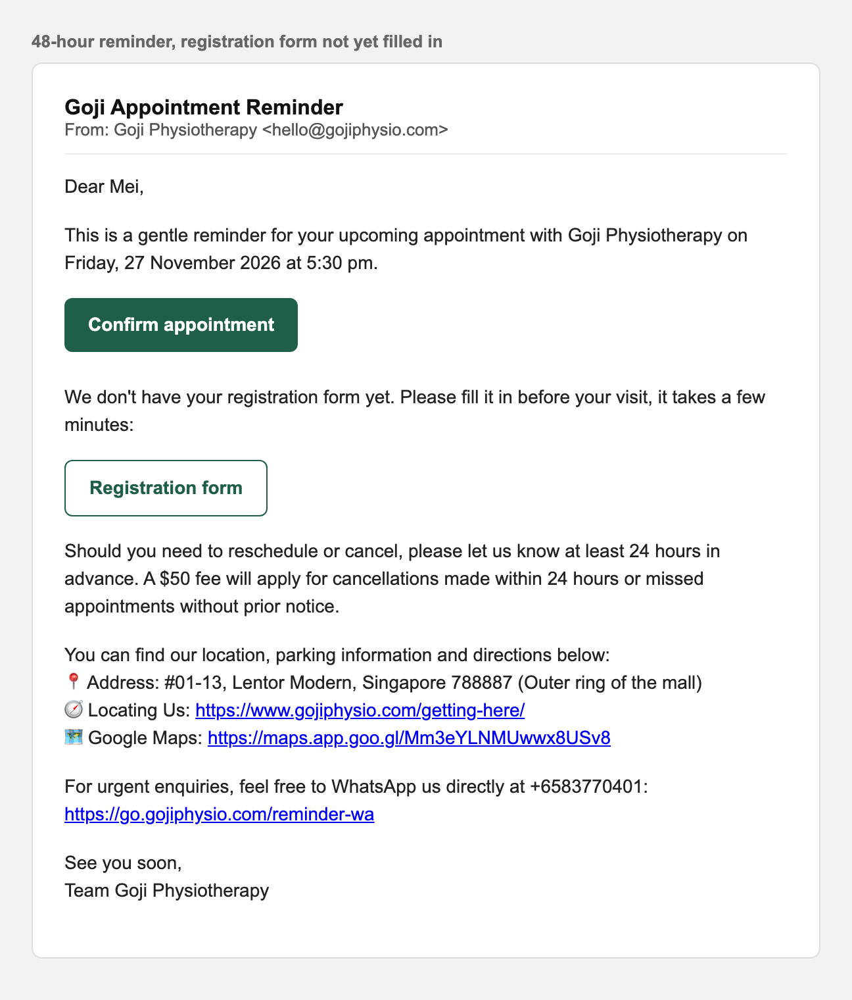
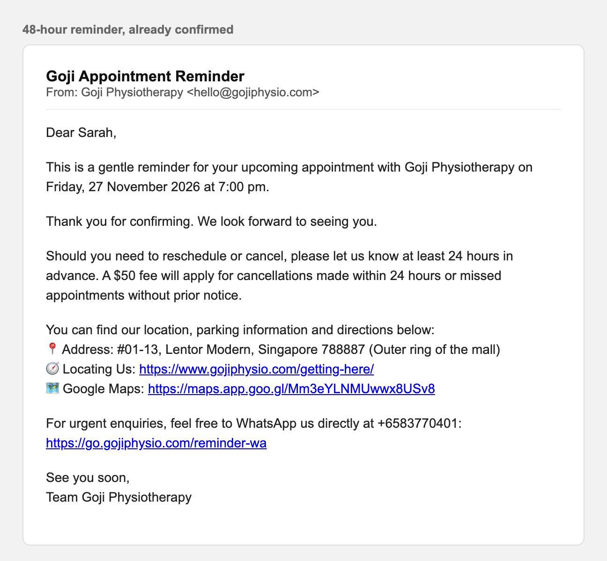

# Booking emails and WhatsApp messages: for Chris to approve

26 Nov 2026 · prepared by Charles

Every booking gets one confirmation by email and one on WhatsApp, whether it was made on the website, on WhatsApp or by the front desk. Two days before, the patient gets the reminder email and a WhatsApp reminder. Once they've confirmed, we stop asking them to. Every message asks for the registration form until the patient has filled it in. A cancellation sends nothing. Today's Plato confirmation and Plato's own 48-hour reminder both stop on go-live day, the same day all of this starts.

## The emails

Six designs. Which one a patient gets depends on whether they've confirmed and whether they've filled in the registration form. The samples use made-up patient names.

| Email | Sent when |
| --- | --- |
| [Booking confirmation](#booking-confirmation) | Right after any booking: website, WhatsApp or front desk |
| [Booking confirmation, with registration form](#booking-confirmation-registration-form-not-yet-filled-in) | The same, when the patient hasn't filled in the form yet |
| [Appointment moved](#appointment-moved) | When the time changes |
| [48-hour reminder](#48-hour-reminder-not-yet-confirmed) | 12:00, two days before, when not yet confirmed |
| [48-hour reminder, with registration form](#48-hour-reminder-registration-form-not-yet-filled-in) | The same, when the form isn't filled in yet |
| [48-hour reminder, already confirmed](#48-hour-reminder-already-confirmed) | The same, once they've confirmed |

Every booking confirmation also adds the appointment to the patient's calendar, with no alert. If the time moves, that calendar entry moves with it.

### Booking confirmation

### Booking confirmation, registration form not yet filled in

### Appointment moved

A move is the same appointment in Plato with a new time: staff drag it in the calendar, or the WhatsApp assistant moves it. If the front desk deletes an appointment and books a new one instead, the patient gets a fresh booking confirmation, not the "moved" email, and the old time stays in their calendar. So moving is better than deleting and re-booking.

### 48-hour reminder, not yet confirmed

### 48-hour reminder, registration form not yet filled in

### 48-hour reminder, already confirmed

## The WhatsApp messages

Meta approves the wording of each WhatsApp message. Changing it means resubmitting, which takes a few days.

**Booking confirmation** (approved). It goes out with the confirmation email for website and front-desk bookings. Bookings made in a WhatsApp chat are confirmed in that chat instead. Patients with no email on file still get it.

> Hi Sarah, your physiotherapy appointment at Goji Women's and Family Physiotherapy is confirmed for Fri 27 Nov, 7:00pm with Kristy.
>
> Reply here if you need to change it.
>
> 📍 Lentor Modern
>
> [Get directions]

**Booking confirmation, registration form not yet filled in** (with Meta for approval):

> Hi Sarah, your physiotherapy appointment at Goji Women's and Family Physiotherapy is confirmed for Fri 27 Nov, 7:00pm with Kristy.
>
> Please fill in your registration form before your visit, using the button below.
>
> Reply here if you need to change it.
>
> 📍 Lentor Modern
>
> [Registration form] [Get directions]

**48-hour reminder** (approved). It goes out at the same time as the reminder email, except to patients who have already confirmed and have an email.

> Hi Sarah, a reminder of your physiotherapy appointment on Fri 27 Nov, 7:00pm with Kristy at Goji Women's and Family Physiotherapy.
>
> If you need to reschedule, please let us know at least 24 hours before.
>
> [Confirm] [Reschedule]

**48-hour reminder, registration form not yet filled in** (with Meta for approval):

> Hi Sarah, a reminder of your physiotherapy appointment on Fri 27 Nov, 7:00pm with Kristy at Goji Women's and Family Physiotherapy.
>
> We don't have your registration form yet. Please fill it in before your visit, using the button below.
>
> If you need to reschedule, please let us know at least 24 hours before.
>
> [Confirm] [Reschedule] [Registration form]

Tapping Confirm marks the appointment confirmed in Plato. Tapping Reschedule starts a reschedule in the chat. Until Meta approves the "with form" versions, those patients get the approved versions, and the form comes in their email.

"Filled in" means the patient has signed the Clinic Consent Form at the end of Plato's registration form. The form button always opens the right Plato form for that patient. If they've already done it, it shows "You're all set".

## How we tested it

On 25 Nov we ran the emails for real, with two test bookings on Fri 27 Nov with Kristy. Both went to Charles's personal email and were deleted afterwards. Everything worked.

1. Booked a returning patient (Charles), the way the WhatsApp assistant books: the booking confirmation went out.
2. Moved that booking from 6:30pm to 7:00pm: the "moved" email went out, and the calendar entry moved, with no second entry.
3. Booked a new patient through the website: the confirmation went out with the registration form.
4. Ran the 48-hour reminder: each booking got one reminder with a Confirm button.
5. Confirmed both bookings, one through Plato's Confirm link and one the way the WhatsApp Confirm button does. Plato showed both as Confirmed.
6. Ran the 48-hour reminder again: each booking got the thank-you version, and no WhatsApp reminder.
7. Deleted both bookings. Nothing went to the patient.

We also checked that a booking never gets a second confirmation, and that only patients who haven't filled in the form are asked for it. Meta accepted both approved WhatsApp messages in a send test, but they didn't reach Charles: the phone number on his Plato profile looks mistyped. We'll resend them to his correct number.

The Confirm button has since been renamed "Confirm appointment", as shown in the samples.

## Please approve

Reply to Charles on each point:

- [ ] The booking confirmation emails
- [ ] The "moved" email
- [ ] The 48-hour reminder emails: today's Plato wording, plus the Confirm button or a thank-you
- [ ] The WhatsApp booking confirmation going out alongside the email
- [ ] Reminders going out by email and WhatsApp together, and confirmed patients with an email getting no WhatsApp reminder
- [ ] Every message, email and WhatsApp, asking for the registration form until it's filled in
- [ ] Cancellations sending nothing to the patient
- [ ] Go-live date: _______

On go-live day, the front desk stops sending Plato's confirmation by hand, and Plato's own 48-hour reminder is switched off. Our emails and the WhatsApp messages start that same day.

---

[How our reminder compares with Plato's today](README.md)
