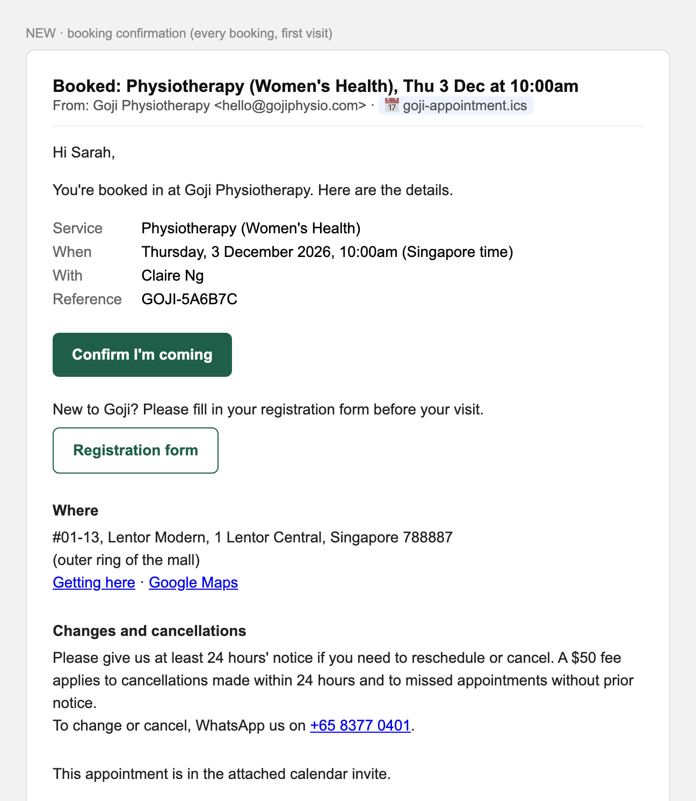
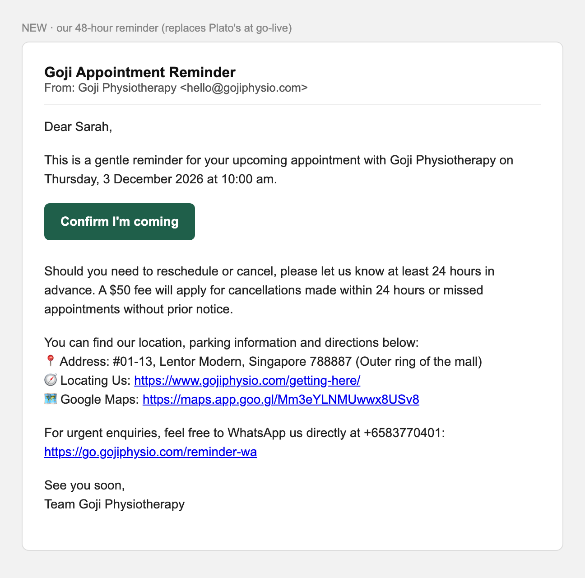
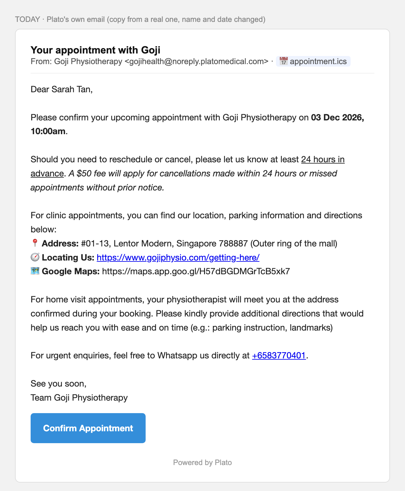

# Confirmation email: samples for review

Review copies for [PR #284](https://github.com/gojiphysio/goji/pull/284). This branch holds only these images and is never merged. Sample patient: "Sarah Tan", physiotherapy on Thu 3 Dec 2026, 10:00am, first visit.

## 1. New booking confirmation (every booking, any channel)

Sent once per appointment. The registration form shows on a first visit only. The calendar invite is attached and adds itself, with no alert.

## 2. New 48-hour reminder vs Plato's email today

Ours replaces Plato's on go-live day. The two never run together.

| Ours (new) | Plato's (today) |
| --- | --- |
|  |  |

How they differ:
- Ours sends only the directions that apply (clinic or home visit). Plato's sends both to everyone.
- Ours gives one Confirm button per session and one email per patient per day.
- Ours uses the tracked WhatsApp link and the new Google Maps link.
- Plato's attaches its own .ics, which can add a second calendar entry next to the one from our confirmation.

Plato's sample keeps the wording and links of a real Plato email from 30 Oct 2026. Only the name and date are changed, and the layout is simplified.
