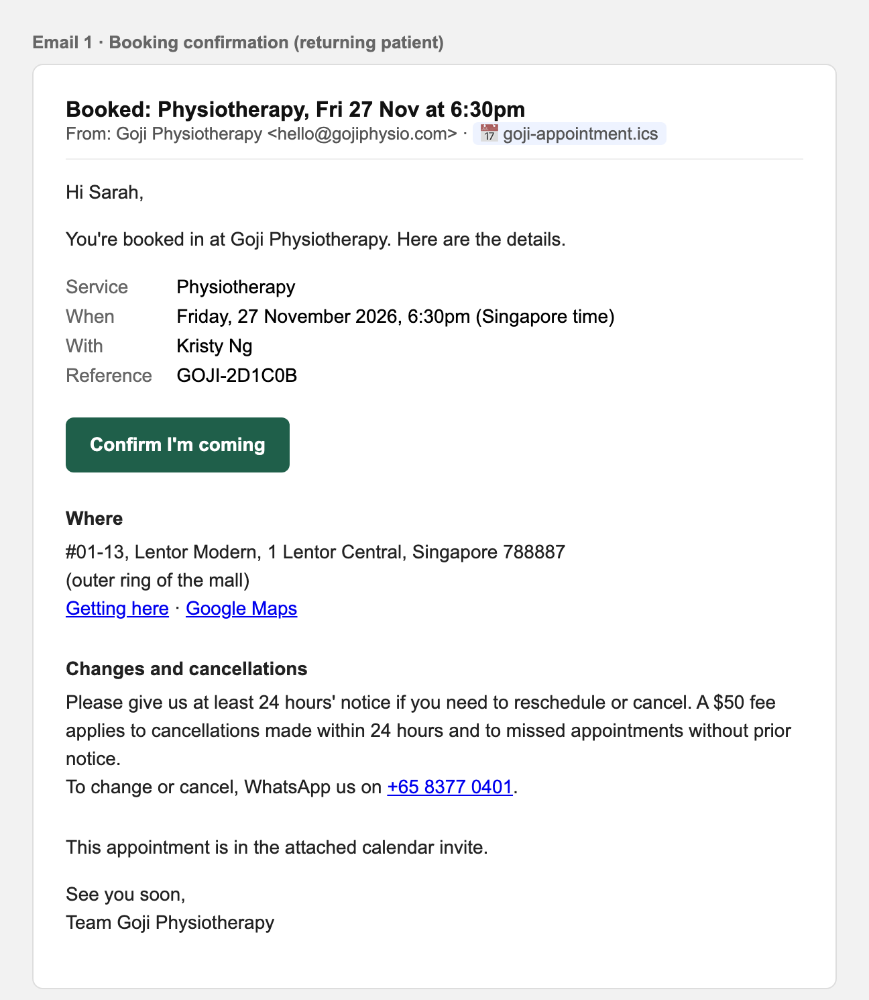
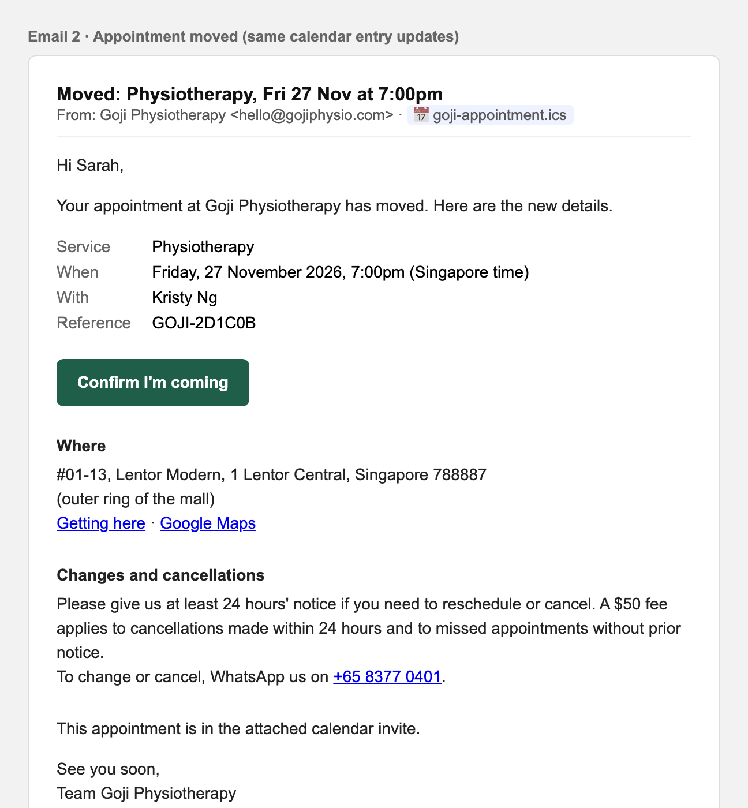
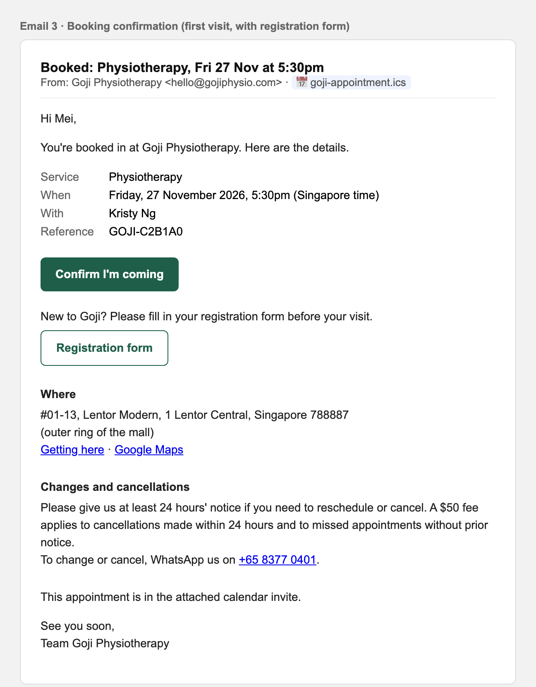
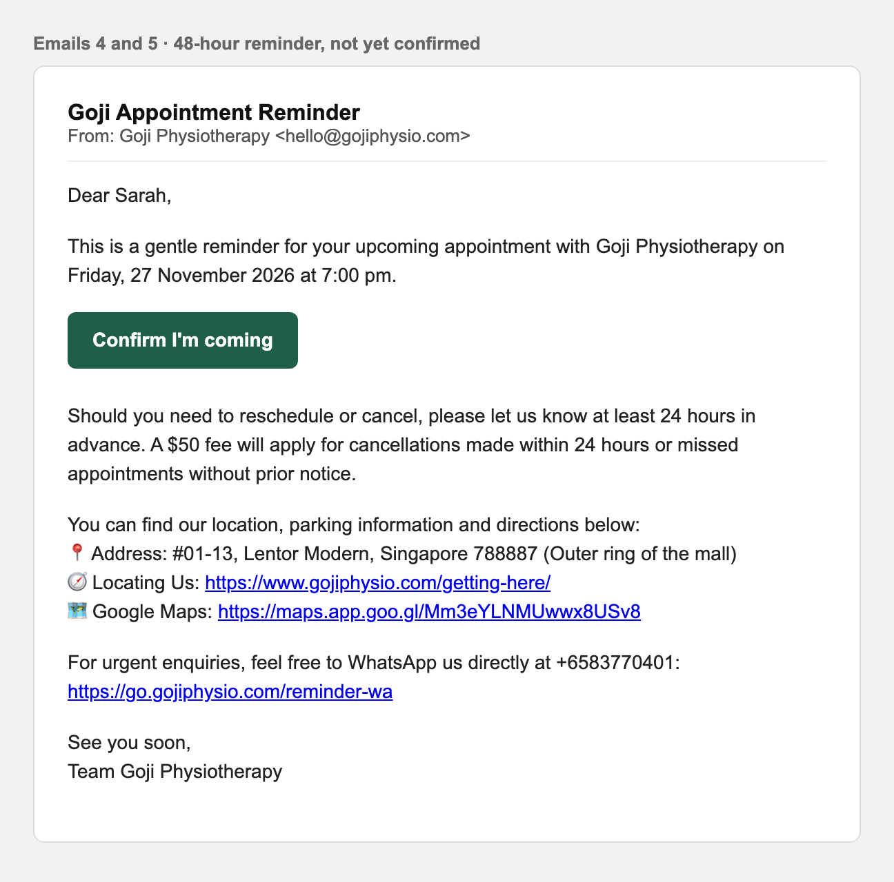
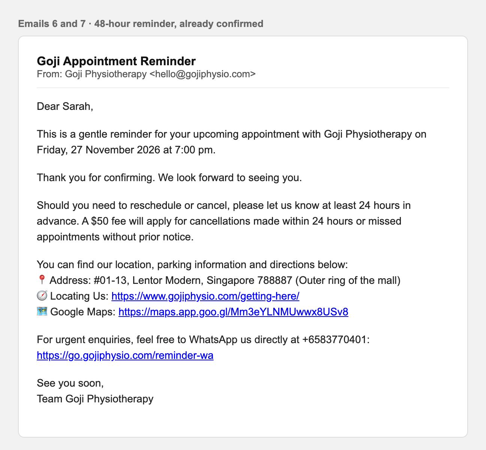

# The emails from the 25 Nov test

These are samples of the emails the test sent. The patient names are made up. Times and physio match the test bookings.

## Email 1: booking confirmation (returning patient)

## Email 2: appointment moved

## Email 3: booking confirmation, first visit (with registration form)

## Emails 4 and 5: 48-hour reminder, not yet confirmed

## Emails 6 and 7: 48-hour reminder, already confirmed

