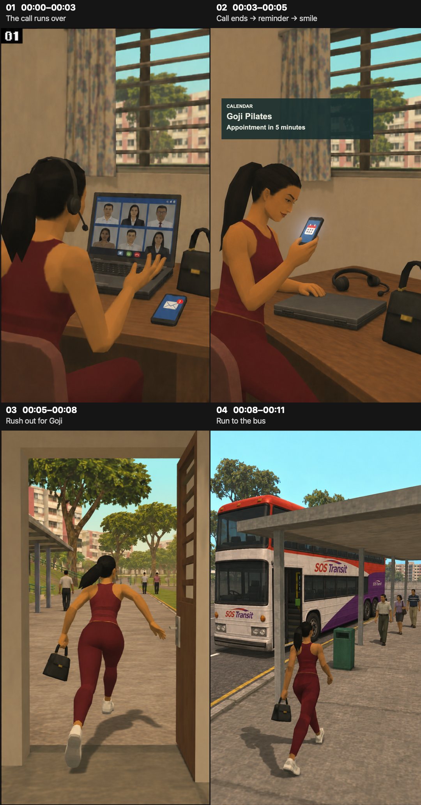
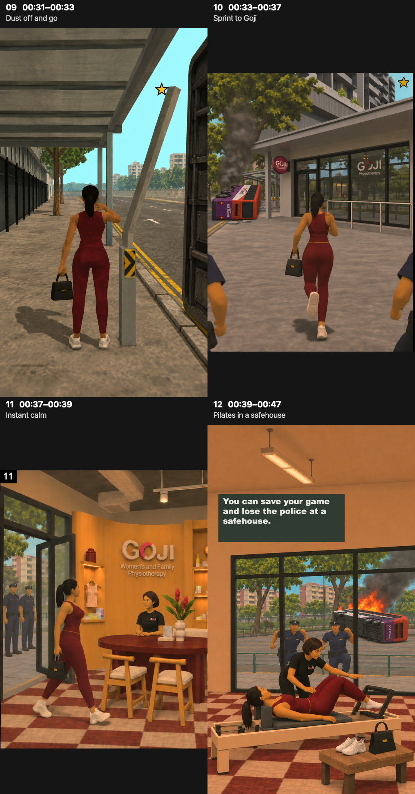
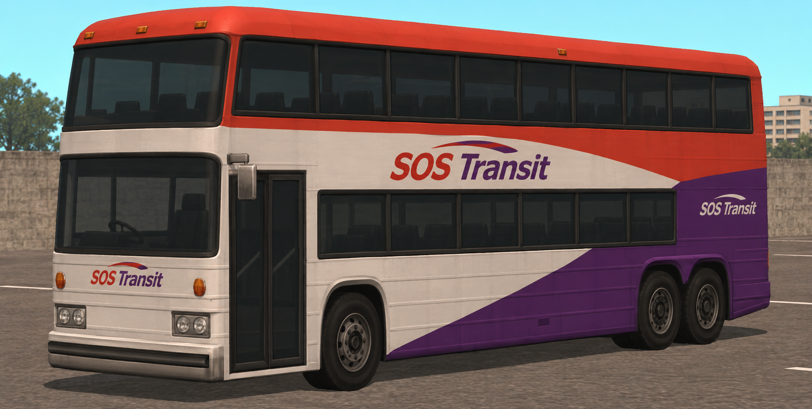

# Goji Girl · Episode 02 — TAP OUT

**Creative draft v7 · 25 November 2026 · proposed 47 seconds · vertical 9:16**

After ending a frustrating work call, Goji Girl gets her Goji calendar reminder,
smiles, and rushes out. A stolen bus, a crash and a conscientious EZ-Link tap
later, she reaches Pilates while the police get stuck running against the glass.

## Storyboard from the top

The six Blender bus panels now have an original GTA San Andreas appearance pass.
The user-approved **SOS-BUS-01** is the recurring vehicle reference: shaped body
and roof, inset glazing, wheel arches, detailed rims, lamps and fitted bumpers.
Blender continues to control the road side, vehicle pose and interaction anchors.
These are storyboard look frames; the full episode has not been animated.

### 01–04 · Call ends → reminder → smile → rush out

### 05–08 · Takeover → chase → crash → tap out

### 09–12 · Dust off → sprint → safehouse → Pilates

[01–04 full size](revision-07/frames/01-04-storyboard.png) ·
[05–08 full size](revision-07/frames/05-08-storyboard.png) ·
[09–12 full size](revision-07/frames/09-12-storyboard.png)

## Approved bus reference

[Canonical reference and approval record](../references/sos-bus-01/README.md).
Use it alongside Goji Girl’s character reference in every bus shot. Its rounded
forms and authored vehicle details supersede the old primitive shell as the
appearance target. Two decks, three axles, SOS Transit branding, orange-red /
purple / white livery and dark charcoal doorway trim stay fixed.

## Corrected passenger exit

The opening is confined to the upward-facing **side passenger doorway**. A solid
white front-corner panel separates it from the intact front facade. The shared
Blender doorway ends at local y=5.30; the front plane is y=6.00, leaving a 0.70 m
corner. The reader and its pole rotate with the chassis; Goji Girl faces away
from the camera with her bag on her left forearm.

[Full exit frame](revision-07/frames/08-look.png) ·
[Colour-coded door boundary guide](revision-07/frames/08-door-control.png) ·
[Direct geometry frame](revision-07/frames/08-direct.png)

[Editable Blender master](https://raw.githubusercontent.com/gojiphysio/goji/codex/goji-girl-episode-2/marketing/assets/goji-girl/episode-02/revision-07/blender/double-decker-master.blend) ·
[Transform records](revision-07/blender/continuity-record.json) ·
[Prompts and review notes](revision-07/README.md)

## Safehouse popup

> You can save your game and lose the police at a safehouse.

Exact copy, unchanged y=360 placement, shown at 41.5–46.0s. The active therapist,
quiet interior and police running against the glass remain the ending.

[Full clinic panel](revision-07/frames/12-safehouse-preview.png) ·
[Editable popup](revision-07/overlays/safehouse-popup.svg) ·
[UI reserve check](revision-07/frames/12-ui-clearance-check.png)

## Camera and look

**On foot:** the camera follows Goji Girl from behind at an ordinary gameplay
height. Keep her full body in the lower middle of the frame, her back toward
us and the route ahead readable. Small interaction-driven yaw is allowed;
low hero angles, face inserts and sweeping orbits are removed outdoors.

**Driving:** camera control transfers to the bus. Its rear grille and taillights
face us; the road ahead remains visible above it. Follow position and heading
with a little lag. The bus can yaw, lean and roll independently of the camera;
the horizon stays level. Scale follow distance to the bus rather than copying
the skill's sedan distances literally. These are framing proposals, not measured
PS2 camera constants.

**Indoors:** simple, deliberately staged San Andreas cutscenes. Medium shots,
fixed cameras, readable gestures. The clinic's quiet comes from pacing and sound,
while its people and materials remain in the same PS2 game as the street.

**Original PS2 target:** painted low-resolution surfaces, economical faces and
hair meshes, simple joint deformation, broad diffuse lighting, restrained
highlights, textured foliage and moderate distance haze. Every commuter, driver,
police officer and video-call participant follows the same standard. Avoid
modern glossy materials, photographic NPCs, toy-like faces and bare faceted
geometry. The cyan sky and warm concrete follow the selected daylight reference;
a heavy orange filter is not the definition of the look.

## Timed script

### 01 · 00:00–00:03 — Just one more thing

**Home cutscene.** Over her shoulder: headset with a visible boom microphone,
laptop full of meeting tiles. Her finger taps the desk. A colleague drones,
**“Just one more thing…”** The black handbag and phone sit beside the laptop.
The Goji appointment reminder has not arrived yet.

Sound: flat laptop voice and impatient finger tapping.

### 02 · 00:03–00:05 — Call over. Something to smile about.

**Home cutscene.** At 03–04s she angrily rips off the headset and slams the laptop
shut, cutting the colleague off mid-word. At **04–05s**, her phone pings with a
calendar reminder: **“Goji Pilates — Appointment in 5 minutes.”** She looks at it
and **smiles**, switching from irritation to eager anticipation. She grabs the
black handbag in her left hand and gets up. The storyboard shows this second
beat; the headset removal and laptop slam remain the preceding action.

Sound: headset clatter → sharp **CLACK** → calendar ping. Let the smile register
before the cut; final motion timing still needs an animatic.

### 03 · 00:05–00:08 — Rush out for Goji

**PLAYER follow.** Cut behind her at normal gameplay height. She pushes the
front door wide with her right hand and immediately **runs out of the house**.
Her movement is eager and purposeful. Full-body player stays below centre;
we see where she is going. Her back remains toward us, bag in her left hand.

Sound: door **BANG**, quick running footsteps. Brief objective: **“Get to Goji.”**

### 04 · 00:08–00:11 — Public transport, technically

**Same PLAYER follow.** She reaches a busy Singapore bus stop. A white/purple
**SOS Transit** double-decker bus with the familiar italic red/purple logo and a red roof band has its left passenger doors open and
commuters alighting. She runs around the nose toward the right-hand driver's
cab. The camera follows her route around the nose; the bus remains stationary
and parallel to the same curb through shot 05. Finish 04 at the nose with both
the front windscreen and her crossing direction readable before the view changes.

Sound: idle engine, air hiss, chatter. Show the last passenger step clear before
the takeover. The bus looks busy on arrival, but nobody remains aboard for the
crash. Keep traffic on the left and the driver's seat on the right.

### 05 · 00:11–00:15 — One star, zero hesitation

**PLAYER interaction view.** The camera settles modestly behind her right
shoulder at full-body distance, with both people readable. She hooks the bag
over her left forearm, smashes the driver's window, pulls the driver out,
lets him clear the cab, then climbs into the seat. He lands upright, alive
and indignant. Keep the separate removal, clearance and entry states.

The bus remains in the same left lane and the same parked transform as04.
The player is now on its road-centre/driver side; the shelter and bin remain
beyond the opposite passenger side. Camera screen positions follow the Blender
view rather than a mirrored image.

Sound: **CRASH**, surprised yelp, wanted sting. **One star lights up.** She places
the bag in the cab footwell as she gets in. Transfer to the vehicle camera only
once she is seated. This gets four seconds, borrowing one from the chase;
final contact timing still needs an animatic.

### 06 · 00:15–00:20 — The least relaxing commute

**BUS rear chase, one sustained view.** The bus accelerates away from us,
threads between traffic, then swerves toward the junction. The rear stays our
anchor while road markings, traffic and buildings pass around it. Suspension
reacts to steering; the chassis remains rigid. No front-quarter beauty shot,
cab insert or roadside tracking cut.

Sound: diesel, horn, tyre squeal and rattling fittings. Police remain behind
the camera, out of sight. Broad blue/red spill sweeps unevenly over the road, railing and bus body.
The sources belong to the unseen chasing cars, behind and offset from the camera,
with staggered pulses and different falloff. No paired glowing points, blue bus
lamps or symmetric red/blue patches. Normal bus tail lamps remain red/amber.
Sirens tell us the pursuit is getting closer. Keep the single star.

### 07 · 00:20–00:25 — Arrival is a strong word

**Continue the BUS chase camera.** Lentor Modern and an empty shelter appear
ahead. The bus takes a left turn too sharply, rolls onto its right/driver's
side and slides into the shelter. The camera follows its travelling centre
with heading lag, so its side can come into view as it slides. The camera itself
does not roll, orbit to the front or cut to an impact close-up.

Sound: squeal → scrape → enormous **CRUNCH**. Sparks start at road contact.
Keep the bus recognisable and the left passenger side upward. No explosion
covers the recovery. The shelter is empty. The storyboard shows the final sliding/settled pose:
right side down, passenger side upward, roof toward the road centre, wheels
toward the mall-side curb. From this rear view, the mall/canopy is screen left. The front bumper
stops at the damaged post. Freeze that chassis transform at the end of 07.

### 08 · 00:25–00:31 — Still must tap out

**Recovery camera transfers back to PLAYER.** First hold on the settled wreck
for one full second, preserving the exact end-of-07 bus transform, curb,
bent post and bin. A little piece of shelter drops. Use a deliberate recovery
camera cut from the rear vehicle view to the front passenger doorway, with the
same wreck still at rest; never rotate or relocate the bus to fit the new view.
The mall is now screen right in the front recovery view. The bus still points
in exactly the same world direction; the camera changes, not its heading. Then the camera settles
behind her as she climbs up through the upward-facing front passenger doorway.
A modest rise/offset keeps her and the reader visible, as an interaction camera
avoiding obstruction would; it does not become an aerial shot.

Halfway out, she remembers. She reaches back down and taps her EZ-Link card
on the reader attached just inside the doorway. Green light. **BEEP.** She
finishes climbing onto the upward-facing side panel, bringing the bag from the cab
with her. The geometry blockout allocates one second to the pause and five to the
rise, tap and climb clear; the pavement drop follows in shot 09. No hand insert,
face close-up or caption explains the joke: the reach, green flash and isolated
beep do the work at gameplay distance.

Keep the reader and its pole rotated with the bus. The opening faces upward;
it is not an upright door on the bus's rear. Protect the silence around the beep.

### 09 · 00:31–00:33 — Nothing to see here

**PLAYER follow, behind her.** She drops to the pavement, dusts her shoulders,
settles the handbag back into her left hand and sets off. Her back stays toward
us; no front-facing reaction shot. The wreck smokes off to one side and the
mall route is ahead. Sound: two brushing sounds, then returning sirens.

### 10 · 00:33–00:37 — Same appointment, new entourage

**PLAYER sprint.** Follow her toward the mall and Goji shopfront. Two officers
catch up from behind, their bodies only partly entering the lower frame edges.
She remains the centred, readable player; the camera never changes allegiance
to the pursuers. An intentional route-compression cut is allowed if needed,
but match rear view, gait and screen direction across it.

Sound: her feet, two heavier sets, radio chatter, one **“Oi!”** Keep one star.
If an entrance marker is used, retain episode one's established marker design.

### 11 · 00:37–00:39 — Safe zone

**Clinic cutscene begins at the threshold.** Cut to the fixed interior camera
as she enters. Her posture relaxes instantly. The officers stop outside;
the star and other gameplay HUD disappear. All sirens, shouting and running
sound cut dead on the threshold. Quiet room tone and a soft arrival chime.

Preserve the reference reception: warm timber, red/cream floor, deep-red table,
short-bobbed therapist in black. The officers' feet remain on exterior pavement.
The therapist greets her without acknowledging the pursuit.

### 12 · 00:39–00:47 — And… breathe out

**Fixed clinic cutscene.** Elliptical cut to her on the reformer, doing one slow
footwork repetition in grip socks. White shoes and the single handbag sit on
a bench. Therapist in a black crew-neck top and leggings, white shoes, small
left-chest mark only; plain black back, no name tag. She leans toward the footbar,
watches the near knee and cues alignment with one open hand while her other hand
demonstrates the extension direction. She follows the repetition attentively;
there is no passive hands-clasped pose.

Instructor: **“And… breathe out.”** Quiet breath and reformer mechanism.

Hold the same medium-wide composition for the whole eight seconds. Her movement
draws the eye first; the background is already there to discover, without a
cinematic pullback. Through the clear glass, two police face inward and run
against it—alternating knees, pumping arms, no forward progress, slightly out
of phase. Beyond them, the overturned bus burns. Nobody inside reacts.

At **41.5s**, show the tutorial box at y=360. Hold until **46s**:

> You can save your game and lose the police at a safehouse.

This is original San Andreas-style parody copy, not a verbatim game quote.
The joke stays entirely in the fictional game; no appointment or treatment claim.

Small final-two-second copy: **“Pilates at Goji · Lentor Modern.”** Keep it clear
of the background gag. End on the moving tableau.

## Continuity and review notes

- **Approved direction:** the user accepted the story intent and requested
  predominantly third-person outdoor gameplay with indoor cutscenes. The user approved SOS-BUS-01 as the canonical bus appearance reference and
  confirmed the reminder/smile after the call. Other revised illustrations and
  exact 47-second motion timing remain proposals.
- **Retain the comedy:** crash pause, isolated tap beep, hard audio boundary,
  slow reformer action and police with broken pathing. No blood or deaths;
  driver is visibly okay, passengers clear the bus, shelter is empty.
- **Prop ownership:** desk → left hand → left forearm during takeover → cab
  footwell → recovered during exit → left hand → bench in the Pilates cut.
  Do not silently change hands, add a shoulder strap or duplicate the bag.
- **Geography:** this is a fictional compressed Lentor Modern game set, allowing
  the bus to be visible through the clinic glass. The boards are not a surveyed
  route, verified transit service or faithful reconstruction of every frontage.
- **Geometry review:** the Blender asset fixes the previous rear-door/roof-hatch
  ambiguity. The reader and pole retain their chassis-local coordinates; the
  card meets the front-door reader. Constant-length limb solves and wheel/ground
  clearance are checked. The six-second blockout uses a procedural proxy and
  neutral surroundings, not approved final cast or a full accident simulation.
  Contact frames were inspected; the final PS2 motion and exit-to-ground cut still
  need production review. The earlier generated bus panels are superseded. The revision-07 `.blend`
  and its direct views remain the spatial authority; styled panels are look frames,
  with projection/material interpretation rather than exact 3D proof; the old revision-03 isolated
  exit motion remains a contact study, not the current street layout.
- **Service framing:** Pilates/studio experience, no medical or treatment claim.
  Her unhurt state is cartoon continuity, not recovery attributed to a session.
- **Future motion handoff:** the new skill's Blender staging and H3 continuous
  video guidance apply to these complex outdoor actions; simpler fixed-camera
  scenes can use H3 still guides. This revision updates the shared double-decker and all twelve storyboard panels, without launching
  a new H3 benchmark or rendering the full episode.

## References used

Applied the new [Goji GTA video skill](https://github.com/gojiphysio/goji/blob/a4cb40ee89d6baa9ca027785fca71abe56b65cb8/marketing/video-production/skills/goji-gta-video/SKILL.md),
[series bible](https://github.com/gojiphysio/goji/blob/a4cb40ee89d6baa9ca027785fca71abe56b65cb8/marketing/video-production/skills/goji-gta-video/references/series-bible.md)
and [San Andreas reference pack](https://github.com/gojiphysio/goji/blob/a4cb40ee89d6baa9ca027785fca71abe56b65cb8/marketing/video-production/skills/goji-gta-video/references/san-andreas-reference.md).

- **Identity/style:** the skill's recovered `ep01-street.png` (Episode 1 v6),
  plus `ep01-reception.png` for therapist identity, wardrobe and reception layout.
  The smoother reception rendering is simplified toward the street/PS2 standard.
- **Game-camera/look:** inspected cached samples from
  [Paulo Cassiano's reported original-hardware PS2 capture](https://www.youtube.com/watch?v=Z9cD9uj1fb8&t=240s),
  including the rear player view near 04:04 and rear driving view near 04:46.
  Also inspected the reference pack's takeover and turn contact sheets. These
  were still-frame inspections, not new normal-speed playback or measured physics.
  Source capture processing and cheats remain unverified, as recorded in the pack.
- **Generation:** built-in image generator, with identity and game-camera
  references assigned separate roles. Exact prompts, edits and reference hashes
  are in [v2 generation records](storyboard-prompts-v2.json).
- **Current shot states:** [camera and continuity record](camera-plan-v7.json).
- **This revision:** [canonical bus, corrected doorway and styled storyboard](revision-07/README.md).
- **Retained staging:** [source photos and Blender records](revision-03/README.md).
- **Earlier drafts:** [v1](creative-v1.md), [v2](creative-v2.md) and [v3](creative-v3.md) and [v4](creative-v4.md) and [v5](creative-v5.md) and [v6](creative-v6.md), retained for comparison.

## Optional caption

> She took public transport. Technically.
>
> Goji Girl, Episode 02: TAP OUT.

Any later customer CTA must use a verified `go.gojiphysio.com/<slug>` redirect.
No Instagram publication or main-branch merge is included in this revision.
