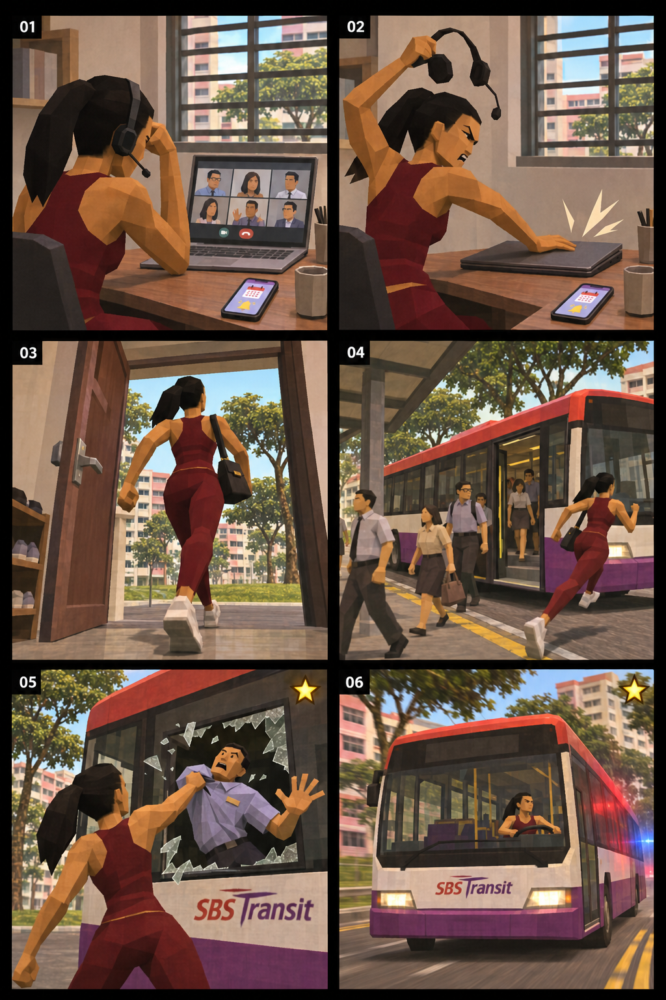
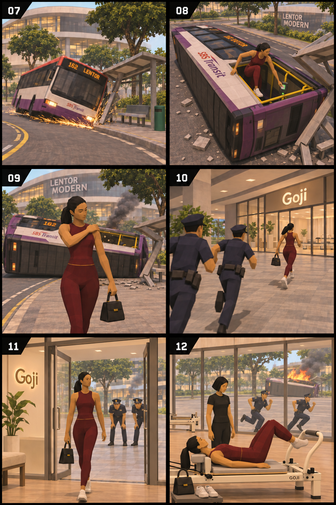

# Goji Girl · Episode 02 — TAP OUT

**Creative draft v1 · 24 November 2026 · 45 seconds · vertical 9:16**

A work call overruns into Goji Girl's Pilates appointment. She steals a bus,
survives an absurd crash, remembers to tap out, and reaches the one place where
the outside world's chaos cannot follow her.

**The central joke:** she has absolutely no respect for the laws of physics,
but she still pays her bus fare. The final reward is a peaceful Pilates session
while the police get stuck on the clinic's invisible game boundary.

This is a creative script and concept storyboard. Runtime is a proposed edit,
not an existing video. The image boards establish mood and composition; the
written directions below govern exact action and continuity.

## Storyboard at a glance

Read each sheet left to right, then down. The twelve panels correspond to the
twelve sequences below; some sequences contain more than one shot.

[Open sheet 1 at full size](storyboards/01-call-to-chase.png)

[Open sheet 2 at full size](storyboards/02-crash-to-calm-v2.png)

## Timed script and shot direction

### 01 · 00:00–00:03 — This meeting could have been an email

**Picture:** Start already inside the call, over Goji Girl's shoulder at her
home desk. A little headset with a visible boom mic; the laptop shows a grid of
people and call controls. Her smile has become a fixed, angry stare. One finger
taps the desk. Her phone lights up: **“Goji Pilates · Starts in 5 min.”**

**Sound:** Thin laptop-speaker voice: **“Just one more thing…”** The appointment
notification cuts through the meeting chatter.

**Cut:** Close on her eyes moving from the reminder back to the laptop. No
spoken response. The viewer understands both her frustration and the deadline.

### 02 · 00:03–00:05 — Tap out of the call

**Picture:** In two sharp actions she angrily rips off the headset, then SLAMS
the laptop shut. Hold a fraction on the shut lid. Her black handbag is ready
beside the desk.

**Sound:** Headset clatter. Laptop **CLACK** cuts the colleague off mid-word.

**Performance:** This is her one obvious flash of anger. From here on, she
treats the chaos as a routine commute.

### 03 · 00:05–00:08 — Player control resumes

**Picture:** Hard cut to a low third-person camera behind her. Bag over her
shoulder, she shoves the front door open with outrageous force, strides out
with her familiar GTA swagger, then accelerates toward the street. Let the
door bang against its stop behind her.

**Sound:** Door **BANG**, two heavy swaggering footsteps, then running steps.
Small mission cue. Brief objective: **“Get to Goji.”**

**Camera:** Follow her down the path into the street. No lengthy home-exit
montage; the gait is the episode-one callback.

### 04 · 00:08–00:11 — Public transport, technically

**Picture:** Wide enough to read a busy Singapore bus stop. A single-deck bus
waits with its left-side passenger doors open. Commuters stream off. Goji Girl
arrives at a run, ignores the boarding queue, and rounds the front of the bus
toward the right-hand driver's cab.

**Sound:** Bus idle, pneumatic door hiss, commuter chatter.

**Blocking:** The last passenger steps clear before the takeover; the crowd
stays behind on the pavement. The bus looks busy on arrival, with no passengers
aboard for the crash. Maintain the same bus body and livery throughout.

### 05 · 00:11–00:14 — One star, zero hesitation

**Picture:** Tight on the driver's side window. One exaggerated game-animation
smash breaks the glass. She grabs the driver and pulls him out in a single
absurd motion. He lands seated, upright and indignant; he throws his hands up
as she takes the wheel. No blood or injury detail.

**Sound:** Glass **CRASH**, a short surprised yelp, then the wanted-level sting.
**Exactly one star lights up.** Engine rev and air-brake release.

**Cut:** The bus jerks away before the driver has finished protesting.

### 06 · 00:14–00:20 — The least relaxing commute

**Picture:** Three escalating shots, about two seconds each:

1. Low front three-quarter: the enormous bus threads an absurdly narrow gap
   between traffic, its suspension heaving.
2. Cab insert: Goji Girl yanks the wheel with complete conviction; street
   scenery whips past. Red and blue flashes sweep across her and the cab.
3. Exterior tracking: the bus clips roadside bollards and swerves through a
   junction. Lentor Modern comes into view ahead.

**Sound:** Diesel roar, horn, tyre squeal, rattling fittings. Police sirens
approach from behind. The pursuit vehicles remain just out of sight; reflected
red/blue lighting tells us they are there.

**HUD:** Keep the single wanted star. No escalating stars, weapon display or
extra joke captions competing with the action.

### 07 · 00:20–00:25 — Arrival is a strong word

**Picture:** Establish Lentor Modern and an empty bus shelter in the same
wide shot. She takes a left turn much too sharply. The bus leans onto its
right/driver's side, fully tips over, and slides broadside across the road.
Sparks trail along the body before it hits the empty shelter with an enormous
metallic crunch. Its left passenger-door side now faces upward.

**Sound:** Long tyre squeal → metal scraping → shelter **CRUNCH**.

**Camera:** Keep the rollover and slide readable in one wide view, with a brief
impact insert if needed. The wreck remains recognisably the same bus; no
explosion obscures the next joke.

### 08 · 00:25–00:29 — Still must tap out

**Picture, 00:25–00:26:** Locked shot of the motionless wreck. A small piece of
shelter drops off. Nothing else happens. Hold the full second.

**Picture, 00:26–00:29:** Goji Girl climbs halfway out through the upward-facing
passenger doorway. She pauses, remembers something, and casually reaches back
to tap her EZ-Link card on the reader still attached inside the doorway.
Close enough to see card meet reader. Its green light flashes. She completes
the climb out.

**Sound:** A last settling rattle. Then a clean, isolated **BEEP**. Give the
beep a brief pocket of silence; no dialogue, music accent or caption explains
the joke. The distant sirens can return after it.

**Spatial rule:** The reader rotates with the bus. Her body climbs against
gravity; the doorway must not magically become an upright street-level door.

### 09 · 00:29–00:31 — Nothing to see here

**Picture:** She lands on the pavement, straightens, dusts off both shoulders
and adjusts her handbag. A small plume of smoke begins at the rear engine.
She looks toward the mall and breaks into a sprint.

**Sound:** Two deliberate brushing sounds. Sirens grow louder again.

**Performance:** No limp, panic, victory pose or look back at the wreck.

### 10 · 00:31–00:35 — Same appointment, new entourage

**Picture:** Return to the familiar third-person sprint toward the mall.
Exactly two police officers enter frame behind her on foot. Match cut through
the mall approach to the Goji shopfront. They are close enough to remain a
comic threat as she charges for the entrance.

**Sound:** Her footsteps, two heavier sets behind, radio chatter, a brief
**“Oi!”** from one officer. The single wanted star remains visible.

**Continuity:** Reuse episode one's established entrance-marker language if
shown; do not introduce a differently coloured marker as a new series rule.

### 11 · 00:35–00:37 — Safe zone

**Picture:** From inside the clinic, she barrels across the threshold. At the
exact crossing, her posture relaxes. The two officers abruptly stop at the
boundary outside. The wanted star vanishes. The doorway has no visible force
field; it simply behaves like a game interior they cannot enter.

**Sound:** Hard cut all sirens, shouting, running and impact sound on the
threshold. Soft room tone and a gentle arrival chime replace them immediately.
No fade, because the sudden change is the punchline.

**Performance:** She is instantly composed. The Goji instructor greets her as
though this is entirely ordinary.

### 12 · 00:37–00:45 — And… breathe out

**Picture, 00:37–00:40:** Elliptical cut to Goji Girl already on the reformer.
Her white shoes and handbag rest together on a bench; she wears grip socks.
A black-clad instructor guides one slow footwork repetition. Frame her face
and the smooth carriage movement first.

**Sound:** Instructor, gently: **“And… breathe out.”** Soft exhale and the
quiet reformer mechanism. No outside chase audio returns.

**Picture, 00:40–00:45:** Ease wider, revealing the clear shopfront glass. The
two officers are now running endlessly into it: full running animations,
alternating knees and pumping arms, but zero forward progress. One is slightly
out of sync with the other. Beyond them, the overturned bus has begun burning.

Goji Girl completes her slow repetition without looking up. The instructor
doesn't react. Hold the composition so viewers discover the background gag
for themselves. No close-up of the officers and no explanatory reaction shot.

**End copy:** During only the final two seconds, small and clear without
covering the gag: **“Pilates at Goji · Lentor Modern.”** End on the living
tableau rather than cutting away to a full-screen logo card.

## Creative decisions to preserve

- **Two pauses matter more than extra stunts.** Protect the one-second crash
  silence, the isolated tap beep, and at least five seconds to discover the
  police in the final frame. If tightening later, cut chase coverage first.
- **The clinic changes the film's rhythm.** Outside: rough third-person
  tracking, sharp cuts, angular game movement and loud mechanical sound.
  Inside: steady camera, warm light, slow movement and quiet room tone. Keep
  the same retro game rendering on both sides of the door.
- **The cops stop pursuing but their animation keeps running.** The threshold
  ends the chase; the final window view reveals the broken pathing. They must
  jog against the glass, not bang on it, stand with raised hands, or enter.
- **The final frame has three readable depths.** Reformer in front, two police
  at the glass, burning wreck farther away. No curtains hiding the joke.
  This deliberately compresses the geography into a fictional game version
  of Lentor Modern; it is not a claim about the real clinic's road sightline.
- **Character continuity:** adult woman, black ponytail, maroon athleisure,
  white sneakers outside, small black handbag. Instructor in black top and
  black leggings, plain black back, no name tag.
- **Series tone:** nobody dies; no blood, casualties or prolonged beating.
  Driver is visibly okay, commuters have cleared the bus, impact shelter is
  empty. Destruction reads as absurd game physics.
- **Service framing:** Pilates and the studio experience, with no claim that
  a session treats stress, injury or a medical condition. Her unhurt state is
  cartoon continuity, not recovery attributed to treatment.
- **Sound carries the edit.** The script works with dialogue and original
  effects alone. Optional instrumental backing must drop fully for the tap
  and the clinic transition; no specific song is required by this concept.

## Concept-board limitations

The boards communicate the twelve story beats, not final animation blocking.
Before final keyframes, follow the script for the right-hand driving position,
the rotated doorway/card reader and the officers' running loop. Do not carry
over generated route numbers as verified transport information. Architecture
and road sightlines are illustrative; real location references belong in the
later production pass. Preserve the actual episode-one character reference.

## Optional post caption

> She took public transport. Technically.
>
> Goji Girl, Episode 02: TAP OUT.

The closing service label and caption deliberately make no booking offer.
Any later booking/message CTA must use an existing verified
`go.gojiphysio.com/<slug>` redirect, following the repository convention.

## Reference and provenance

- [Episode-one review cut](https://github.com/gojiphysio/goji/blob/codex/goji-reel-mobile-handoff/marketing/assets/goji-reel-prototype/animation-v8/README.md)
- [Episode-one character reference](https://github.com/gojiphysio/goji/blob/codex/goji-reel-mobile-handoff/marketing/assets/goji-reel-prototype/v5/frames/01-swagger.png)
- [Earlier reformer-room reference](https://github.com/gojiphysio/goji/blob/codex/goji-reel-mobile-handoff/marketing/assets/goji-reel-prototype/v5/frames/08a-goji-reformer.png) — used for room/reformer mood, not its superseded staff uniform.
- [Final episode-one plain-black-back correction](https://github.com/gojiphysio/goji/blob/codex/goji-reel-mobile-handoff/marketing/assets/goji-reel-prototype/final-scene-v9/README.md)
- Storyboard illustrations: built-in image generation, using the references
  above. [Exact storyboard prompt set](storyboard-prompts.json).

Scope: creative direction only. No video generation, workflow redesign,
Instagram publication or main-branch merge is part of this draft.
