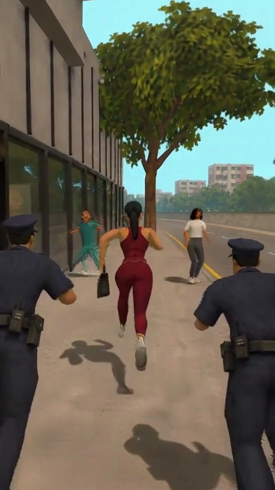
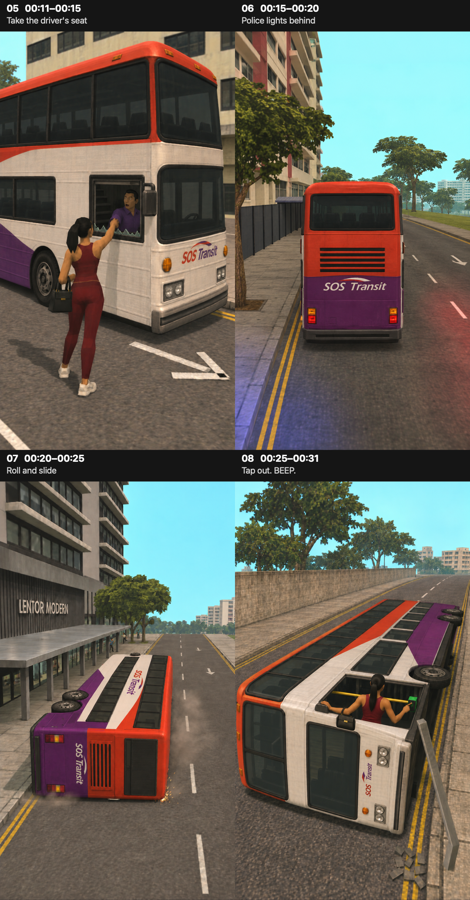
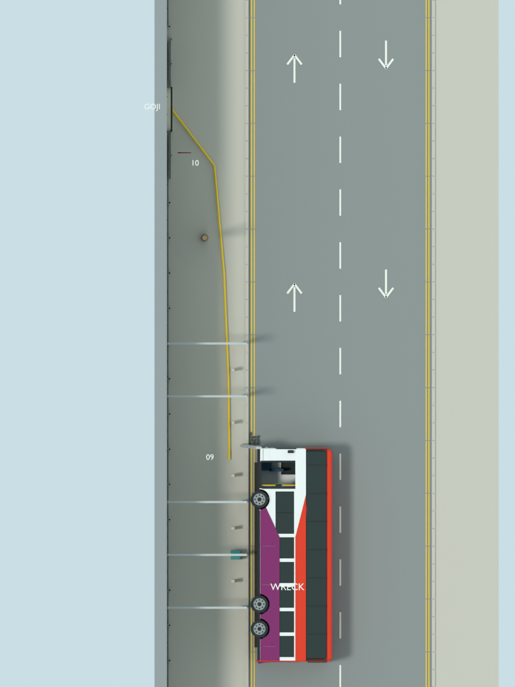

# Goji Girl · Episode 02 — TAP OUT

**Revised first cut · 49 seconds · vertical 9:16 · with SFX**

[**Watch the revised animated cut**](https://raw.githubusercontent.com/gojiphysio/goji/codex/goji-girl-episode-2/marketing/assets/goji-girl/episode-02/first-cut-v2/deliverables/episode-02-first-cut-v2.mp4)

The running uses both arms with the rigid bag alongside her body. The bus has a
faster chase and a sharp-turn rollover; the exit shows a braced climb and a
supported descent to the pavement. The extra exit time brings this cut to 49 seconds.

[Review notes, timestamps and selected takes](first-cut-v2/README.md) ·
[Previous 47-second cut](first-cut-v1/README.md) · [Draft PR #265](https://github.com/gojiphysio/goji/pull/265)

This remains a creative review draft. The takeover contacts, impact livery and
small card-tap gesture still need polish. Frame sampling and the full-decode
check are complete; normal-speed playback and audio audition remain pending
because the Mac relocked.

The safehouse text is exactly:

> You can save your game, improve your stats, and lose the police at a safehouse.

The video uses the updated text in the lowered popup position. Calendar lines
use one font size; wanted stars and other gameplay HUD remain for later post-production.
The earlier storyboard panels below retain their earlier popup artwork.

## Storyboard from the top

Calendar text is now **33 px throughout**. Scene02 shows surprise, scene04 shows
a running stride, and **all wanted stars are removed from the artwork** for later
post-production. The calendar and safehouse text remain editable review overlays.

Startled pedestrians now react in **07, 09 and 10**: recoiling toward the
shopfront, looking back, and hurrying clear as she runs past. **Nobody is hit.**

### 01–04 · Call ends → only five minutes?! → run

### 05–08 · Takeover → chase → crash → tap out

### 09–12 · Away from the wreck → Goji → Pilates

[01–04 full size](revision-08/frames/01-04-storyboard.png) ·
[05–08 full size](revision-08/frames/05-08-storyboard.png) ·
[09–12 full size](revision-08/frames/09-12-storyboard.png)

## Grounded transition: 09 to 10

The bus stays fixed. In09, Goji's red sign is farther ahead on the same left-hand
storefront row. In10, she and the follow camera have advanced along that pavement
toward the entrance. **The entire wreck is behind camera10**, so it cannot appear
in front of her. The girl advances in +Y and her distance to the clinic decreases.
This is fictional compressed geography, not a surveyed real-world route.

[Scene09 geometry](revision-08/frames/09-route-direct.png) ·
[Scene10 geometry](revision-08/frames/10-route-direct.png) ·
[Route coordinates and checks](revision-08/blender/route-record.json) ·
[Editable route scene](https://raw.githubusercontent.com/gojiphysio/goji/codex/goji-girl-episode-2/marketing/assets/goji-girl/episode-02/revision-08/blender/route-09-10.blend)

## Pedestrian reactions

Four recurring PS2-style extras have fixed marks in the same Blender world.
Blue-shirt and cream-shirt pedestrians react beyond the crash; teal-shirt and
white-shirt passersby react farther along the route near Goji. They stay out of
the slide, debris and running corridor. Reactions are staggered, not synchronized.
Nobody is struck by the bus, Goji Girl or the officers; no falls or ragdolls.

[Blender crowd scene](revision-08/blender/route-with-pedestrians.blend) ·
[Positions and clearance checks](revision-08/blender/pedestrian-record.json) ·
[07 guide](revision-08/frames/07-crowd-direct.png) ·
[09 guide](revision-08/frames/09-crowd-direct.png) ·
[10 guide](revision-08/frames/10-crowd-direct.png)

These checks establish separated staging marks. Continuous movement and
no-contact clearance still need review when the episode is animated.

## Retained references and exit

[SOS-BUS-01 remains the approved bus reference](../references/sos-bus-01/README.md).
The corrected passenger doorway, intact white front corner and nose-mounted SOS
logo are retained. The reader/pole rotate with the bus; the windscreen stays clear.

[Current clean exit frame](revision-08/frames/08-look.png) ·
[Shared bus geometry master](https://raw.githubusercontent.com/gojiphysio/goji/codex/goji-girl-episode-2/marketing/assets/goji-girl/episode-02/revision-07/blender/double-decker-master.blend) ·
[Revision notes and prompts](revision-08/README.md)

## Safehouse popup

> You can save your game, improve your stats, and lose the police at a safehouse.

Revised copy; y=360 placement retained, shown at41.5–46.0s. The active therapist,
quiet interior and officers running against the glass remain the ending.

[Full clinic panel](revision-08/frames/12-safehouse-preview.png) ·
[Editable safehouse overlay](first-cut-v1/overlays/safehouse-popup.svg) ·
[Editable calendar overlay](revision-08/overlays/calendar-reminder.svg)

## Camera and look

**On foot:** the camera follows Goji Girl from behind at an ordinary gameplay
height. Keep her full body in the lower middle of the frame, her back toward
us and the route ahead readable. Small interaction-driven yaw is allowed;
low hero angles, face inserts and sweeping orbits are removed outdoors.

**Driving:** camera control transfers to the bus. Its rear grille and taillights
face us; the road ahead remains visible above it. Follow position and heading
with a little lag. The bus can yaw, lean and roll independently of the camera;
the horizon stays level. Scale follow distance to the bus rather than copying
the skill's sedan distances literally. These are framing proposals, not measured
PS2 camera constants.

**Indoors:** simple, deliberately staged San Andreas cutscenes. Medium shots,
fixed cameras, readable gestures. The clinic's quiet comes from pacing and sound,
while its people and materials remain in the same PS2 game as the street.

**Original PS2 target:** painted low-resolution surfaces, economical faces and
hair meshes, simple joint deformation, broad diffuse lighting, restrained
highlights, textured foliage and moderate distance haze. Every commuter, driver,
police officer and video-call participant follows the same standard. Avoid
modern glossy materials, photographic NPCs, toy-like faces and bare faceted
geometry. The cyan sky and warm concrete follow the selected daylight reference;
a heavy orange filter is not the definition of the look.

## Timed script for the 49-second motion revision

### 01 · 00:00–00:03 — Just one more thing

**Home cutscene.** Over her shoulder: headset with a visible boom microphone,
laptop full of meeting tiles. She taps the desk impatiently, rips off the headset
and slams the laptop shut. The black handbag and phone stay on the desk.
The Goji appointment reminder has not arrived yet.

Sound: desk taps, headset clatter, then the laptop **CLACK**. This cut uses SFX
without dialogue.

### 02 · 00:03–00:05 — Only five minutes?!

**Home cutscene.** After the call has ended, her phone pings with the calendar
reminder: **“Goji Pilates — Appointment in 5 minutes.”** She looks surprised,
with raised eyebrows and parted lips, then reaches for the black handbag with
her left hand. The reminder uses one font size throughout.

Sound: calendar ping. Let the surprise register before the cut.

### 03 · 00:05–00:08 — Rush out for Goji

**PLAYER follow.** Cut behind her at normal gameplay height. She pushes the
front door wide with her right hand and immediately **runs out of the house**.
Both arms pump through the running cycle. The rigid handbag follows her left
hand, with its long side alongside her body rather than facing the rear camera.
Full-body player stays below centre;
we see where she is going. Her back remains toward us, bag in her left hand.

Sound: door **BANG**, quick running footsteps. Optional objective for later UI post-production: **“Get to Goji.”**

### 04 · 00:08–00:11 — Public transport, technically

**Same PLAYER follow.** She reaches a busy Singapore bus stop. A white/purple
**SOS Transit** double-decker bus with the familiar italic red/purple logo and a red roof band has its left passenger doors open and
commuters alighting. She runs around the nose toward the right-hand driver's
cab. The camera follows her route around the nose; the bus remains stationary
and parallel to the same curb through shot 05. Finish beside the compact driver
window after the full run around the nose. Both arms keep pumping through the turn.

Sound: idle engine and air hiss. Show the last passenger step clear before
the takeover. The bus looks busy on arrival, but nobody remains aboard for the
crash. Keep traffic on the left and the driver's seat on the right.

### 05 · 00:11–00:15 — One star, zero hesitation

**PLAYER interaction view.** The camera settles modestly behind her right
shoulder at full-body distance, with both people readable. She hooks the bag
over her left forearm, smashes the driver's window, pulls the driver out,
lets him clear the cab, then climbs into the seat. He lands upright, alive
and indignant. Keep the separate removal, clearance and entry states.

The bus remains in the same left lane and the same parked transform as04.
The player is now on its road-centre/driver side; the shelter and bin remain
beyond the opposite passenger side. Camera screen positions follow the Blender
view rather than a mirrored image.

Sound: breaking glass and the bus engine. **Post-production cue: one wanted star appears.** The storyboard art stays free of wanted-level graphics. She places
the bag in the cab footwell as she gets in. Transfer to the vehicle camera only
once she is seated. The retained four-second takeover still needs contact polish.

### 06 · 00:15–00:20 — The least relaxing commute

**BUS rear chase, one sustained view.** The bus races forward with
rapid left-right steering corrections. The rear stays our anchor while road
markings, trees and buildings whip past. The road corridor stays clear. Suspension
reacts to steering; the chassis remains rigid. No front-quarter beauty shot,
cab insert or roadside tracking cut.

Sound: diesel, horn, tyre squeal and rattling fittings. Police remain behind
the camera, out of sight. Broad blue/red spill sweeps unevenly over the road, railing and bus body.
The sources belong to the unseen chasing cars, behind and offset from the camera,
with staggered pulses and different falloff. No paired glowing points, blue bus
lamps or symmetric red/blue patches. Normal bus tail lamps remain red/amber.
Sirens tell us the pursuit is getting closer. Keep the single star in post-production; omit it from storyboard art.

### 07 · 00:20–00:25 — Arrival is a strong word

**Continue the BUS chase camera.** Lentor Modern and an empty shelter appear
ahead. The bus carries its speed into a sharp left turn, loads its outside tyres,
topples onto its right/driver's side and strikes the road. It keeps sliding at
speed until it hits the empty mall-side canopy supports and jolts to a stop. The camera follows its travelling centre
with heading lag, so its side can come into view as it slides. The camera itself
does not roll, orbit to the front or cut to an impact close-up.

Two pedestrians farther along the sheltered pavement flinch and retreat toward
the shopfronts: blue-shirt man raises his hands; cream-shirt woman turns to hurry
away, glancing back. Keep them beyond the impact zone throughout the roll and slide.
Nobody occupies the shelter, bus path or debris path.

Sound: squeal → scrape → enormous **CRUNCH**. Sparks start at road contact.
Keep the bus recognisable and the left passenger side upward. No explosion
covers the recovery. The shelter is empty. The storyboard shows the final sliding/settled pose:
right side down, passenger side upward, roof toward the road centre, wheels
toward the mall-side curb. From this rear view, the mall/canopy is screen left. The front bumper
stops at the damaged post. Freeze that chassis transform at the end of 07.

### 08 · 00:25–00:33 — Still must tap out

**PLAYER interaction view.** Cut from the rear chase view to the front passenger
doorway. Keep the same stationary wreck, with its right side down and passenger
side up. Start with her head and shoulders visible inside the opening. After a
short deadpan pause, she braces both palms on the frame, hooks one knee over the
sill and pulls her hips across. Her hands and feet carry her weight; she stays
low rather than rising upright out of the bus.

While braced, she reaches back inside with the card toward the fixed reader.
Green light. **BEEP.** She then turns to face the chassis, takes the outer edge
with her hands, lowers herself onto a crossmember and briefly hangs before
releasing. Both feet land on the pavement around 00:32; her knees compress and
she recovers. The bag stays with her left wrist/hand.

The doorway remains behind the solid front corner. The reader and pole stay
attached to the chassis. This gets eight seconds so the climb, tap and descent
can finish. The rendered tap is small in the wide view and remains a polish note.
No caption explains the gag; the reach and isolated beep carry it.

### 09 · 00:33–00:35 — Nothing to see here

**PLAYER follow, behind her.** Already on the pavement, she dusts her shoulder,
settles the handbag back into her left hand and sets off **forward along the same
pavement**. The wreck's charcoal edge remains beside the camera at the right.
The red Goji projecting sign is visible farther ahead on the left storefront row.
The same blue-shirt and cream-shirt pedestrians remain beside the storefront,
watching her in disbelief and keeping clear of her path. She keeps moving away
from the wreck. Sound: two brushing sounds and returning sirens.

### 10 · 00:35–00:39 — Same route, new entourage

**Continue PLAYER sprint.** She runs farther along that same pavement toward
the Goji entrance ahead-left. Two officers pursue her from behind, partly entering
the lower frame edges. The girl stays the centred player; the camera follows her
forward with a small leftward turn toward the clinic door.

The fixed Blender route starts at y=4.4 in09 and resumes at y=14 in10,
then passes y=22.1 before turning toward the clinic entrance at y=25.3. **The wreck is now behind the camera and absent from10.**
Neither the girl nor the camera reverses direction. Shopfront stays left, road
stays right. A teal-shirt passerby recoils toward the glass farther beyond the
entrance; a white-shirt passerby hurries away along the outer pavement, looking
back. Neither crosses her route or blocks the doorway. She and the officers pass
without touching anybody. A forward time cut compresses the sprint without relocating the bus.

Sound: running feet, two heavier sets and the approaching siren. Wanted star
and any gameplay UI are added later in post; the storyboard image contains none.

### 11 · 00:39–00:41 — Safe zone

**Clinic cutscene begins at the threshold.** Cut to the fixed interior camera
as she enters. Her posture relaxes instantly. The officers stop outside;
the star and other gameplay HUD disappear. All sirens, shouting and running
sound cut dead on the threshold. Quiet room tone and a soft arrival chime.

Preserve the reference reception: warm timber, red/cream floor, deep-red table,
short-bobbed therapist in black. The officers' feet remain on exterior pavement.
The therapist greets her without acknowledging the pursuit.

### 12 · 00:41–00:49 — And… breathe out

**Fixed clinic cutscene.** Elliptical cut to her on the reformer, doing one slow
footwork repetition in grip socks. White shoes and the single handbag sit on
a bench. Therapist in a black crew-neck top and leggings, white shoes, small
left-chest mark only; plain black back, no name tag. She leans toward the footbar,
watches the near knee and cues alignment with one open hand while her other hand
demonstrates the extension direction. She follows the repetition attentively;
there is no passive hands-clasped pose.

Quiet breath and reformer mechanism. An instructor line can be added later;
this cut has no dialogue.

Hold the same medium-wide composition for the whole eight seconds. Her movement
draws the eye first; the background is already there to discover, without a
cinematic pullback. Through the clear glass, two police face inward and run
against it—alternating knees, pumping arms, no forward progress, slightly out
of phase. Beyond them, the overturned bus burns. Nobody inside reacts.

At **43.5s**, show the tutorial box at y=360. Hold until **48s**:

> You can save your game, improve your stats, and lose the police at a safehouse.

This is original San Andreas-style parody copy, not a verbatim game quote.
The joke stays entirely in the fictional game; no appointment or treatment claim.

Optional later post-production copy, absent from this cut: **“Pilates at Goji · Lentor Modern.”** Keep it clear
of the background gag. End on the moving tableau.

## Continuity and review notes

- **Approved direction:** the user accepted the story intent and requested
  predominantly third-person outdoor gameplay with indoor cutscenes. The user approved SOS-BUS-01 as the canonical bus appearance reference.
  Latest direction: surprised calendar reaction, uniform popup font, running04,
  no wanted stars baked into boards, a grounded forward09–10 route, and
  startled pedestrians with no collisions. Other revised illustrations and
  the 49-second revision remain subject to creative review.
- **Retain the comedy:** crash pause, isolated tap beep, hard audio boundary,
  slow reformer action and police with broken pathing. No blood or deaths;
  driver is visibly okay, passengers clear the bus, shelter is empty.
- **Prop ownership:** desk → left hand → left forearm during takeover → cab
  footwell → recovered during exit → left hand → bench in the Pilates cut.
  Do not silently change hands, add a shoulder strap or duplicate the bag.
- **Geography:** this is a fictional compressed Lentor Modern game set, allowing
  the bus to be visible through the clinic glass. The boards are not a surveyed
  route, verified transit service or faithful reconstruction of every frontage.
- **Geometry review:** the canonical bus asset retains the corrected passenger
  doorway and reader. The current [motion revision](first-cut-v2/README.md)
  supplies the high-speed crash, shared wreck transform, supported eight-second
  exit and forward route. Its contact, clearance and grip checks apply to the
  Blender guides; generated footage has separate review notes. Earlier boards
  remain as creative history and do not supersede the current motion records.

- **Service framing:** Pilates/studio experience, no medical or treatment claim.
  Her unhurt state is cartoon continuity, not recovery attributed to a session.
- **Motion method:** Blender staging and H3 continuous video guidance control
  the complex outdoor actions; simpler fixed-camera scenes use indexed still
  guides. The current pass replaces the rejected motion in the existing first
  cut. It does not start a new model benchmark.

## References used

Applied the new [Goji GTA video skill](https://github.com/gojiphysio/goji/blob/a4cb40ee89d6baa9ca027785fca71abe56b65cb8/marketing/video-production/skills/goji-gta-video/SKILL.md),
[series bible](https://github.com/gojiphysio/goji/blob/a4cb40ee89d6baa9ca027785fca71abe56b65cb8/marketing/video-production/skills/goji-gta-video/references/series-bible.md)
and [San Andreas reference pack](https://github.com/gojiphysio/goji/blob/a4cb40ee89d6baa9ca027785fca71abe56b65cb8/marketing/video-production/skills/goji-gta-video/references/san-andreas-reference.md).

- **Identity/style:** the skill's recovered `ep01-street.png` (Episode 1 v6),
  plus `ep01-reception.png` for therapist identity, wardrobe and reception layout.
  The smoother reception rendering is simplified toward the street/PS2 standard.
- **Game-camera/look:** inspected cached samples from
  [Paulo Cassiano's reported original-hardware PS2 capture](https://www.youtube.com/watch?v=Z9cD9uj1fb8&t=240s),
  including the rear player view near 04:04 and rear driving view near 04:46.
  Also inspected the reference pack's takeover and turn contact sheets. These
  were still-frame inspections, not new normal-speed playback or measured physics.
  Source capture processing and cheats remain unverified, as recorded in the pack.
- **Generation:** built-in image generator, with identity and game-camera
  references assigned separate roles. Exact prompts, edits and reference hashes
  are in [v2 generation records](storyboard-prompts-v2.json).
- **Current shot states:** [camera and continuity record](camera-plan-v8.json).
- **This revision:** [surprise, clean art and continuous route](revision-08/README.md).
- **Retained staging:** [source photos and Blender records](revision-03/README.md).
- **Earlier drafts:** [v1](creative-v1.md), [v2](creative-v2.md) and [v3](creative-v3.md) and [v4](creative-v4.md) and [v5](creative-v5.md) and [v6](creative-v6.md) and [v7](creative-v7.md), retained for comparison.

## Optional caption

> She took public transport. Technically.
>
> Goji Girl, Episode 02: TAP OUT.

Any later customer CTA must use a verified `go.gojiphysio.com/<slug>` redirect.
No Instagram publication or main-branch merge is included in this revision.
