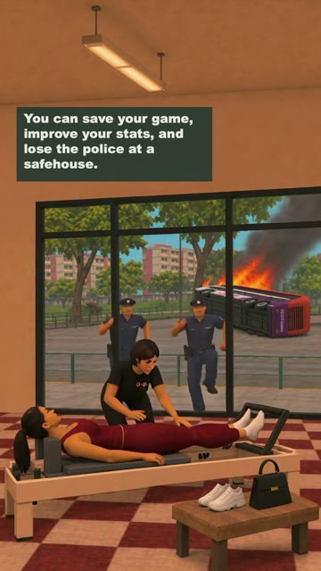

# Episode 2 — first animated cut

[**Watch the 47-second cut with SFX**](https://raw.githubusercontent.com/gojiphysio/goji/codex/goji-girl-episode-2/marketing/assets/goji-girl/episode-02/first-cut-v1/deliverables/episode-02-first-cut-v1.mp4)

A first motion cut for creative review. All twelve scenes are animated, with original SFX and editable calendar/safehouse overlays. No music or dialogue. Wanted stars and other gameplay HUD remain for post.

The departure, bus approach and clinic sprint use a revised run cycle informed by [original PS2 footage](https://www.youtube.com/watch?v=Z9cD9uj1fb8&t=248s): bent elbows, a firmer arm pump, forward lean and stronger heel recovery. Her bag stays in her left hand. H3 still softens some poses; this is an approximation of the game animation.

## Review by timestamp

| Time | Beat |
|---|---|
| 00:00–00:05 | Frustrating call, laptop shut, five-minute reminder and surprise |
| 00:05–00:08 | Revised departure sprint |
| 00:08–00:11 | Run past the passenger door and around to the driver |
| 00:11–00:15 | Window break and driver takeover |
| 00:15–00:20 | Bus chase with ambient police light |
| 00:20–00:25 | Roll and slide at Lentor Modern |
| 00:25–00:31 | Passenger-door exit and EZ-Link beep |
| 00:31–00:33 | Dust off and continue away from wreck |
| 00:33–00:37 | Revised clinic sprint with police behind |
| 00:37–00:39 | Cross the threshold into calm |
| 00:39–00:47 | Reformer session, stranded cops and safehouse tutorial |

## Known roughness

- The driver pull-out and climb have floaty body motion and imperfect hand contact.
- The crash needs a more decisive turn and stronger shelter contact.
- The exit has a small initial body dip. The bag’s shape and hand at reception need continuity polish.

- A foreground officer briefly obscures Goji Girl near the turn into the clinic.
- The reformer foot/bar contact has slight drift to polish.

The safehouse message is exactly:

> You can save your game, improve your stats, and lose the police at a safehouse.

It retains the lower y=360 placement on the 1080×1920 overlay canvas. Calendar lines all use one font size.

## Review record and editable sources

The export is 47.000 seconds, 576×1024 at 24 fps, with H.264 video and stereo AAC sound. Every scene is animated; there are no pending storyboard holds. Source in/out points and the complete MP4 decode pass. All shots received sampled-frame review, with denser 8fps stride/contact checks where noted. The crash-to-exit, recovery-to-sprint and clinic-threshold cuts were sampled in the assembled video.

Full normal-speed playback and a listening check for this final export remain pending because the Mac relocked. Earlier opening, chase and exit previews had QuickTime playback checks; those do not substitute for reviewing this complete export.

[Selected takes and notes](selected.json) · [Edit/source-frame record](deliverables/episode-02-first-cut-v1-record.json) · [Running reference and guide checks](guides/sa-gait-reference.json) · [Sound cues](audio/cues.json) · [Safehouse overlay](overlays/safehouse-popup.svg)

Blender supplies paths, camera placement and contacts. The approved Goji Girl and SOS-BUS-01 references supply finished shapes and textures; proxy boxes are not the appearance target. The exterior layout compresses real landmarks for the fictional gag.

[Original review checkpoint 01](https://raw.githubusercontent.com/gojiphysio/goji/009a4a7/marketing/assets/goji-girl/episode-02/first-cut-v1/deliverables/review-checkpoint-01.mp4) remains unchanged for earlier timestamped comments. It contains labelled storyboard holds and earlier running takes.

[Review checkpoint 02](https://raw.githubusercontent.com/gojiphysio/goji/ff72286/marketing/assets/goji-girl/episode-02/first-cut-v1/deliverables/review-checkpoint-02.mp4) is also preserved, including its revised running scenes and labelled pending holds.
