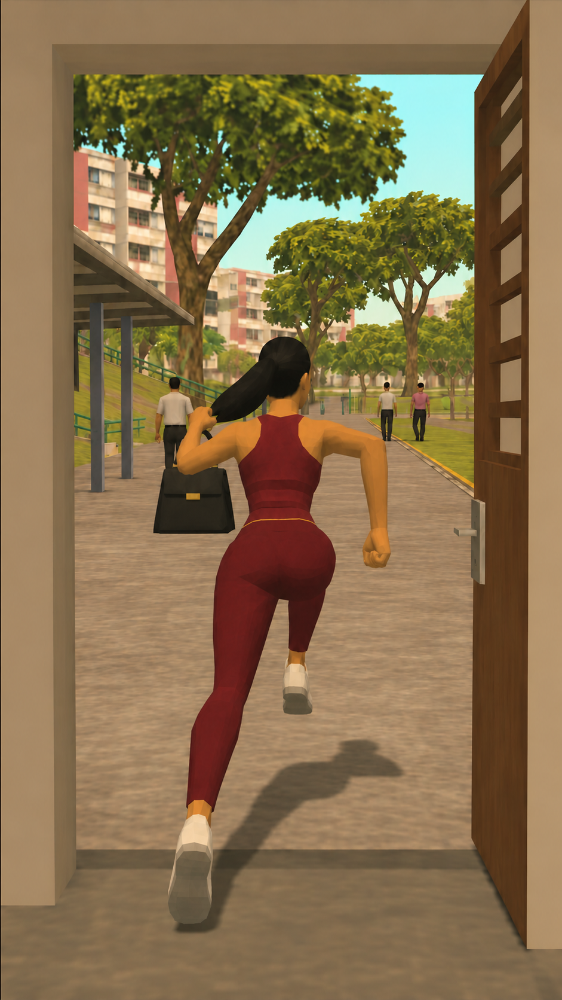
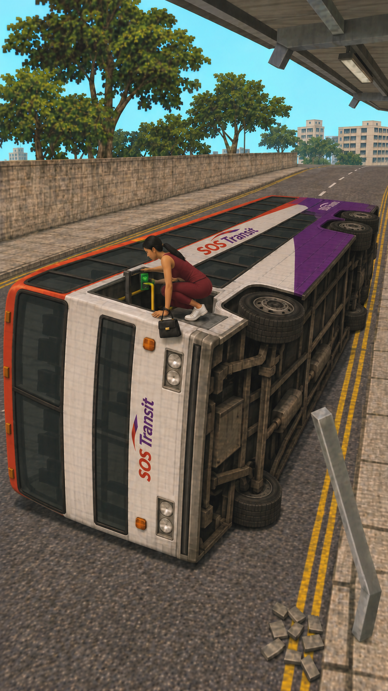
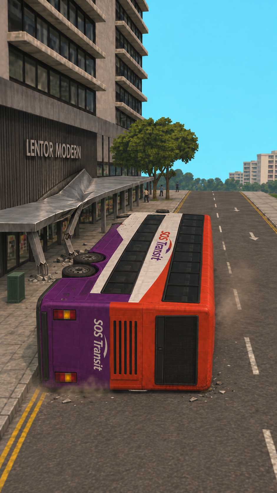

# Episode 2: motion revision

This pass is in production. The previous cut remains available in [first-cut-v1](../first-cut-v1/README.md).

The revision covers the running scenes, bus chase, rollover, exit and the dust-off transition. Both arms pump through the full running cycle, with the handbag attached as a rigid prop. The bus carries speed through a sharp turn, a roll onto its side and a slide into the mall-side canopy. Goji Girl climbs through the passenger doorway with visible hand and foot support, taps the reader while braced, then climbs down and lands on the pavement.

The exit gets eight seconds, bringing the planned cut to 49 seconds. The safehouse message stays exactly as approved: “You can save your game, improve your stats, and lose the police at a safehouse.”

[Watch the new five-second chase test with SFX](deliverables/chase-motion-test.mp4). This is a provisional take reviewed in frame samples; the full revision is still rendering.

## New appearance references

These are still references for rendering, not proof that the animation passes review.

| Full arm pump | Braced exit |
| --- | --- |
|  |  |

## Motion and continuity

[Geometry check record](guides/motion-audit.json) · [Render status](render-status.json) · [Selected takes](selected.json) · [Render prompts](revision-jobs.json)

The Blender guide covers 110 metres in five seconds for the chase. The crash separates steering, weight transfer, ground contact, sliding and impact. The exit checks limb reach and carries the same wreck transform into the next shot. These are original staging choices, not measurements of GTA or a real bus. Generated footage needs its own contact and continuity review.

The retained scenes are 01, 02, 05, 11 and 12. Scene 05's earlier driver-window contact roughness remains documented in the previous cut. No wanted stars or other gameplay HUD are baked into the new footage.
