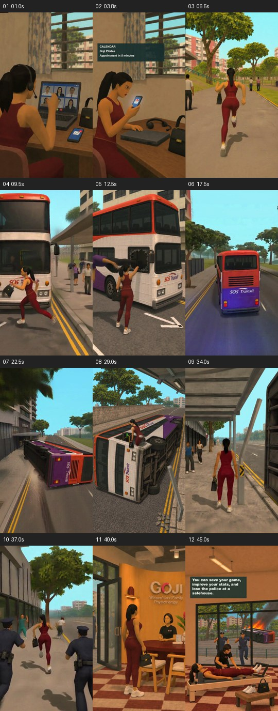
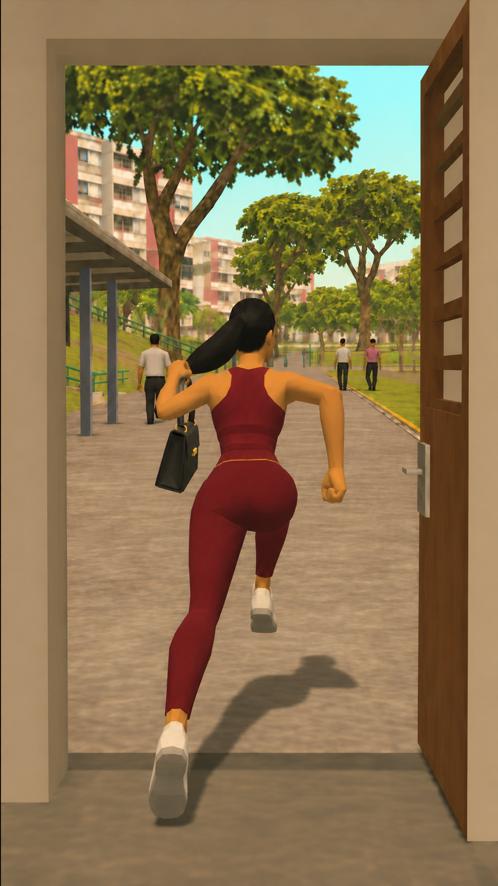

# Episode 2: revised first cut

**Production paused · 27 November 2026.** [Pause handoff and lessons](../PAUSE-HANDOFF.md).

**49 seconds · vertical 9:16 · original SFX · creative review draft**

[**Watch the revised cut with sound**](https://raw.githubusercontent.com/gojiphysio/goji/codex/goji-girl-episode-2/marketing/assets/goji-girl/episode-02/first-cut-v2/deliverables/episode-02-first-cut-v2.mp4)

The running uses both arms, with the rigid handbag moving through the left-arm swing. Its long side sits alongside her body, so the rear view mostly shows its narrow end. The bus approach carries that movement through the turn around the nose.

The chase has faster road travel and sharper steering. At Lentor, the bus turns hard, topples, strikes the road and slides into the canopy supports. Goji Girl braces through the passenger doorway, pulls her legs across, taps while supported, then lowers herself down and lands on the pavement. The exit now gets eight seconds.

The safehouse message is exactly:

> You can save your game, improve your stats, and lose the police at a safehouse.

The calendar uses one font size. Wanted stars and other gameplay HUD remain for later post-production.

## Timing

| Time | Action |
| --- | --- |
| 00:00–00:05 | End the call; five-minute reminder and surprise |
| 00:05–00:08 | Run out of the house |
| 00:08–00:11 | Run around the bus to the driver window |
| 00:11–00:15 | Take over the bus |
| 00:15–00:20 | High-speed weave with offscreen police lights |
| 00:20–00:25 | Sharp turn, roll, slide and canopy impact |
| 00:25–00:33 | Supported climb, tap, descent and landing |
| 00:33–00:35 | Dust off and move away from the wreck |
| 00:35–00:39 | Sprint toward Goji with police behind |
| 00:39–00:41 | Enter the calm clinic |
| 00:41–00:49 | Reformer session and police pathing gag |

The safehouse box appears at 00:43.5–00:48, in the lowered position agreed for Instagram.

## Remaining roughness

- The retained driver pull and cab entry still have floaty contacts.
- The bus side livery changes near the final impact.
- The card tap is small and partly hidden in the wide exit view. The beep marks it.
- The dust-off render needed a gradual crop to counter its camera pullback.
- The retained reception shot has a bag-hand continuity detail; the reformer shot has slight foot/bar contact drift.

## Review and sources

The export passes a strict full-decode check. Frame review covers complete revised shots, including samples within each stride and close checks of the exit contacts. Full normal-speed playback and audio audition remain pending because the Mac relocked; file checks and contact sheets do not replace that review.

[Selected takes and per-shot notes](selected.json) · [Edit record](deliverables/episode-02-first-cut-v2-record.json) · [Production notes](production-notes.md) · [Render status](render-status.json)

[Blender motion and clearance checks](guides/motion-audit.json) · [Bag grip checks](guides/bag-grip-audit.json) · [Render prompts](revision-jobs.json)

The Blender checks apply to the guides. Approved character, SOS-BUS-01 and facade references define the finished appearance. Raw attempts, rejected running tests, source hashes, editable overlays and separate sound stems are retained.

## Short motion tests

[Running and bag](https://raw.githubusercontent.com/gojiphysio/goji/codex/goji-girl-episode-2/marketing/assets/goji-girl/episode-02/first-cut-v2/deliverables/running-bag-motion-test.mp4) · [Chase and crash](https://raw.githubusercontent.com/gojiphysio/goji/codex/goji-girl-episode-2/marketing/assets/goji-girl/episode-02/first-cut-v2/deliverables/chase-crash-motion-test.mp4) · [Supported exit](https://raw.githubusercontent.com/gojiphysio/goji/codex/goji-girl-episode-2/marketing/assets/goji-girl/episode-02/first-cut-v2/deliverables/exit-motion-test.mp4)

## Bag reference correction

| Earlier reference | Side-on reference |
| --- | --- |
|  |  |

[Previous 47-second cut](../first-cut-v1/README.md) · [Storyboards and timed script](../README.md) · [Draft PR #265](https://github.com/gojiphysio/goji/pull/265)
