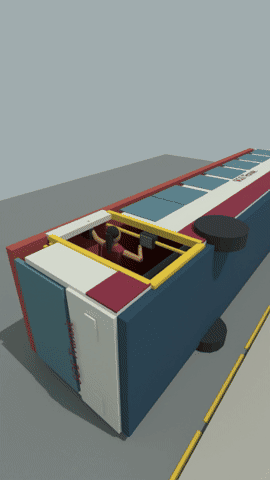
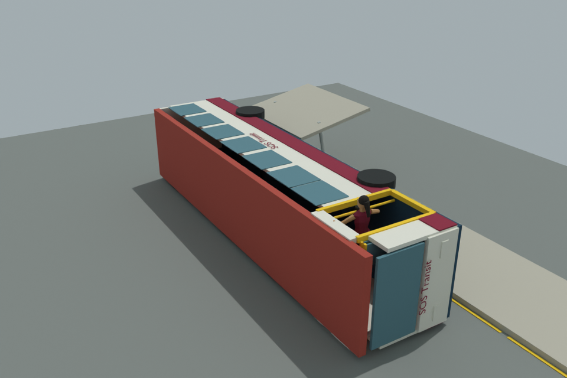
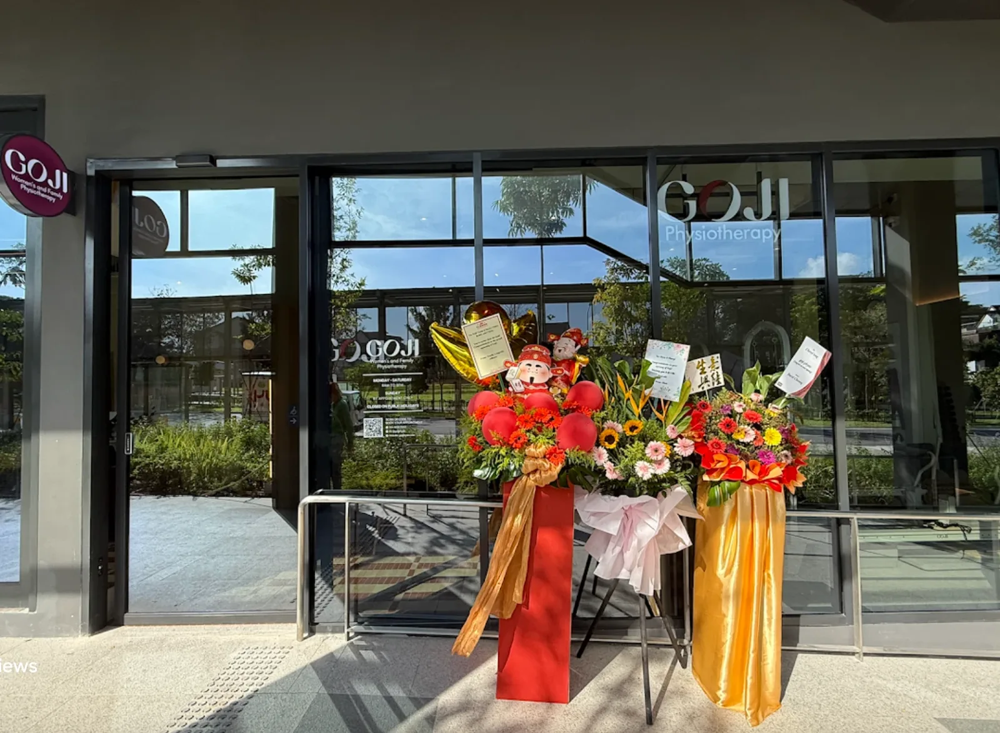
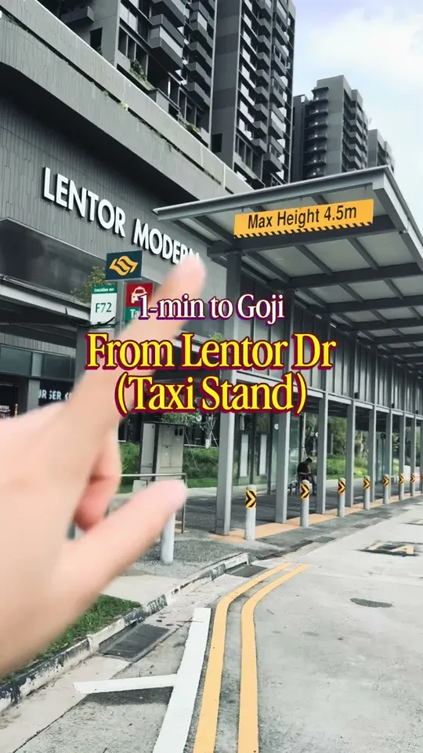
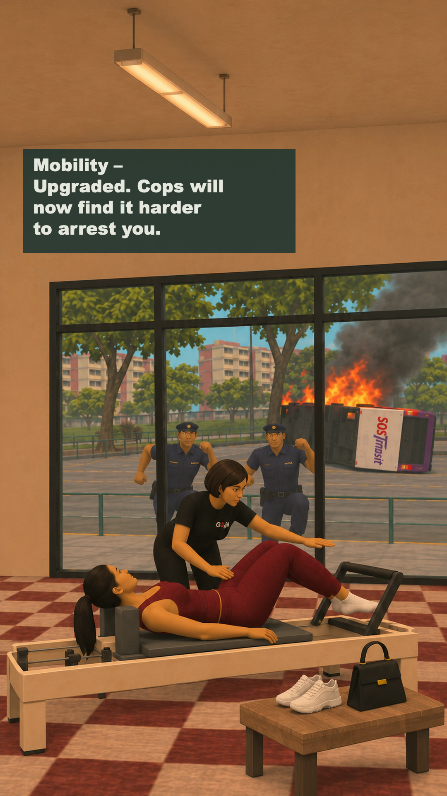

# Revision 3 — exit geometry and visual corrections

[Current episode script and boards](../README.md)

## Corrected bus exit

[Watch/download the six-second blockout](https://raw.githubusercontent.com/gojiphysio/goji/codex/goji-girl-episode-2/marketing/assets/goji-girl/episode-02/revision-03/blender/bus-exit-blockout.mp4)

[Download the editable Blender scene](https://raw.githubusercontent.com/gojiphysio/goji/codex/goji-girl-episode-2/marketing/assets/goji-girl/episode-02/revision-03/blender/bus-exit.blend) ·
[Build script](scripts/build_bus_exit.py) · [Scene record](blender/scene-record.json) ·
[Contact frames](blender/contact-sheet.jpg)

The bus uses local +Y forward, +X driver's right and Z up. The front-left
passenger opening is at y=3.80–5.30, ahead of the front axle at y=3.15.
Its aft-jamb reader is at local (-1.08, 3.95, 1.60), with its display facing +Y.
These are original staging dimensions, not a surveyed or manufacturer-certified
bus model. The whole chassis rolls +90° about Y onto its driver's side. The
reader, pole and folded door leaves inherit that transform; the door opening
then lies horizontally at world z=2.70. The nearest end is the front windscreen,
not the engine grille. The model uses fictional **SOS Transit** branding.

The proxy rises through the opening, braces, touches the reader with a card,
then swings both legs onto the upward-facing passenger side. Shot 09 begins
with the drop to the pavement. The six-second action contains one second of
pause, rise at 1–2s, tap at 2.8–3.3s, and climb clear by 6s. The clip uses Blender
frames 1–72 at 12 fps; frame 73 is a terminal pose/handle at source time 6s.

The build asserts fixed reader parenting, front-door location, constant-length
limb reachability and wheel/ground clearance. Contact stills were inspected.
This is a **motion/geometry blockout**, with an unapproved procedural proxy,
neutral surroundings and keyed movement. It is not final PS2 character animation
or a simulated crash. No claim of complete continuous-playback review is made.
The Blender asset/direct renders control geometry in the next H3 pass.

One standalone restyle was rejected because it made the bus upright and turned
the doorway into a roof hatch. The selected storyboard panel uses the corrected
guide, but remains concept art rather than a replacement geometry source.

## Real frontage references

[Source in Goji website assets](../../../../website/public/photos/directions/exterior-frontage.webp)

Use the individual black-framed glass bay, left entrance, right window logo,
burgundy circular projecting sign, plain soffit and metal walkway handrail.
Opening-day flower displays are temporary decoration and are omitted.

[Source in Goji website assets](../../../../website/public/photos/directions/cover-taxi-lentor-dr.webp)

Use dark vertical cladding, the real mall-lettering position, stepped balcony
towers, silver canopy structure and chevron bollards. The reference's finger and
social-video text are not architecture and are omitted. The site plan below
records the real relative location; the stunt and view of the burning bus from
inside Goji remain deliberate fictional compression.

[Level 1 plan](references/lentor-level1-plan.webp) ·
[Goji's directions and route videos](https://www.gojiphysio.com/getting-here/)

The references are existing project website assets copied unchanged, not
newly invented architecture. The interior composition is retained from v2.

## Engaged therapist and lower popup

The therapist watches the moving knee, leans toward the footbar and provides
an alignment/extension cue, while the player remains calm. The two police
continue their inward-facing running loop behind the glass.

The popup is recreated from Episode 1's v8 vector/drawing source, with text,
font, colour, size and line breaks unchanged. Only the vertical placement moves
**+180 px**, from y=180 to **y=360** on a 1080×1920 canvas. It remains separate
from the illustration. Episode 2 display interval: **41.5–46.0 seconds**.

[Editable SVG](overlays/mobility-popup.svg) · [Transparent PNG](overlays/mobility-popup.png) ·
[Placement record](overlays/placement.json) · [UI reserve check](frames/12-ui-clearance-check.png) ·
[Clean frame](frames/12-coaching-clean.png)

The UI reserve check uses proposed top=280, right x≥900 and bottom y≥1540 masks.
The popup clears them, all faces and the background gag. This is a composition
check, not a claim that live Instagram chrome was verified on every device.

## Reproducibility

- [Image prompts and input provenance](generation-record.json)
- [Validation results](validation.json)
- [Popup renderer](scripts/draw_mobility.swift)
- [Preview compositor](scripts/compose_previews.py)

Run Blender 5.3 with `--background --python scripts/build_bus_exit.py` to rebuild
all 73 source frames, or append `-- --preview` for the six retained anchors and
overview. The `.blend` has no external texture dependencies. The build script is
self-contained; procedural character helpers were adapted from the repository's
existing local-benchmark stage. Image illustrations use the built-in image tool.
No H3/model benchmark or final episode render was launched.
