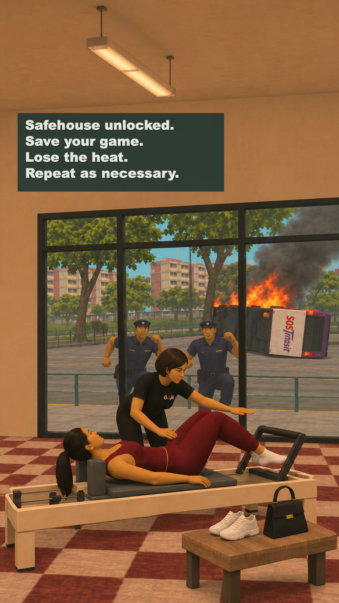
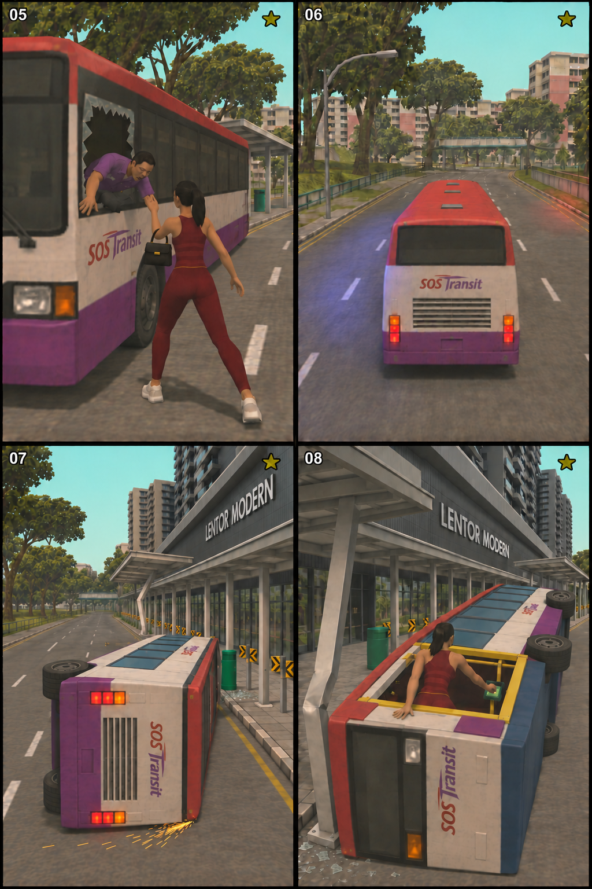

# Revision 4 — safehouse and continuity

[Full script and storyboard](../README.md)

## New tutorial

> **Safehouse unlocked.** 
> **Save your game.** 
> **Lose the heat.** 
> **Repeat as necessary.**

Original San Andreas-style parody copy, not a verbatim Rockstar quote. It
replaces Mobility and keeps the joke entirely inside the fictional game.
The editable episode-one box styling stays at x56, y360, 658×250 on 1080×1920.
Display remains 41.5–46.0s within the proposed 47-second cut.

[SVG](overlays/safehouse-popup.svg) · [Transparent PNG](overlays/safehouse-popup.png) ·
[Placement](overlays/placement.json) · [UI reserve check](frames/12-ui-clearance-check.png)

## Bus continuity

| Transition | World stays fixed | Camera/readability |
|---|---|---|
| 04 → 05 | Same parked bus, heading and curb. Shelter and bin remain on its passenger side. | Follow her around the nose. 04 sees the passenger side; 05 sees the driver side, with the nose on screen left. Never mirror the bus artwork or text. |
| 06 | Police light sources belong to unseen pursuing cars. Bus has ordinary red/amber tail lamps. | Uneven blue spill across left rear/road; offset red spill on right roadside. Animate staggered pulses and changing falloff, not fixed symmetric points. |
| 07 → 08 | Right side down, passenger side up, roof toward mall, wheels toward road. Bent post stays by front bumper; bin beside mid-bus. End-07 transform equals start-08 transform. | 07 looks from rear: mall right, wheels left. 08 looks from front: mall left, wheels right. Motivated camera transfer; no vehicle teleport or second rollover. |

The 07 still represents the end of the slide, not the whole turn. The rear
camera stays level during the preceding rollover. Hold the same settled wreck
through the one-second pause, then transfer to the player recovery view.
Front passenger door and rotated reader remain governed by the existing
[Blender geometry](../revision-03/README.md#corrected-bus-exit).

These are concept-board corrections and a motion handoff contract. The
illustrations are not proof of identical measured meshes or continuous motion.
No new full video or crash simulation was rendered in this revision.

## Retained material and provenance

Panels 01–04 and the clean clinic art are retained. The new ending is a native
text-overlay composite; it does not regenerate the accepted therapist/interior.
The real frontage references and previous Blender blockout remain unchanged.

- [Current camera/continuity record](../camera-plan-v4.json)
- [Exact image prompts, attempts and hashes](generation-record.json)
- [Native popup renderer](scripts/draw_safehouse.swift)
- [Preview compositor](scripts/compose_previews.py)
- [Validation](validation.json)

The first image edit improved the driver's-side view and chase spill but left
the mall on the wrong side in 07. A targeted revision corrected that reverse
angle; a final prop-only pass restored the handbag to the left forearm. The
selected sheet was visually inspected. The final overlay clears the proposed
UI mask and faces; live Instagram UI was not tested.
