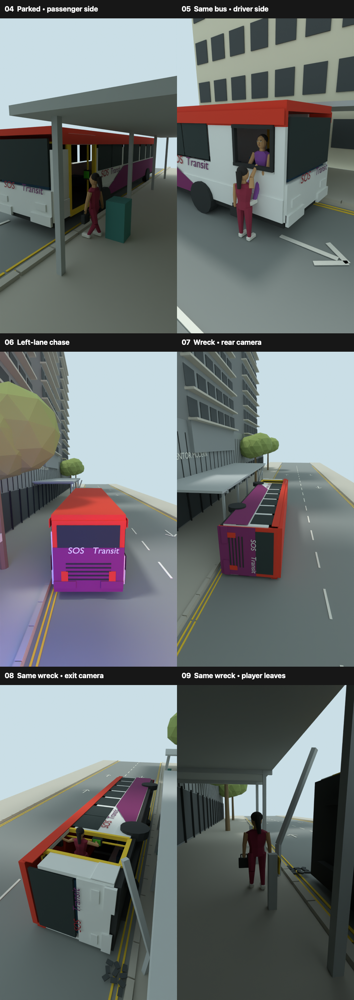
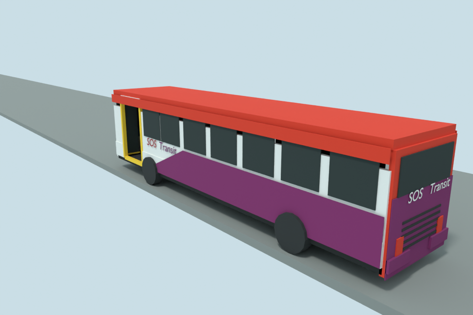
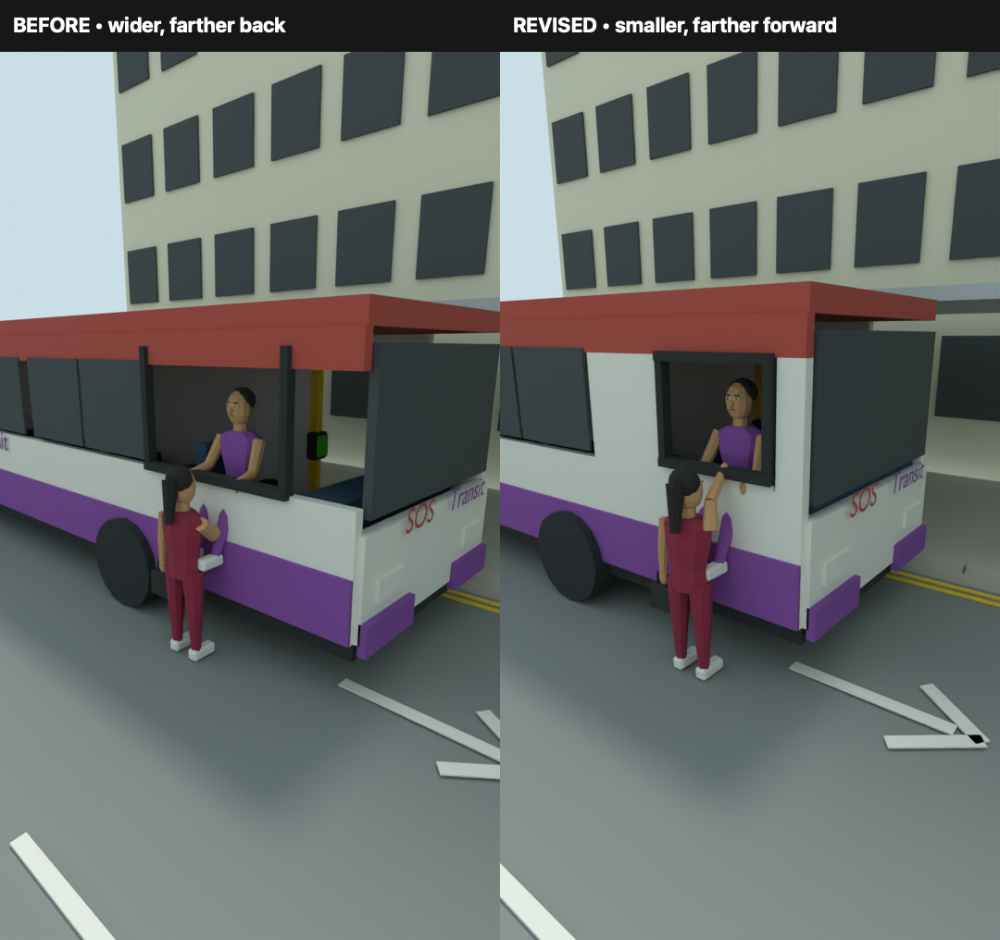
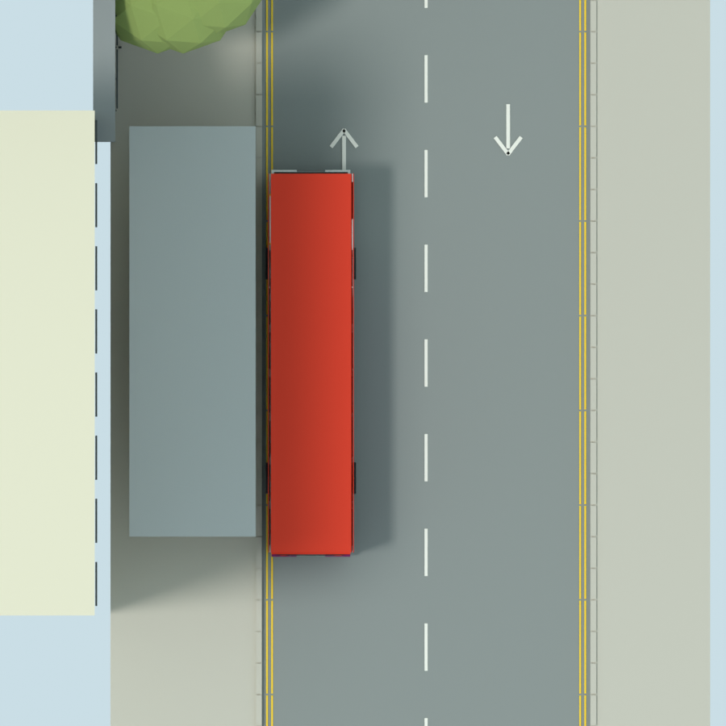
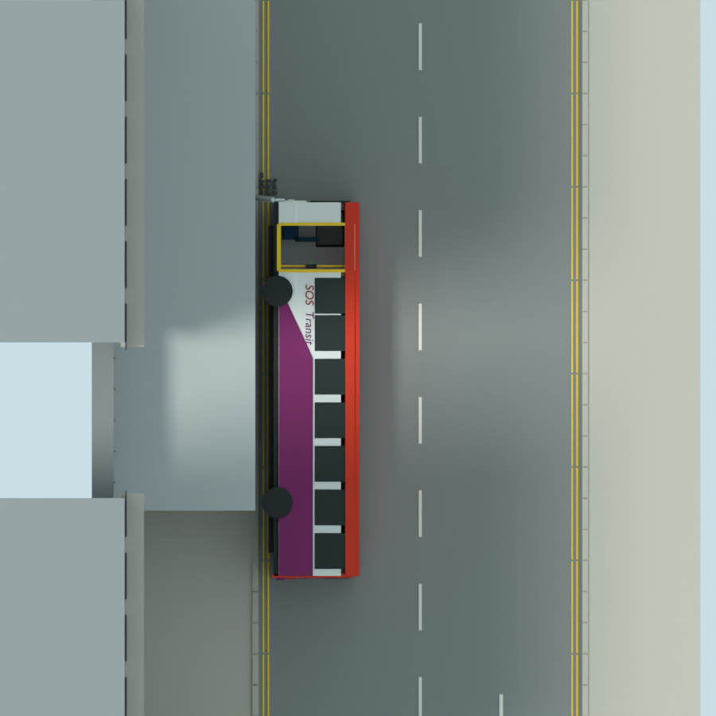

# Revision 5 — shared Blender geometry

[Current script and review](../README.md)

The previous AI bus panels are superseded. This revision uses direct renders
from **one bus asset, one fixed street layout and six saved cameras**. The
people and architecture are blocking proxies; these are geometry-review frames,
not a finished PS2 appearance pass.

[Editable Blender master](https://raw.githubusercontent.com/gojiphysio/goji/codex/goji-girl-episode-2/marketing/assets/goji-girl/episode-02/revision-05/blender/continuity-livery-v52.blend) ·
[Build script](scripts/build_continuity.py) · [Exported scene record](blender/continuity-record.json)

The driver window is now a compact 1.10m × 0.82m opening, with its centre
moved forward from local y=4.47 to y=5.15. Its front edge sits 0.30m behind
the nose. The driver seat and takeover marks follow the revised opening.
These are staging dimensions, not a manufacturer specification.

## Supplied colour reference

The isolated full-bus view hides the street set for paint inspection; story cameras remain fixed.

The user-provided double-decker photo is used for its orange-red upper paint,
deep-purple lower/rear panels, white diagonal fields, dark glass and white rear
wordmark. These are adapted onto the accepted single-decker mesh, retaining
**SOS Transit**. Deck count and vehicle transforms are unchanged.

The current driver-window change is shown separately below using the same old
paint on both sides, so the livery change does not obscure the smaller opening.
The before render comes from commit 1d223b6; the revised render from 8833a2c.
The published scene05 image was verified byte-for-byte against the revised
local render. A stale client view was not confirmed; the new preview filenames
make this update explicit.

[Current scene05 with new livery](frames/05-livery-v52.png)

## World rules and verified poses

Northbound is +Y. Its left lane is x<0, with the centreline at x=0 and west curb
at x=-5.2. The mall and passenger pavement are west of that curb. The original
pickup stop is farther south on the same street layout, with a separate shelter.
This is fictional staging informed by the real facade photos, not surveyed geography.

| Shots | Bus root in metres | Rotation | What changes |
|---|---|---|---|
| 04, 05 | (-3.65, -28, 0) | Upright, forward +Y | Player moves from passenger pavement around nose to driver side; camera follows. |
| 06 | (-3.65, -12, 0) | Upright, forward +Y | Rear chase view, unseen pursuing-car lights behind camera. |
| 07, 08, 09 | (-5.1, 0, 1.45) | +90° about Y, still forward +Y | Camera and player only; wreck stays fixed. |

The direct render bounds stay in the left lane. The 04/05 matrices are exactly
equal; 07/08/09 matrices are exactly equal. Every determinant is positive: no
mirroring or negative scaling. The door, reader, wheels, lettering and livery
remain children of the same chassis.

The red roof faces the road centre after the right-side rollover. The purple
skirt, wheels and charcoal undercarriage face the passenger curb. This corrects
the previous misleading roof-toward-mall staging. In 09 the player is on that
pavement, so the camera sees the **actual underside**, not invented reversed
livery. A rear engine grille, front windscreen and front passenger opening remain
fixed landmarks throughout. The floor is charcoal, not blue.

## Overhead checks

These are review diagrams, not cameras proposed for the episode.

Open the `.blend` at the named timeline markers: 04=frame1, 05=10, 06=20, 07=30,
08=35 and 09=80. These are snapshot states, not episode-time mappings or a rendered
crash animation. The inherited keyed exit pose is offset into this set by a
single translation; this revision does not claim a new continuous action review.
The final exit camera was moved to clear the canopy and show the reader, while
leaving bus and street transforms unchanged.

## Flowing tutorial copy

> You can save your game and lose the police at a safehouse.

The previous episode's Body Muscle and Mobility overlays are the tone and styling
reference: clear sentences, with line breaks used for typesetting. This new text
is original parody copy, not a verbatim Rockstar message. No appointment reference.

[Popup SVG](overlays/safehouse-popup.svg) · [Transparent PNG](overlays/safehouse-popup.png) ·
[Placement record](overlays/placement.json) · [Composited preview](frames/12-safehouse-preview.png) ·
[UI reserve check](frames/12-ui-clearance-check.png)

The preview retains the earlier clinic look image to check the paragraph and
lower y=360 placement. That image's older background bus remains an appearance
reference only and must be replaced from this geometry in the next look pass.
The accepted therapist and interior direction remain intact.

[Validation results](validation.json) · [Validation script](scripts/validate.py)
