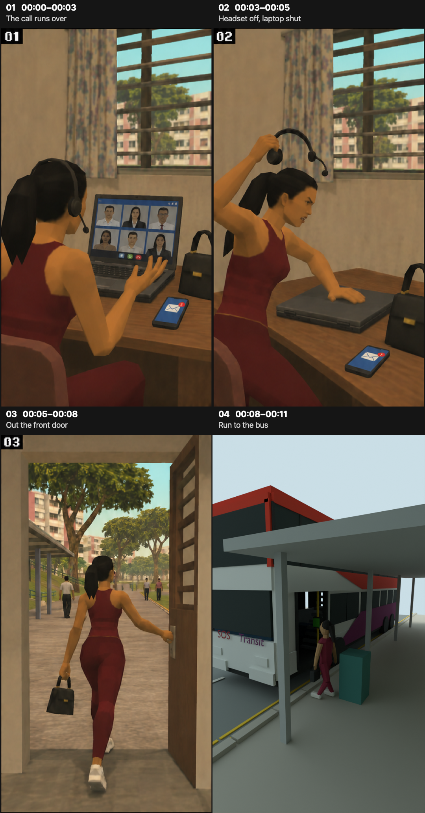
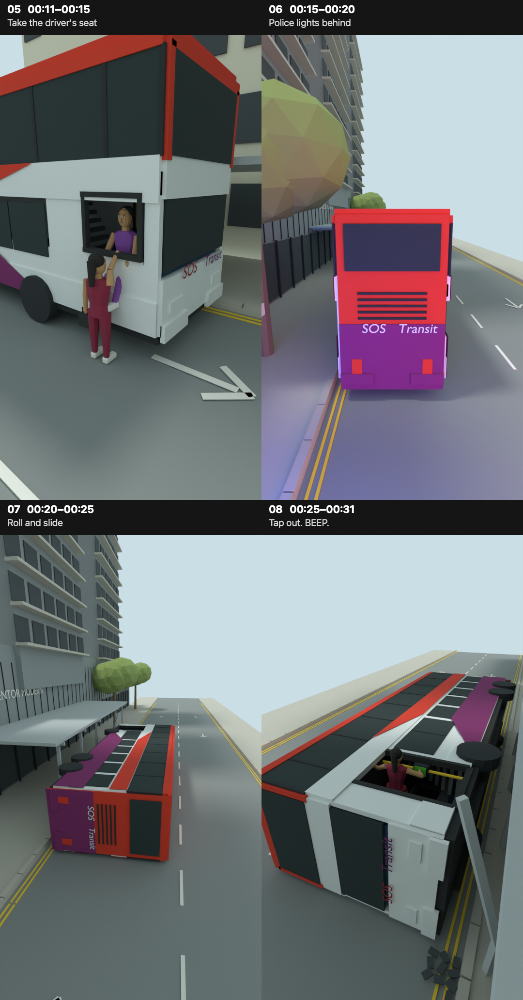
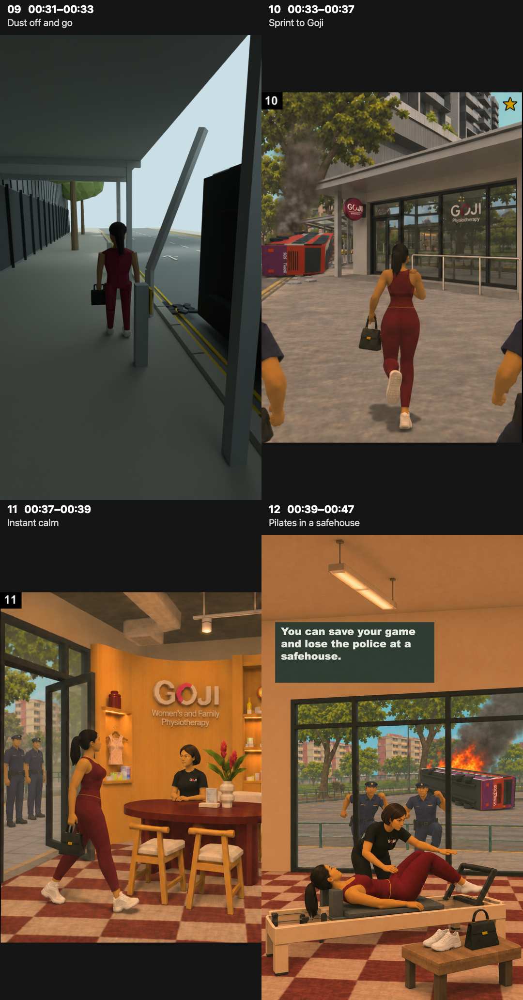

# Revision 6 — double-decker and complete storyboard

[Read the full episode from the top](../README.md).

## Selected boards

## Shared geometry

The single shared [Blender master](blender/double-decker-master.blend) now has
two decks, upper-floor access stairs, two glazing rows and three axles. Its
12 × 2.5 × 4.65 m staging proportions are proposed, not manufacturer dimensions.
The supplied bus photograph controls colour/layout; SOS Transit remains the name.

04/05 share the parked transform; 07/08/09 share the wreck transform. All bounds
remain in the left lane. The front lower-deck passenger doorway, rotated reader,
small forward driver window and charcoal door trim retain their positions.
The separate interior reader pole remains yellow. Police spill sources belong
to chase cars behind the camera. The roll does not change the camera horizon.

[Transform and bounds record](blender/continuity-record.json) ·
[Parked plan](frames/plan-parked.png) · [Wreck plan](frames/plan-wreck.png) ·
[Isolated bus](frames/bus-double-decker.png) ·
[Clinic wreck geometry reference](frames/wreck-clinic-angle.png)

## Appearance and provenance

04–09 use direct Blender views. 01–03 and 11 retain the earlier approved look
panels. Only panel 10 is cropped from the newly edited 10-sheet-source image;
its other quadrants are unused. The clinic background was edited using an
isolated wreck render at the matching angle. The first clinic edit was rejected
because its side windows contradicted the rolled chassis; the second preserves
the charcoal undercarriage and upward-facing windows. These generated appearance
concepts do not replace the shared scene as geometry authority.

[Exact edit prompts and inputs](generation-record.json) ·
[Validation and asset hashes](validation.json) ·
[Camera/timing plan](../camera-plan-v6.json)

The safehouse copy is native editable text at y=360, with the exact user sentence.
No new double-decker motion clip or full episode has been rendered. The earlier
single-decker exit video is historical contact research, not this revision's
vehicle simulation. Final PS2 surfaces, cast and continuous motion still need
production review. Fictional stunt geography is retained.
