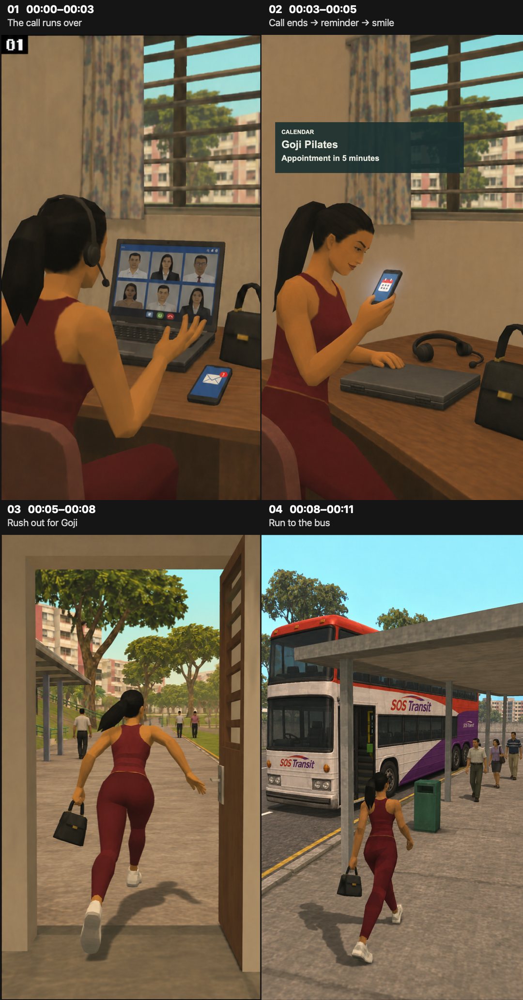
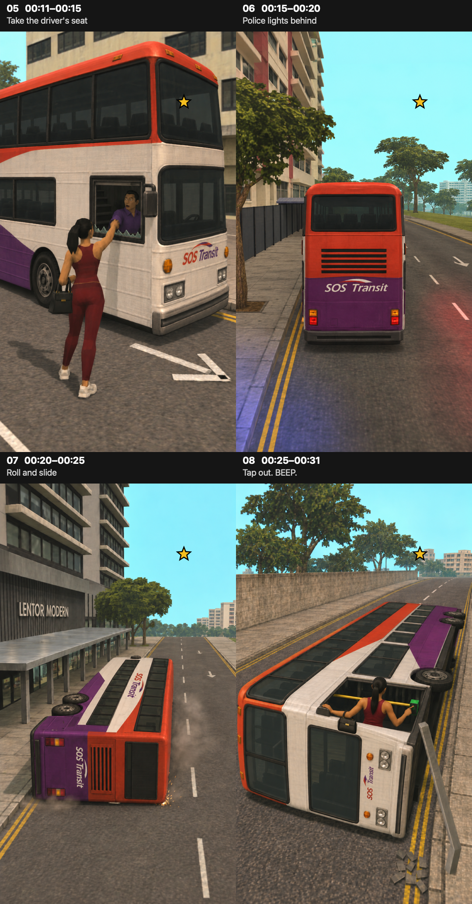
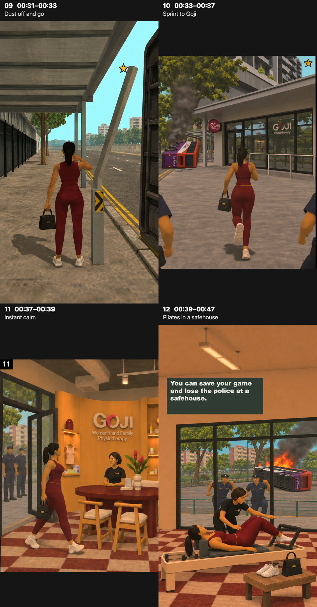
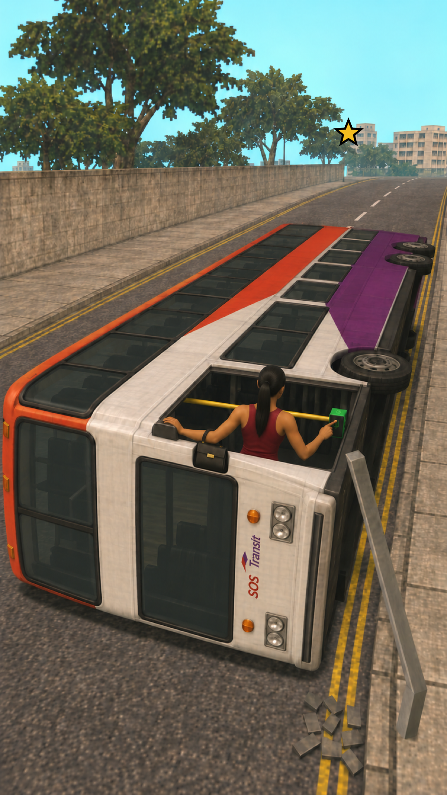

# Revision 7 — reminder, canonical bus and PS2 look frames

[Full storyboard and timed script](../README.md) ·
[Approved SOS-BUS-01 reference](../../references/sos-bus-01/README.md)

The user confirmed that the Goji calendar reminder arrives **after** ending the
frustrating call, at04–05s. She smiles, then rushes out at05–08s. The earlier angry
headset/laptop beat is retained. Panel02 depicts the smile/reminder moment.

## Current storyboards

## Vehicle reference and geometry

The user approved the generated rounded double-decker as **SOS-BUS-01**, to be
used like a character reference. It is a bespoke bus inspired by the supplied
GTA SA coach detail benchmark and Singapore livery photo; it is not a game asset
extracted from Rockstar. It controls appearance, while the shared Blender scene
controls cameras, lane, pose and contacts.

The master has a rounded roof cap/body corners, fitted window gaskets, boolean
wheel-arch openings, profiled tyres, recessed rims and hubs, twin lamp housings,
continuous bumpers, panel seams, compact mirrors and SOS swooshes. All features
are attached to one chassis. Two decks and three axles remain fixed.

[Blender master](blender/double-decker-master.blend) ·
[Transforms/bounds](blender/continuity-record.json) ·
[Vehicle detail script](scripts/refine_vehicle.py) ·
[Direct isolated render](frames/bus-double-decker.png)

The passenger opening remains localy3.80–5.30, front plane y6.00. The 0.70m solid
front corner is highlighted green in the control guide; magenta marks the only
opening footprint. In the selected art it returns to white bodywork. Girl faces
away; bag left, reader/pole rotated with chassis. These are appearance concepts,
not a claim of exact correspondence at every pixel or finished motion.

[Colour-coded guide](frames/08-door-control.png) ·
[Unmarked geometry guide](frames/08-direct.png)

## Review and rejected attempts

- The initial texture-over-blockout attempts were superseded after the user
  identified oversimplified vehicle shapes. They are not selected.
- The first detailed05 added a false nearby axle; corrected to one visible
  front wheel, with the distant tandem pair outside that crop.
- The first detailed07 added a fourth wheel; corrected to three.
- The first detailed09 showed an upright bus edge; replaced with the rolled
  vehicle's charcoal undercarriage edge.
- Initial detailed08 and its first correction extended the opening into the
  nose. A new colour-coded Blender guide resolved the solid corner boundary.
  The resulting front-facing player was then corrected to the rear-player view.
  The user approved the doorway; the final logo-only edit moves the front decal
  entirely onto white nose bodywork, clear of the windscreen. The Blender front
  logo anchor was lowered/scaled to maintain the same boundary.
- 10 and12 retain their compositions and facade/interior, with the distant wreck
  updated using the canonical bus and matching rolled references.

[Exact prompts, inputs and input hashes](generation-record.json) ·
[Selected source mapping](selected-sources.json) · [Validation](validation.json)

The built-in image generator produced the look frames; exact model version and
per-image cost were not exposed. Raw generated outputs remain at the source
paths in the take log. Selected originals are copied here before native overlays
and board assembly. Safehouse copy stays editable and unchanged; the new calendar
reminder is also an editable overlay. No video was rendered this revision.
