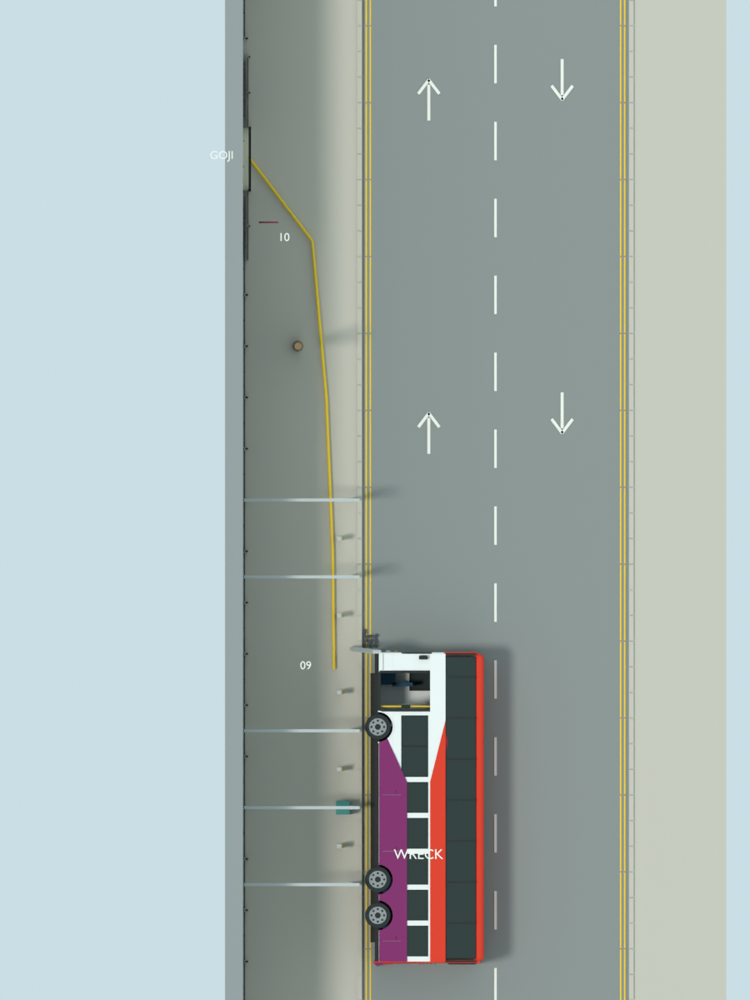
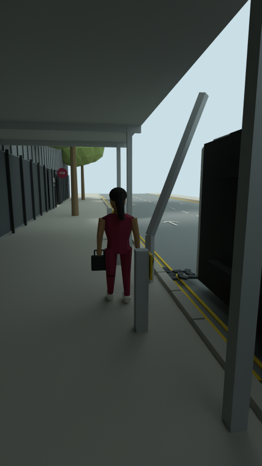
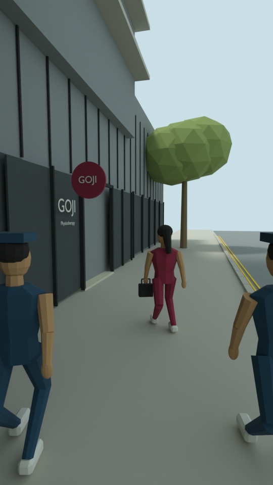
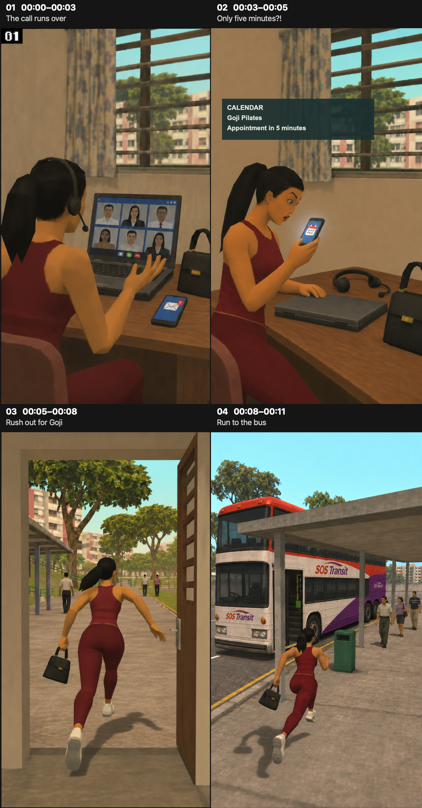
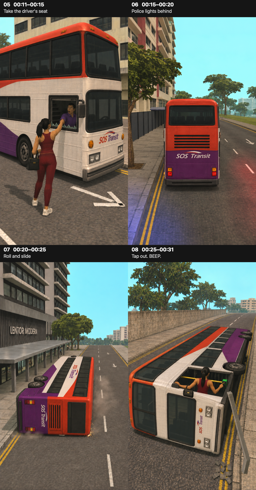
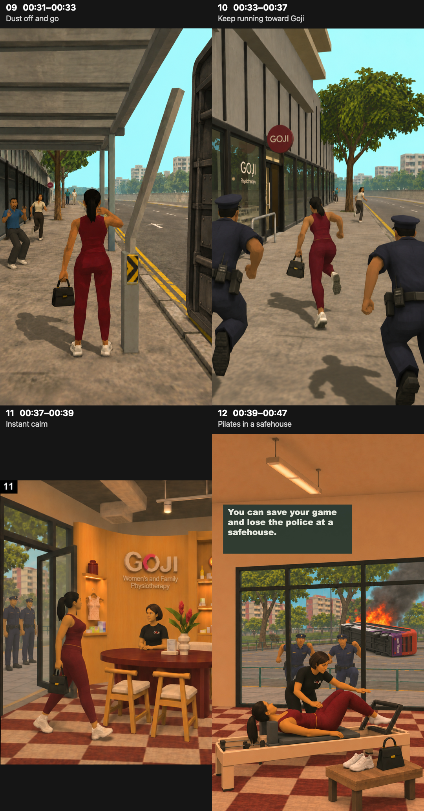

# Revision8 — urgency and a grounded forward route

[Full storyboard and script](../README.md).

- Calendar overlay uses33px Arial Bold on all three lines.
- Scene02 changes smile to surprise at an appointment only five minutes away.
- Scene04 changes walking to a running stride, preserving the approved bus.
- Wanted stars are absent from every selected panel; add them with gameplay UI
  in post. Calendar and safehouse overlays remain editable review copy.
- Scene09 establishes the distant Goji sign ahead-left. Scene10 advances along
  the same pavement, with two pursuing officers and the wreck behind camera.

## Blender route

[Editable scene](blender/route-09-10.blend) · [Route record](blender/route-record.json)

The frozen bus matrix matches the prior wreck. Player y increases from5.4 to22.1,
clinic y is25.3, and camera10 y is17.3. All bus vertices have negative forward
camera depth in10; the nearest is roughly11m behind that camera. This validates
which side of the camera the wreck occupies; styled frames remain interpretations
of the staging, not exact pixel projections. Route geography is fictional.

## Selected boards

The approved doorway/front-logo correction and SOS-BUS-01 vehicle reference are
retained. 05, 06 and 08 use the prior clean originals, without their native star overlay.
07, 09 and 10 add reacting pedestrians from fixed Blender crowd marks.
09 has a small destination sign added;10 is rebuilt from the new Blender guide.
No complete episode or new motion animation was rendered.

## Crowd update

Four recurring extras recoil, look back and hurry clear; none is hit. The
crash pair stay by the shopfront beyond the bus; the clinic pair stay beyond
the entrance. The central sprint corridor remains empty.

[Editable crowd scene](blender/route-with-pedestrians.blend) ·
[Clearance record](blender/pedestrian-record.json) ·
[Exact crowd prompts and attempts](crowd-generation-record.json)

The clearance checks concern staging envelopes, not completed animation. Two
attempts were rejected for crowd placement too close to the bus or doorway.
Selected frames retain the bus geometry, player direction and clean artwork.

[Exact image-edit prompts and inputs](generation-record.json) ·
[Checks and asset hashes](validation.json) · [Shot plan](../camera-plan-v8.json)
