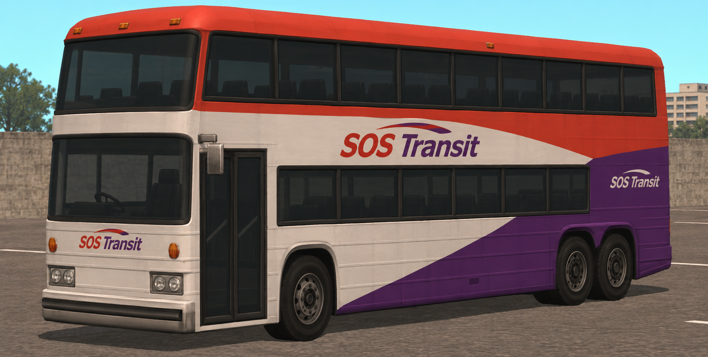

# SOS-BUS-01 — canonical bus reference

**User-approved appearance reference · version 1 · 25 November 2026**

Use this image as a recurring vehicle identity reference, just as Goji Girl has a character reference. It controls the rounded body/roof, inset glazing and seals, shaped arches, detailed tyres/rims, fitted lamps/bumpers, trim, SOS Transit wordmark/swoosh and orange-red/purple/white livery. It supersedes the crude box-shaped bus as the appearance authority.

Blender remains the spatial authority for camera, road side, chassis pose, front passenger doorway and reader contacts. Do not copy this presentation camera into story shots, move the doorway into the front facade, add axles, or infer extra approved viewpoints. There are two decks, three axles, right-hand driving and left-side passenger entry.

[Approval and image hash](reference.json) · [All approved vehicles](../../vehicle-references/README.md)

Saved for reuse in the next episode alongside CONFRONT v3 and GRIP v2. The original canonical PNG and approval JSON were copied byte-for-byte from the Episode 2 worktree on 25 November 2026. No new image generation was performed. The original full generation prompt was not included in that canonical pack; its source description is retained in reference.json.

[Open full-size bus reference](canonical.png)
