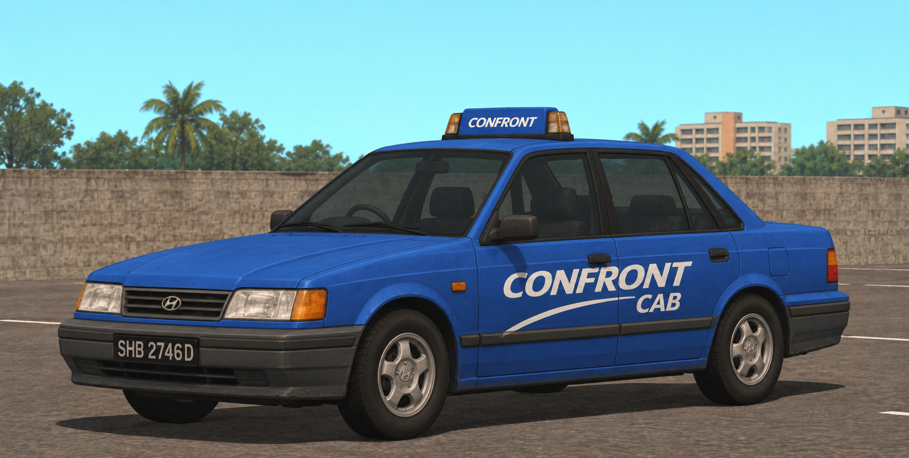

# Singapore vehicle references — CONFRONT / GRIP

Generated 25 November 2026 using the built-in image-generation tool. These are proposed vehicle appearance references for the Goji GTA series, matching the accepted SOS Transit bus look; they are not rigged 3D assets or motion/geometry validation.

## CONFRONT cab

Blue older Singapore-style sedan, white italic CONFRONT CAB door branding and CONFRONT rooftop sign.

[Open full-size CONFRONT reference](confront-cab-v1.png)

## GRIP private-hire car

White hybrid hatchback with green door/rear-quarter wrap and white double-line GRIP lettering. Plain roof; private-hire windscreen decal.

[Open full-size GRIP reference](grip-car-v1.png)

## Continuity and provenance

- Both images use the same SOS Transit bus image as the style/composition reference: `episode-02/revision-07/frames/vehicle-style-reference.png` from the active Episode 2 worktree.
- Preserve the spelling **CONFRONT** and **GRIP** in future views; preserve the taxi/private-hire roof distinction.
- Match angular game geometry, painted wear, subdued reflections and the tropical parking-lot setting.
- Singapore vehicles use right-hand driving positions. Before door-entry or driving animation, confirm seat/door anchors in the 3D asset; a single still is not a geometry test.
- Visual review: full vehicles visible, requested wordmarks readable, shared setting/rendering style, no people. GRIP's Prius-like result is a hatchback; the prompt called it a sedan but also requested a liftback silhouette.
- User approval of these new images is pending. No episode frames were replaced.
- Full generation prompts: [prompts.json](prompts.json).
