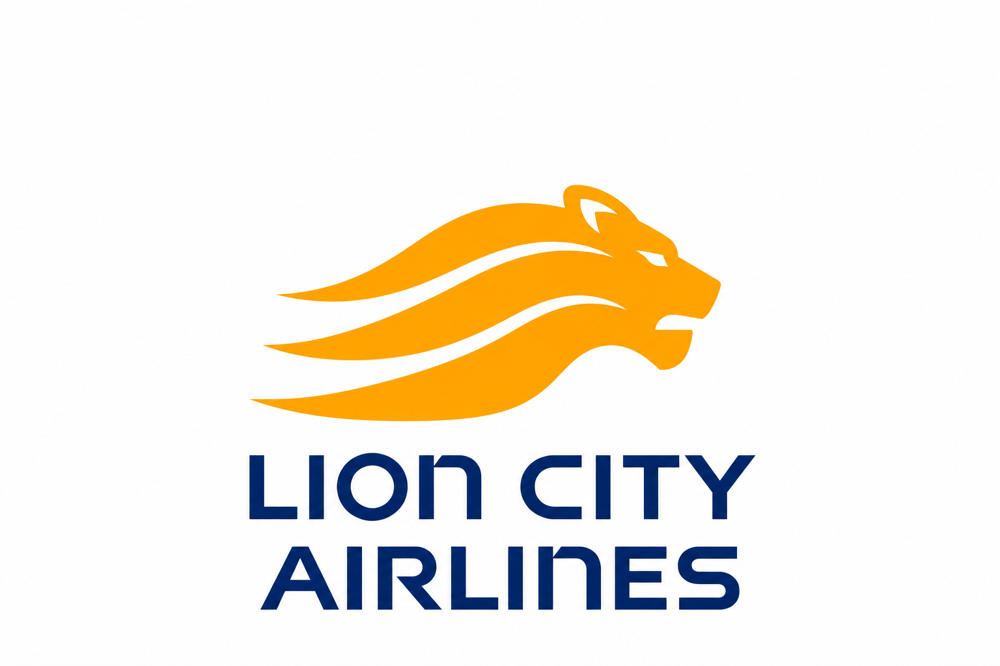
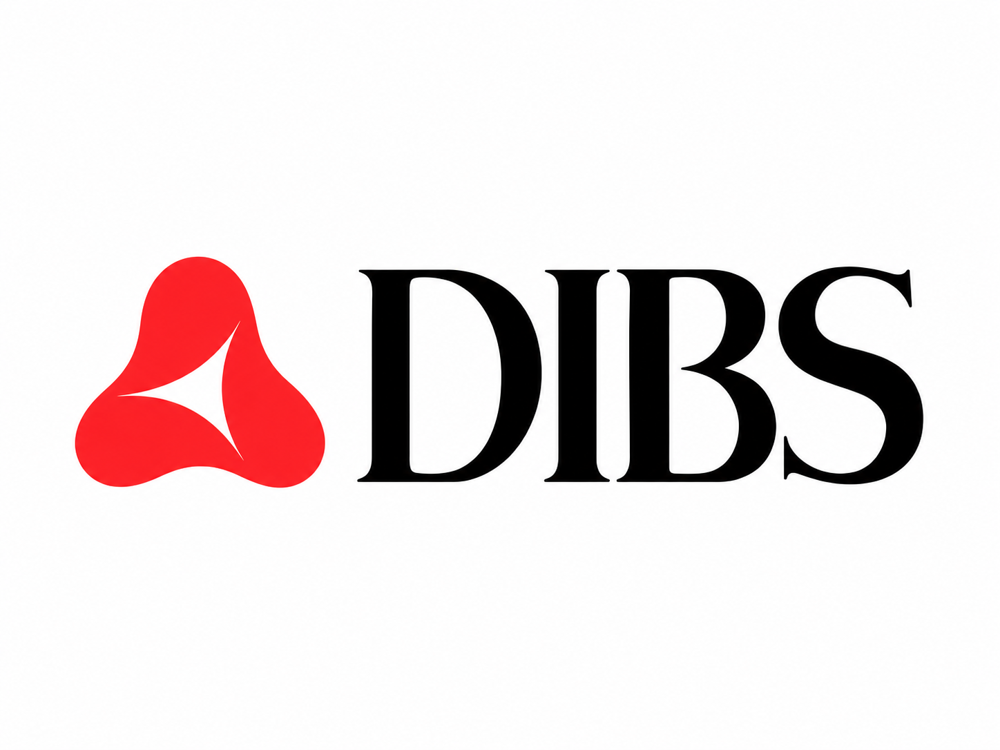
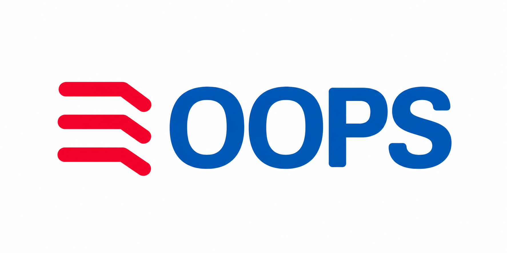
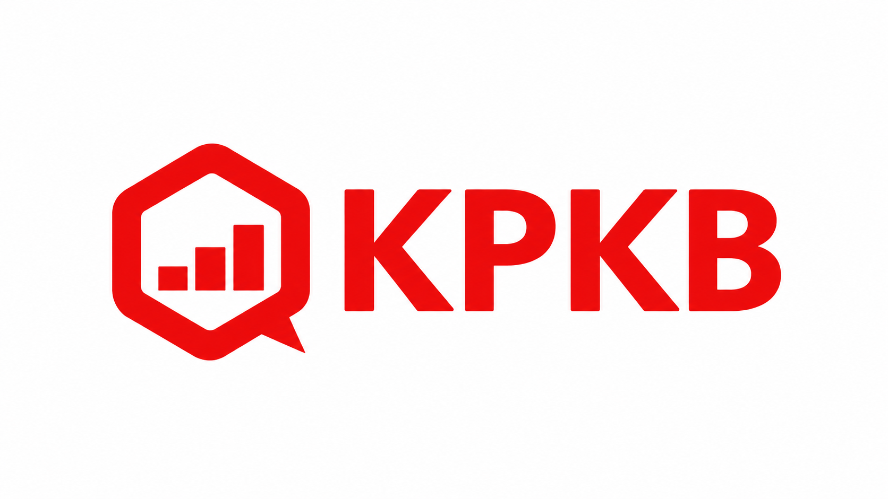
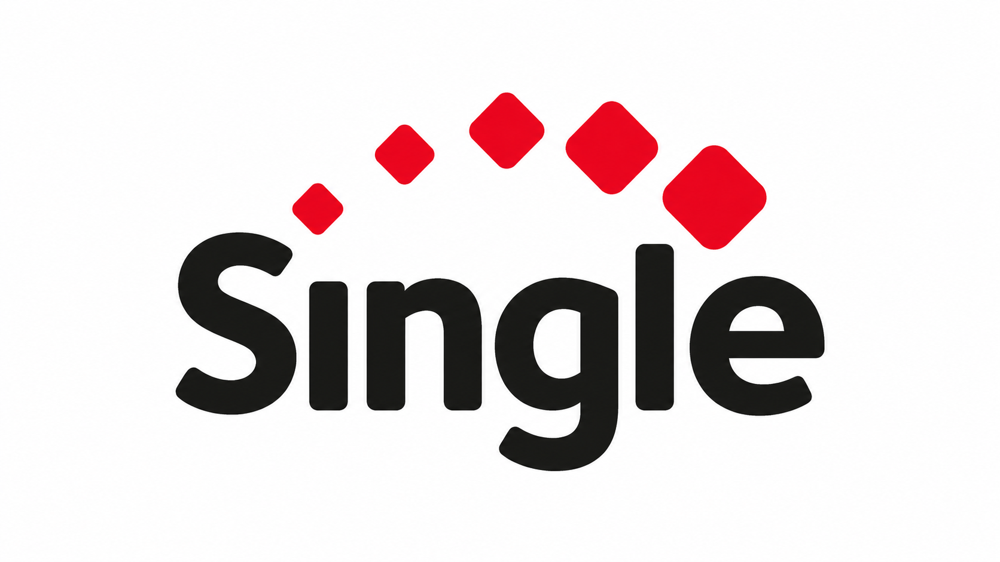
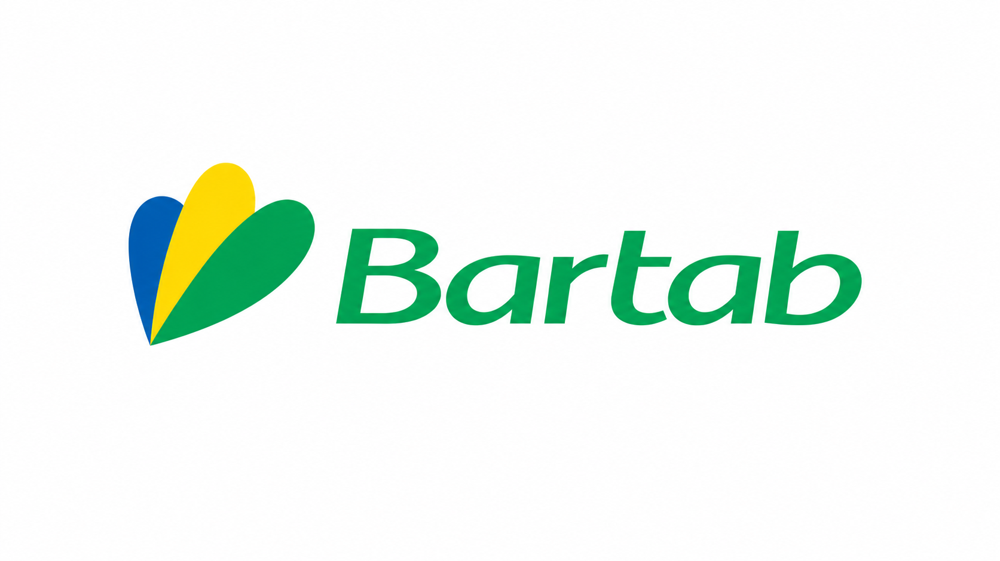
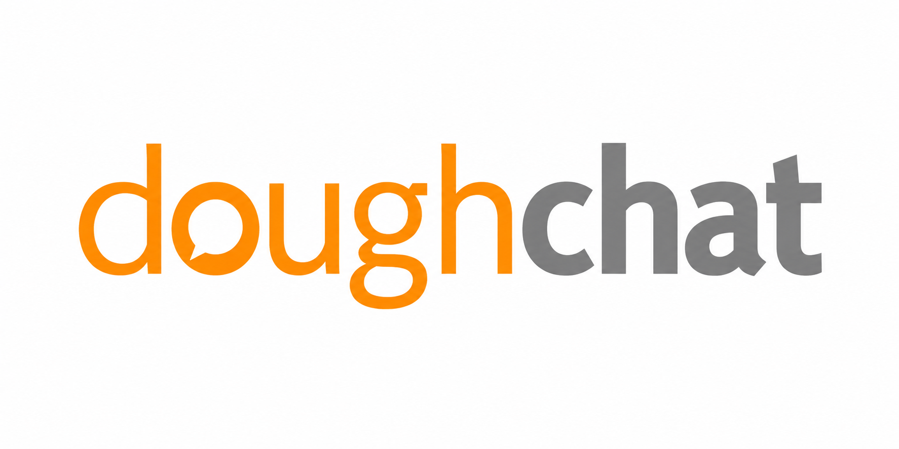

# Singapore fictional brands — shape revision

Seven proposed identities for the Goji GTA-style Singapore world. The user-selected names and familiar colour/lettering cues are retained; the principal symbols have new silhouettes. These are review concepts, not approved series canon.

Selected masters are white-background PNGs. Original corporate logos were visual research references; they are not production assets.

Created using the built-in image generator. [Exact prompts and provenance](prompts.json). Earlier wordmark bases used as edit inputs are stored in reference-inputs/.

## Lion City Airlines

Gold lion profile with three swept horizontal mane bands; navy geometric airline lettering.

[Download PNG](lion-city-airlines.png) · [Visual reference: Singapore Airlines](https://www.itmaasiasingapore.com/plan-your-trip/official-airline)

## DIBS

Red three-lobed triangular emblem; black serif lettering.

[Download PNG](dibs.png) · [Visual reference: DBS](https://logowik.com/dbs-bank-vector-logo-6049.html)

## OOPS

Three bent red horizontal bars; blue bold lettering.

[Download PNG](oops.png) · [Visual reference: UOB](https://www.uob.com.my/about/story/our-logo.page)

## KPKB

Red hexagonal speech badge containing three ascending blocks; red bold lettering.

[Download PNG](kpkb.png) · [Visual reference: OCBC](https://brandripe.com/blog/88/the-principle-of-design-behind-8-of-southeast-asias-top-banks-logos)

## Single

Five red rounded diamond tiles; black rounded lettering.

[Download PNG](single.png) · [Visual reference: Singtel](https://www.addx.co/en/investments/singtel/)

## Bartab

Blue, yellow and green three-petal fan; green italic lettering.

[Download PNG](bartab.png) · [Visual reference: StarHub (older three-colour identity)](https://liveatpc.com/no-more-cable-services-for-singaporeans/)

## doughchat

Orange dough + grey chat; speech-bubble counter in the o.

[Download PNG](doughchat.png) · [Visual reference: BreadTalk](https://www.payalebarquarter.com/siteassets/paya-lebar-quarter/breadtalklogo.jpg?mode=max&quality=80&upscale=false&width=400)
