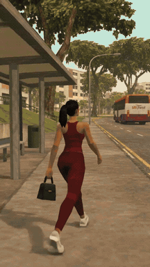

# Goji reel — animated prototype

**20 seconds · vertical · no background music.** Rendered locally on Tidepool using LTX-2.5.

**[Download/watch the effects-only MP4](goji-20s-sfx-no-music.mp4)** · **[Silent MP4 for adding music](goji-20s-silent.mp4)**

## Mobile preview

The lightweight animation below plays directly on GitHub. It is silent and reduced to 8 fps; the MP4s have the full edit and 30 fps playback.

## Editing files

- [Download the editing pack ZIP](goji-animation-editing-pack.zip) — source clips, sound stems, prompts and scripts
- [Individual animated clips](clips/)
- [Effects-only WAV](audio/goji-sfx-only.wav)
- Separate stems: [footsteps](audio/footsteps.wav), [vehicles](audio/vehicles.wav), [impact](audio/impact.wav), [interior](audio/interior.wav), [UI notifications](audio/ui.wav)
- [Sound cue sheet](audio/cue-sheet.json)
- [Exact prompts, seeds and keyframes](jobs.json)
- [Local rendering and editing scripts](scripts/)
- [Approved storyboard V5 and stat overlays](../v5/README.md)

## The cut

| Time | Scene |
|---|---|
| 0–1.8s | Swagger away from the SBS bus |
| 1.8–3.6s | Pull the driver from the taxi; he lands unharmed |
| 3.6–5.5s | Rear-chase driving |
| 5.5–6.4s | Approach and hard lamp-post impact, compact damage |
| 6.4–7.4s | Cut to forward flight beyond the front windscreen |
| 7.4–9.4s | Run to the yellow entry cone |
| 9.4–9.8s | Fade to black |
| 9.8–11.5s | Calm reception entry |
| 11.5–15s | Slow reformer press and return |
| 15–20s | Peaceful mat side stretch; Strength at 18.3s and Mobility at 19.1s |

The ejection uses a cut at the moment of exit: the next shot starts with her already airborne in front of the taxi. The first interpolation incorrectly raised her through the roof and was rejected. The final version keeps the same rear viewpoint. An extra pre-impact still anchors the taxi's approach to the pole. Minor AI motion and geometry drift remain; this is an editable prototype.

## Sound

No music, voiceover or dialogue. The original effects use a dry, punchy PS2-era game treatment: footsteps, door clacks, rising engine, tyre squeal, metal impact, glass and short UI notifications. They are stylistic recreations, not extracted GTA recordings. The interior is intentionally quiet. The silent master contains no audio stream, so music and effects can be mixed independently in post.

## Local model and installation

**Selected:** LTX-2.5 Distilled, 8-bit transformer, native MLX / Metal. This was the best fit found for this short, keyframe-driven project; it is not a universal model ranking. Multi-image anchors and repeatable short renders were more useful here than dialogue-focused features or a larger install.

[Official model](https://huggingface.co/Lightricks/LTX-2.5) · [Mac engine](https://github.com/dgrauet/ltx-2-mlx) · [Installed versions](setup.json) · [Per-shot render results](render-results.json)

Installed on Tidepool: ltx-2-mlx 0.18.0 in an isolated Python environment, MLX 0.32.2, FFmpeg 9.0.2 and approximately 50 GiB of model components. Community model conversions: [base components](https://huggingface.co/notapalindrome/ltx25-mlx) and [Q8 transformer](https://huggingface.co/notapalindrome/ltx25-mlx-ditq8). Exact model revisions and engine commit are in setup.json. No paid cloud video generation was used.

The Mac mini M5 Pro has 64 GB unified memory. Native video generation is **576×1024 at 24 fps**. Masters are **1080×1920 at 30 fps**, upscaled and conformed in FFmpeg; they are not native 1080p generations. Source stills were made with the built-in image tool. All animation was generated locally.

This AI-generated game-fiction prototype uses fictional characters and stats. Goji equipment and location appearance follow the approved real-world references; the road and stunt staging are illustrative.
