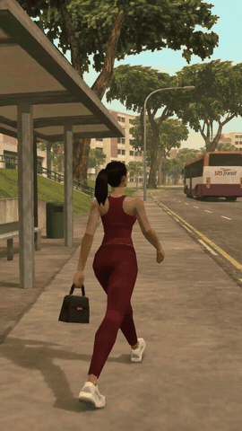

# Goji reel — local animation

**Status: opening test rendered and checked; remaining shots rendering on Tidepool.**

## Opening animation test

[Open/download the MP4](01-swagger.mp4)

This is actual local image-to-video generation, not a moving still. The first 49-frame render took 67.5 seconds on Tidepool’s M5 Pro / 64 GB.

## Selected model

LTX-2.5 Distilled with an 8-bit transformer, running natively through MLX / Metal. Selected for this storyboard’s image anchors, multiple keyframes and repeatable short-shot workflow. Model download and local engine installation are complete.

[Official model](https://huggingface.co/Lightricks/LTX-2.5) · [Mac engine](https://github.com/dgrauet/ltx-2-mlx) · [Installed setup and versions](setup.json)

Native generation: 576×1024 at 24 fps. Planned master: 1080×1920 at 30 fps, upscaled. Nine animated clips will be trimmed to the approved 20-second timeline.

## Audio

No background music. Video generation runs with audio disabled. Original, dry PS2-era game-style effects are mixed separately: footsteps, door clacks, engine rev, tyre squeal, crash, glass and short UI stat sounds. These are recreations, not sampled GTA audio. Quiet interior section; effects-only and silent masters plus separate stems will be included after rendering.

[Approved storyboard V5](../v5/README.md)
