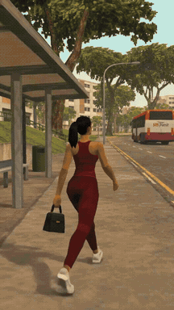
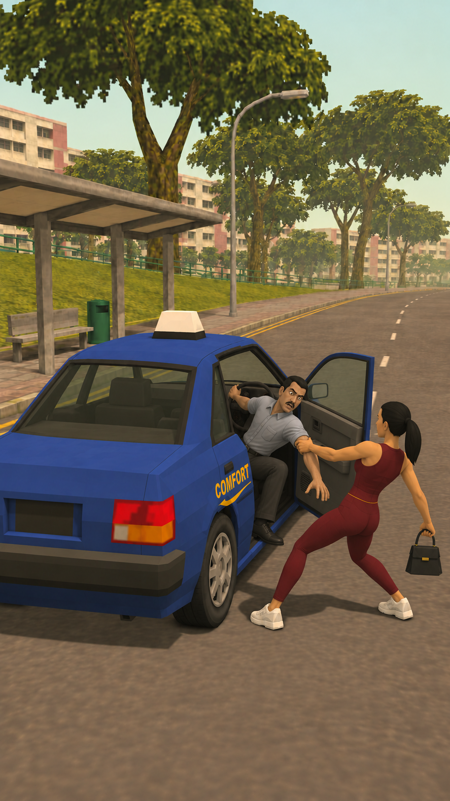
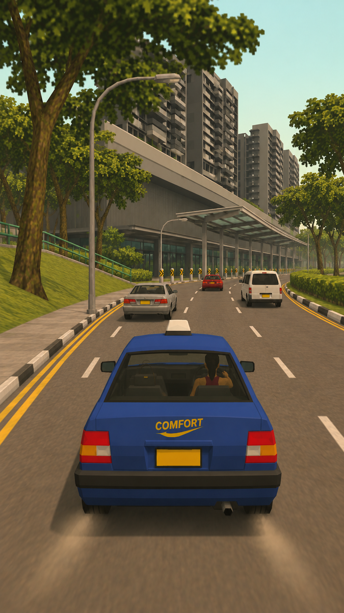
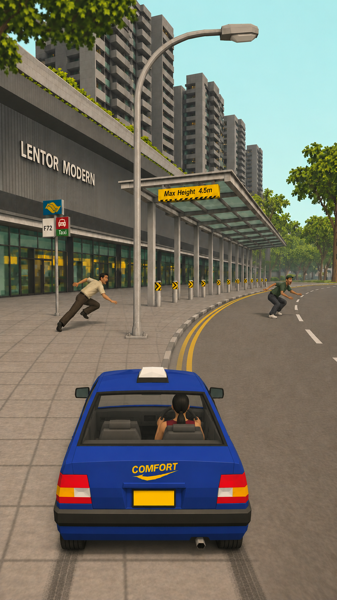
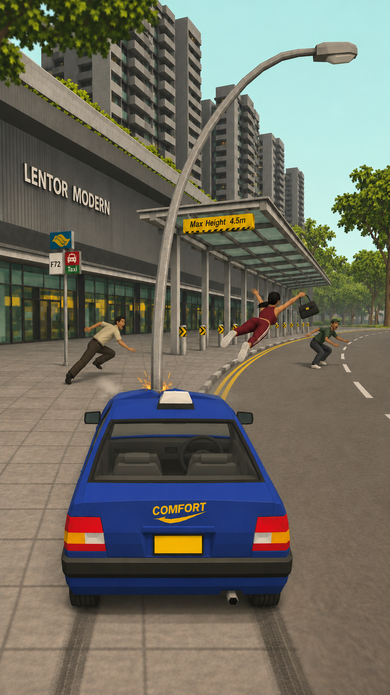
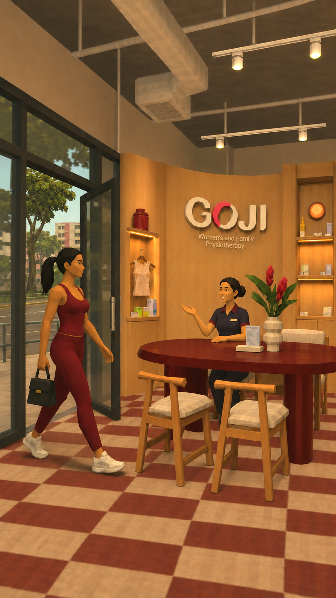
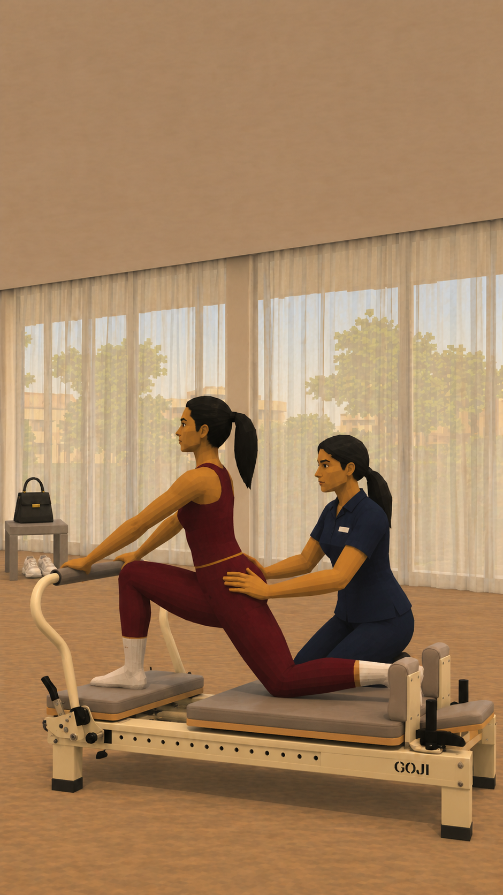
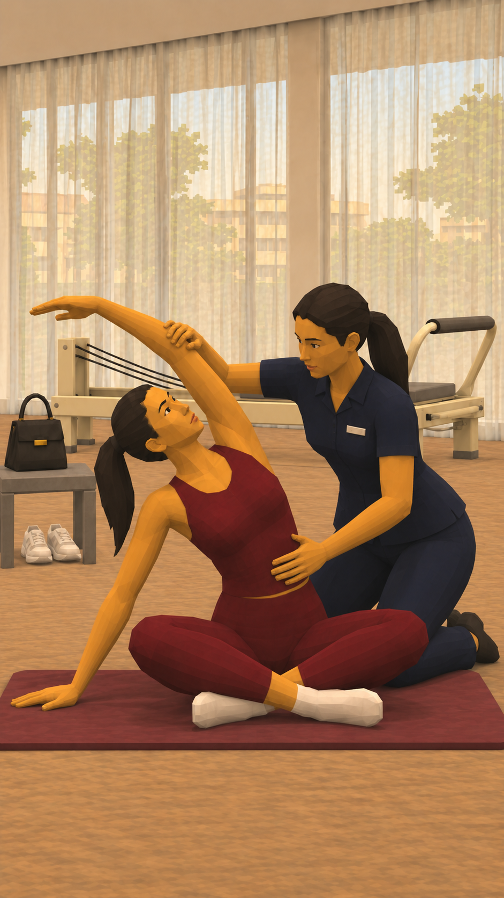

# Goji GTA-style reel — animation v2

[**Play / download the 29.5s cut with sound effects**](https://raw.githubusercontent.com/gojiphysio/goji/codex/goji-reel-mobile-handoff/marketing/assets/goji-reel-prototype/animation-v2/goji-v2-sfx-no-music.mp4) · [Silent cut for adding music](https://raw.githubusercontent.com/gojiphysio/goji/codex/goji-reel-mobile-handoff/marketing/assets/goji-reel-prototype/animation-v2/goji-v2-silent.mp4) · [Editing pack](https://raw.githubusercontent.com/gojiphysio/goji/codex/goji-reel-mobile-handoff/marketing/assets/goji-reel-prototype/animation-v2/goji-v2-editing-pack.zip)

1080 × 1920, 30 fps. No background music. The GIF below is a small silent 8 fps preview; use the MP4 to judge speed and sound.

## Changes in this pass

- Taxi takeover uses one continuous generated action instead of interpolating three different taxi drawings.
- Driving has six seconds in the edit, accelerated from a longer source take, with traffic and stronger evasive-action direction.
- Driving, impact and ejection use scene 3’s pale teal sky, green foliage and daylight. Matching crash keyframes share the same two bystanders.
- Reception includes a seated Goji team member welcoming the player.
- Reformer pose follows the actual Goji photo: kneeling lunge, hands on footbar, front foot on fixed platform and rear knee on carriage. The therapist supports the pelvis.
- Mat stretch has the therapist guiding the raised arm and stabilising the waist. Eleven seconds of gentle assisted movement give the calm section breathing room.
- Original dry game-style engines, traffic horns, skids and impact effects cut to quiet at the loading transition. No music or extracted GTA sound samples.

## Edit timing

| Time | Shot |
|---|---|
| 0.0–1.8s | Swagger |
| 1.8–5.3s | Continuous taxi takeover |
| 5.3–11.3s | Fast traffic weaving |
| 11.3–12.2s | Lamp-post impact |
| 12.2–13.6s | Ejection and evasive passersby |
| 13.6–15.6s | Yellow entry cone |
| 15.6–16.0s | Black loading transition |
| 16.0–18.5s | Seated welcome |
| 18.5–23.5s | Assisted kneeling reformer lunge |
| 23.5–29.5s | Assisted mat side stretch |

## Individual clips and revised frames

The individual clips use native 24 fps timing. Rejected takeover and ejection tails have been removed; longer driving and physio takes retain handles. The edited MP4 uses faster outdoor timing; see [edit manifest](edit-timeline.json). These are editable AI prototype shots, not a physically simulated game scene.

### 01-swagger

[Source clip](https://raw.githubusercontent.com/gojiphysio/goji/codex/goji-reel-mobile-handoff/marketing/assets/goji-reel-prototype/animation-v2/clips/01-swagger.mp4)

### 02-takeover

[Source clip](https://raw.githubusercontent.com/gojiphysio/goji/codex/goji-reel-mobile-handoff/marketing/assets/goji-reel-prototype/animation-v2/clips/02-takeover.mp4)

### 03-drive

[Source clip](https://raw.githubusercontent.com/gojiphysio/goji/codex/goji-reel-mobile-handoff/marketing/assets/goji-reel-prototype/animation-v2/clips/03-drive.mp4)

### 04-impact

[Source clip](https://raw.githubusercontent.com/gojiphysio/goji/codex/goji-reel-mobile-handoff/marketing/assets/goji-reel-prototype/animation-v2/clips/04-impact.mp4)

### 05-ejection

[Source clip](https://raw.githubusercontent.com/gojiphysio/goji/codex/goji-reel-mobile-handoff/marketing/assets/goji-reel-prototype/animation-v2/clips/05-ejection.mp4)

### 06-marker

[Source clip](https://raw.githubusercontent.com/gojiphysio/goji/codex/goji-reel-mobile-handoff/marketing/assets/goji-reel-prototype/animation-v2/clips/06-marker.mp4)

### 07-entry

[Source clip](https://raw.githubusercontent.com/gojiphysio/goji/codex/goji-reel-mobile-handoff/marketing/assets/goji-reel-prototype/animation-v2/clips/07-entry.mp4)

### 08a-reformer

[Source clip](https://raw.githubusercontent.com/gojiphysio/goji/codex/goji-reel-mobile-handoff/marketing/assets/goji-reel-prototype/animation-v2/clips/08a-reformer.mp4)

### 08b-mat

[Source clip](https://raw.githubusercontent.com/gojiphysio/goji/codex/goji-reel-mobile-handoff/marketing/assets/goji-reel-prototype/animation-v2/clips/08b-mat.mp4)

## Source and reproducibility

[Animation prompts and seeds](jobs.json) · [Image prompts](assets/all-image-prompts.json) · [Model setup](setup.json) · [Render results](render-history.jsonl) · [Audio cue sheet](audio/cue-sheet.json) · [Scripts](scripts)

Keyframe revisions used the built-in image generator. Motion was generated locally on Tidepool using the existing LTX-2.5 distilled Q8 MLX installation. No new model download was needed. The editing ZIP contains individual source clips, five SFX stems, mix, manifests and scripts; master MP4s and keyframes are separate links to avoid duplicating large media.

The actual Goji pose and equipment reference is [the private-Pilates photo](../v5/references/goji-reformer-actual.webp). The characters are fictional. Lentor and Goji references ground the staging; the road geometry, traffic, lamp-post collision and antics remain fictional gameplay.

## Review notes

Reviewed frame sequences for every revised shot. The takeover is a slapstick pull-and-tumble, then a cut into driving; it does not show the full seat-entry action. The crash-to-ejection cut carries the windscreen exit rather than showing glass traversal continuously. These remain prototype animation edits, not exact game-engine physics.

Selected clip trims remove a late duplicated character in the takeover and an unwanted taxi restart at the end of the ejection take. The exported individual clips and editing pack omit those rejected tails. The original local takes remain available on Tidepool.
