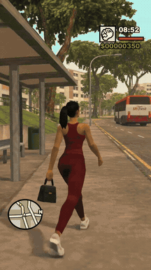
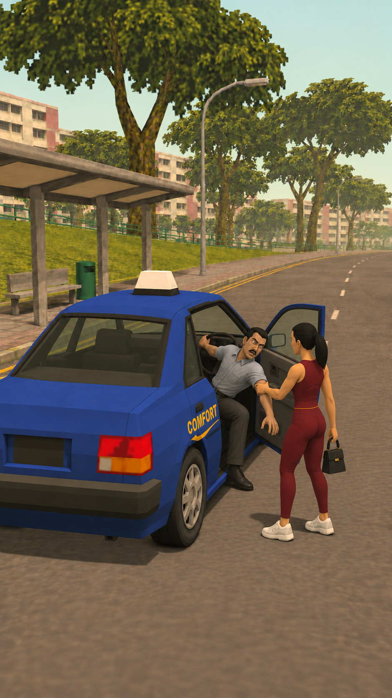
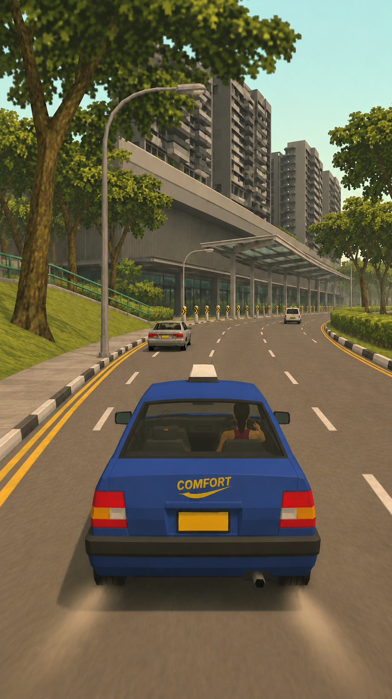
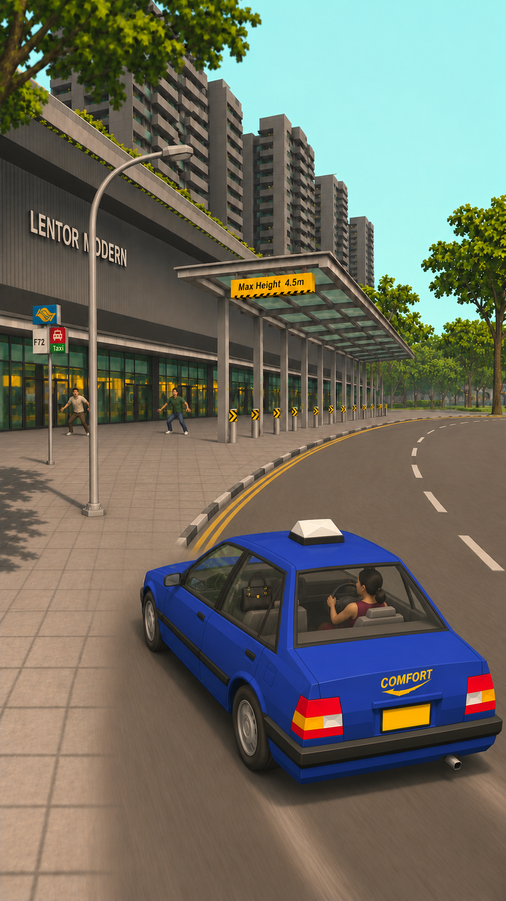
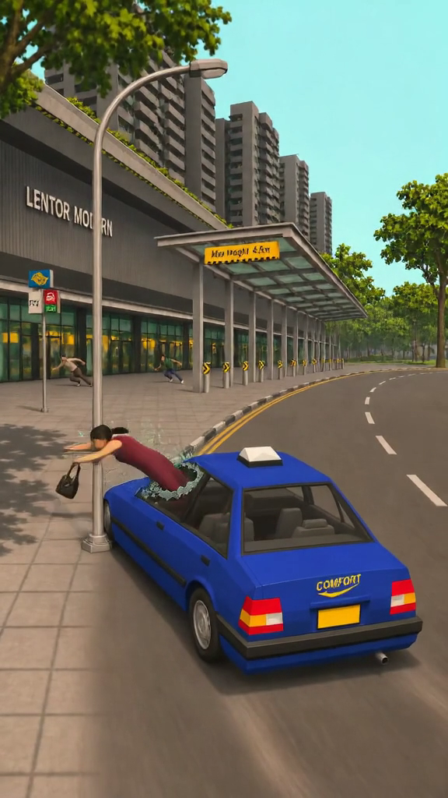
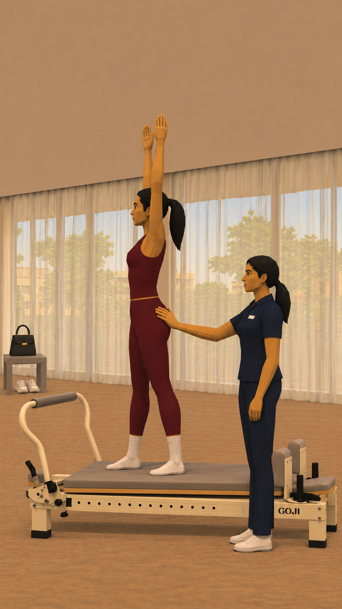
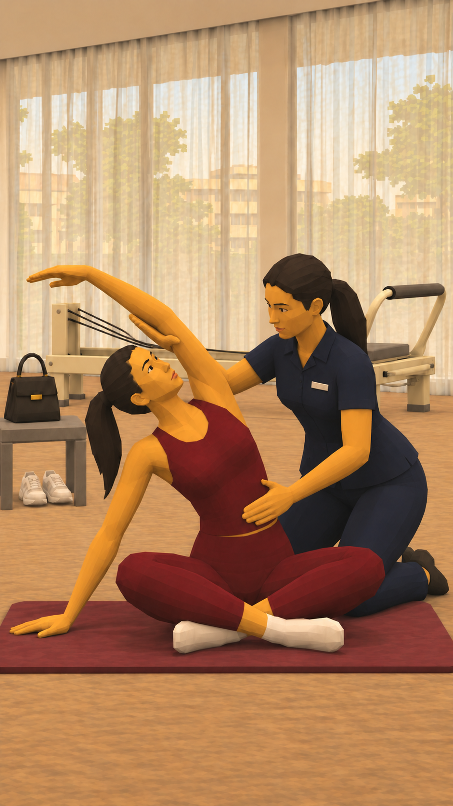
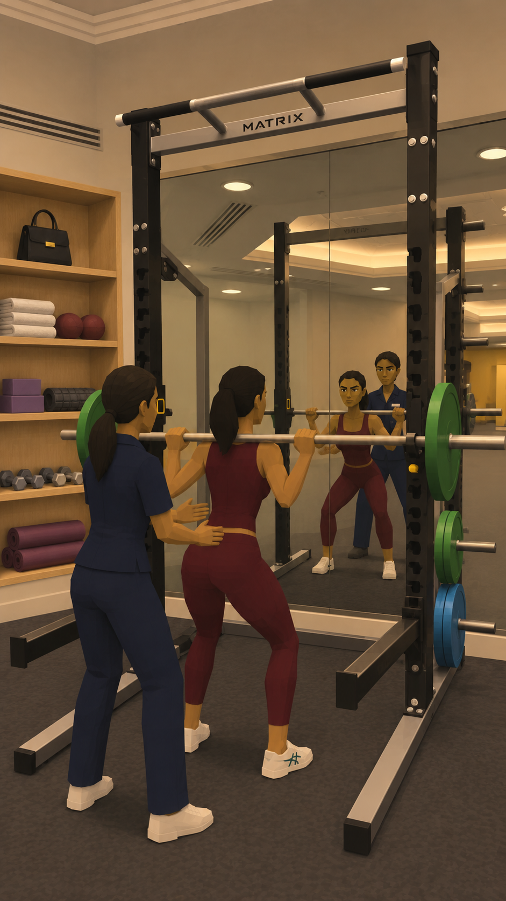

# Goji reel — revised action and squat-rack ending

[**Watch / download the 43.2s cut with SFX**](https://raw.githubusercontent.com/gojiphysio/goji/codex/goji-reel-mobile-handoff/marketing/assets/goji-reel-prototype/animation-v4/goji-v4-ui-sfx.mp4) · [Silent UI cut](https://raw.githubusercontent.com/gojiphysio/goji/codex/goji-reel-mobile-handoff/marketing/assets/goji-reel-prototype/animation-v4/goji-v4-ui-silent.mp4) · [Editing pack](https://raw.githubusercontent.com/gojiphysio/goji/codex/goji-reel-mobile-handoff/marketing/assets/goji-reel-prototype/animation-v4/goji-v4-editing-pack.zip)

1080 × 1920 · 30 fps · no music. GIF is a small silent 8 fps preview; judge movement and sound using the MP4.

**Latest correction:** the player stands on the stationary reformer. [Watch the reformer clip](https://raw.githubusercontent.com/gojiphysio/goji/codex/goji-reel-mobile-handoff/marketing/assets/goji-reel-prototype/animation-v4/clips/08a-warrior.mp4).

## Changes

- Takeover follows her upright pull, pivot, step into the driver seat and door closure. Driver remains visible outside.
- Lighter traffic; ordinary cars mostly continue along their lanes while the taxi weaves past.
- Moving approach before contact; the impact shot carries her from the seat into the front windscreen exit. The following shot starts from its actual final frame.
- Recovery continues from the preceding shot's actual frame so the player can get up and run before the entrance marker.
- Player transitions from overhead reach to Warrior II **on the reformer**, with its carriage, frame and footbar stationary. Therapist supports her hip from the floor.
- Mat support uses a simpler palm and finger arrangement.
- New six-second spotted squat, matching the six-second mat scene. Black MATRIX rack, mirror, safety arms and plate storage follow the supplied photo; the left window is replaced with oak shelving. Fictional player and therapist replace the people in the reference. The supplied original photo is retained locally and not republished.
- GTA SA-style UI remains separate. Gameplay HUD hides indoors; the reference-worded Body Muscle popup moves to the squat-rack ending. No music.

## Timing

| Time | Action |
|---|---|
| 0.0–1.8s | Swagger |
| 1.8–6.8s | Pull driver clear and enter taxi |
| 6.8–12.8s | Sparse traffic, aggressive player driving |
| 12.8–15.8s | Moving approach, pole impact and ejection |
| 15.8–20.3s | Get up and run toward mall |
| 20.3–22.3s | Yellow entrance cone |
| 22.3–22.7s | Loading transition |
| 22.7–25.2s | Seated Goji welcome |
| 25.2–31.2s | Overhead stretch to Warrior II on static reformer |
| 31.2–37.2s | Assisted mat stretch |
| 37.2–43.2s | Spotted squat at reference rack |

## Individual clips

Native 24 fps clips are provided for editing, without HUD. Selected trims are recorded in the [edit timeline](edit-timeline.json). The assembled cut retimes outdoor action.

### Swagger

[Download clip](https://raw.githubusercontent.com/gojiphysio/goji/codex/goji-reel-mobile-handoff/marketing/assets/goji-reel-prototype/animation-v4/clips/01-swagger.mp4)

### Pull driver clear and enter taxi

[Download clip](https://raw.githubusercontent.com/gojiphysio/goji/codex/goji-reel-mobile-handoff/marketing/assets/goji-reel-prototype/animation-v4/clips/02-takeover.mp4)

### Sparse traffic, aggressive player driving

[Download clip](https://raw.githubusercontent.com/gojiphysio/goji/codex/goji-reel-mobile-handoff/marketing/assets/goji-reel-prototype/animation-v4/clips/03-drive.mp4)

### Moving approach, pole impact and ejection

[Download clip](https://raw.githubusercontent.com/gojiphysio/goji/codex/goji-reel-mobile-handoff/marketing/assets/goji-reel-prototype/animation-v4/clips/04-crash-eject.mp4)

### Get up and run toward mall

[Download clip](https://raw.githubusercontent.com/gojiphysio/goji/codex/goji-reel-mobile-handoff/marketing/assets/goji-reel-prototype/animation-v4/clips/05-recovery.mp4)

### Yellow entrance cone

[Download clip](https://raw.githubusercontent.com/gojiphysio/goji/codex/goji-reel-mobile-handoff/marketing/assets/goji-reel-prototype/animation-v4/clips/06-marker.mp4)

### Seated Goji welcome

[Download clip](https://raw.githubusercontent.com/gojiphysio/goji/codex/goji-reel-mobile-handoff/marketing/assets/goji-reel-prototype/animation-v4/clips/07-entry.mp4)

### Overhead stretch to Warrior II on static reformer

[Download clip](https://raw.githubusercontent.com/gojiphysio/goji/codex/goji-reel-mobile-handoff/marketing/assets/goji-reel-prototype/animation-v4/clips/08a-warrior.mp4)

### Assisted mat stretch

[Download clip](https://raw.githubusercontent.com/gojiphysio/goji/codex/goji-reel-mobile-handoff/marketing/assets/goji-reel-prototype/animation-v4/clips/08b-mat.mp4)

### Spotted squat at reference rack

[Download clip](https://raw.githubusercontent.com/gojiphysio/goji/codex/goji-reel-mobile-handoff/marketing/assets/goji-reel-prototype/animation-v4/clips/09-squat.mp4)

## Editing and reproducibility

[Animation prompts](jobs.json) · [Selected keyframe prompts](assets/selected-keyframe-prompts.json) · [Earlier prompt history](assets/image-prompts.json) · [Overlay timing](overlay-timing.json) · [PNG/SVG overlays](overlays) · [SFX stems](audio) · [Local model setup](setup.json) · [Scripts](scripts)

Built-in image generation produced revised keyframes; the existing local LTX-2.5 Q8 MLX installation generated motion on Tidepool. No new model install was required. The ending's squat rack uses the user-supplied reference. Lentor street layout and collision are fictional gameplay staging. The minimap remains illustrative, not route-tracked. Earlier versions remain available for comparison.

## Review notes

The reformer carriage, frame and footbar stay stationary while the player moves on top. The squat scene completes one controlled down-and-up repetition with the spotter following her movement.

The takeover now includes seat entry, and the crash continuation includes the landing, push-up, stand and run. The impact-to-exit handoff uses an extracted frame rather than a separately imagined starting pose.

Remaining prototype limitation: brief geometric warping is visible at the collision and during the recovery camera movement. The collision is still stylised rather than physically exact. The driver and pedestrians remain unharmed; there is no blood.
