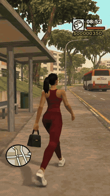

# Goji reel with door bailout

[**Watch or download the 36.8s cut**](https://raw.githubusercontent.com/gojiphysio/goji/codex/goji-reel-mobile-handoff/marketing/assets/goji-reel-prototype/animation-v5/goji-v5-ui-sfx.mp4) · [Silent version](https://raw.githubusercontent.com/gojiphysio/goji/codex/goji-reel-mobile-handoff/marketing/assets/goji-reel-prototype/animation-v5/goji-v5-ui-silent.mp4) · [Editing pack](https://raw.githubusercontent.com/gojiphysio/goji/codex/goji-reel-mobile-handoff/marketing/assets/goji-reel-prototype/animation-v5/goji-v5-editing-pack.zip)

1080 × 1920 · 30 fps · original SFX · no music. The GIF is an 8 fps preview; use the MP4 to judge motion.

## Changes

- The driver pull ends before seat entry. Forearm contact replaces the sleeve grip; the handbag is not part of the action prompt.
- The driving is trimmed before the orientation glitch. The continuation carries video context from the clean driving tail.
- The windscreen ejection is removed. The player bails out through the open driver door before the pole, followed by the retained ground recovery and run.
- Mat assistance moves down and toward screen left into a deeper stretch, with the therapist's palm above the arm.
- The stationary reformer, seated welcome, squat scene and ending popup remain.

## Continuity and model controls

[Read the LTX continuity playbook](research/LTX_PLAYBOOK.md) · [Exact continuity record](continuity.json)

The earlier version used a single extracted frame between impact and tumble, while driving-to-impact used separate references. This version tests the installed runtime's **25-frame video-tail continuation**, plus a bailout pose guide. The local distilled extension mode is experimental. The transition into the retained ground-recovery clip is an editorial action cut, not a claim of one continuous simulated take.

## Timing

| Time | Action |
|---|---|
| 0.0–1.8s | Swagger |
| 1.8–4.0s | Pull driver clear, cut before entry |
| 4.0–8.0s | Selected drive before orientation glitch |
| 8.0–9.8s | Moving approach and door bailout |
| 9.8–13.9s | Ground tumble, get up and run |
| 13.9–15.9s | Yellow entrance cone |
| 15.9–16.3s | Loading transition |
| 16.3–18.8s | Seated Goji welcome |
| 18.8–24.8s | Stretch on stationary reformer |
| 24.8–30.8s | Gentle downward-left assisted stretch |
| 30.8–36.8s | Spotted squat |

## Individual clips

- [Swagger](https://raw.githubusercontent.com/gojiphysio/goji/codex/goji-reel-mobile-handoff/marketing/assets/goji-reel-prototype/animation-v5/clips/01-swagger.mp4)
- [Pull driver clear, cut before entry](https://raw.githubusercontent.com/gojiphysio/goji/codex/goji-reel-mobile-handoff/marketing/assets/goji-reel-prototype/animation-v5/clips/02-takeover.mp4)
- [Selected drive before orientation glitch](https://raw.githubusercontent.com/gojiphysio/goji/codex/goji-reel-mobile-handoff/marketing/assets/goji-reel-prototype/animation-v5/clips/03-drive.mp4)
- [Moving approach and door bailout](https://raw.githubusercontent.com/gojiphysio/goji/codex/goji-reel-mobile-handoff/marketing/assets/goji-reel-prototype/animation-v5/clips/04-bailout.mp4)
- [Ground tumble, get up and run](https://raw.githubusercontent.com/gojiphysio/goji/codex/goji-reel-mobile-handoff/marketing/assets/goji-reel-prototype/animation-v5/clips/05-recovery.mp4)
- [Yellow entrance cone](https://raw.githubusercontent.com/gojiphysio/goji/codex/goji-reel-mobile-handoff/marketing/assets/goji-reel-prototype/animation-v5/clips/06-marker.mp4)
- [Seated Goji welcome](https://raw.githubusercontent.com/gojiphysio/goji/codex/goji-reel-mobile-handoff/marketing/assets/goji-reel-prototype/animation-v5/clips/07-entry.mp4)
- [Stretch on stationary reformer](https://raw.githubusercontent.com/gojiphysio/goji/codex/goji-reel-mobile-handoff/marketing/assets/goji-reel-prototype/animation-v5/clips/08a-warrior.mp4)
- [Gentle downward-left assisted stretch](https://raw.githubusercontent.com/gojiphysio/goji/codex/goji-reel-mobile-handoff/marketing/assets/goji-reel-prototype/animation-v5/clips/08b-mat.mp4)
- [Spotted squat](https://raw.githubusercontent.com/gojiphysio/goji/codex/goji-reel-mobile-handoff/marketing/assets/goji-reel-prototype/animation-v5/clips/09-squat.mp4)

## Editing sources

[Animation prompts](jobs.json) · [Keyframe prompts](assets/image-prompts.json) · [Overlays](overlays) · [SFX stems](audio) · [Local model setup](setup.json) · [Validation](validation.json)

Revised keyframes use the built-in image generator. Animation uses the existing local LTX-2.5 Q8 MLX installation on Tidepool. HUD, wording and SFX remain separate from the native clips. The editing pack contains selected clips, keyframes, overlay sources, audio stems and manifests. The original squat-rack photo remains local.

## Review notes

The selected driver pull retains the woman's upright stance and the driver's roll. The shirt-to-hand fabric bridge is removed in the reviewed opening; all seat-entry footage is cut. The selected drive stops before its orientation glitch.

The new approach continues from video context rather than a separately imagined stationary taxi frame. The player exits through the open front door; the later second hop from the test render is discarded. The windscreen exit is absent. A cut during the fall joins the door jump to the retained tumble, rise and run, so the camera framing changes at that junction.

The approach still has brief generative warping during its fast camera swing, and the car slows sharply as the door opens. It is an edited arcade sequence, not an exact continuous simulation of a high-speed bailout. The selected clips and the rejected-test notes are provided separately so further refinement can target those limitations.

The mat sequence now guides the player down-left into a deeper stretch. The approved stationary-reformer and spotted-squat clips are reused unchanged. No music; generated model audio is discarded in favour of separate original SFX.
