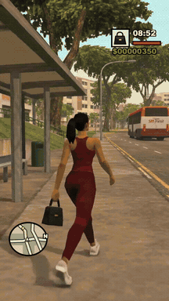

# Goji reel — revision 6

[**Watch or download the 34.3s cut**](https://raw.githubusercontent.com/gojiphysio/goji/codex/goji-reel-mobile-handoff/marketing/assets/goji-reel-prototype/animation-v6/goji-v6-ui-sfx.mp4) · [Silent version](https://raw.githubusercontent.com/gojiphysio/goji/codex/goji-reel-mobile-handoff/marketing/assets/goji-reel-prototype/animation-v6/goji-v6-ui-silent.mp4) · [Editing pack](https://raw.githubusercontent.com/gojiphysio/goji/codex/goji-reel-mobile-handoff/marketing/assets/goji-reel-prototype/animation-v6/goji-v6-editing-pack.zip)

1080 × 1920 · 30 fps · original game-style sound effects · no music. The GIF is a lightweight 8 fps preview; use the MP4 to judge motion.

## Changes

- Walking lasts **4.3 seconds**, with additional generated walking motion.
- The player actively wrenches the taxi door open; the driver falls out. Cut before she gets into the car.
- The taxi references show separate front and rear doors, a fixed centre pillar and one near-side mirror. The stop and door bailout use one generated shot, with the camera side and taxi heading matched to the retained get-up/run footage.
- The HUD uses a black handbag with a gold clasp.
- The welcoming team member and physiotherapist have short hair, no ponytail, and a gentle smile.
- The reformer scene is removed.
- Mat work is **5 seconds**, one second shorter, with a new top-left **Mobility - Upgraded** popup. The ending Body Muscle popup remains on the squat scene.

## Timing

| Time | Action |
|---|---|
| 0.0–4.3s | Extended walking swagger |
| 4.3–7.1s | Wrench open taxi door; driver falls out |
| 7.1–11.1s | Fast driving, trimmed before orientation glitch |
| 11.1–14.6s | Continuous approach, stop and door bailout |
| 14.6–18.4s | Retained get-up and run |
| 18.4–20.4s | Yellow entrance cone |
| 20.4–20.8s | Loading transition |
| 20.8–23.3s | Seated Goji welcome |
| 23.3–28.3s | Assisted stretch + Mobility popup |
| 28.3–34.3s | Spotted squat + Body Muscle popup |

## Clips for editing

- [Extended walking swagger](https://raw.githubusercontent.com/gojiphysio/goji/codex/goji-reel-mobile-handoff/marketing/assets/goji-reel-prototype/animation-v6/clips/01-swagger.mp4)
- [Wrench open taxi door; driver falls out](https://raw.githubusercontent.com/gojiphysio/goji/codex/goji-reel-mobile-handoff/marketing/assets/goji-reel-prototype/animation-v6/clips/02-takeover.mp4)
- [Fast driving, trimmed before orientation glitch](https://raw.githubusercontent.com/gojiphysio/goji/codex/goji-reel-mobile-handoff/marketing/assets/goji-reel-prototype/animation-v6/clips/03-drive.mp4)
- [Continuous approach, stop and door bailout](https://raw.githubusercontent.com/gojiphysio/goji/codex/goji-reel-mobile-handoff/marketing/assets/goji-reel-prototype/animation-v6/clips/04-bailout.mp4)
- [Retained get-up and run](https://raw.githubusercontent.com/gojiphysio/goji/codex/goji-reel-mobile-handoff/marketing/assets/goji-reel-prototype/animation-v6/clips/05-recovery.mp4)
- [Yellow entrance cone](https://raw.githubusercontent.com/gojiphysio/goji/codex/goji-reel-mobile-handoff/marketing/assets/goji-reel-prototype/animation-v6/clips/06-marker.mp4)
- [Seated Goji welcome](https://raw.githubusercontent.com/gojiphysio/goji/codex/goji-reel-mobile-handoff/marketing/assets/goji-reel-prototype/animation-v6/clips/07-entry.mp4)
- [Assisted stretch + Mobility popup](https://raw.githubusercontent.com/gojiphysio/goji/codex/goji-reel-mobile-handoff/marketing/assets/goji-reel-prototype/animation-v6/clips/08b-mat.mp4)
- [Spotted squat + Body Muscle popup](https://raw.githubusercontent.com/gojiphysio/goji/codex/goji-reel-mobile-handoff/marketing/assets/goji-reel-prototype/animation-v6/clips/09-squat.mp4)

## Taxi reference checks

[Closed four-door taxi](assets/04-four-door-closed.png) · [Open front door, rear door retained](assets/04-four-door-open.png) · [Takeover starting frame](assets/02-four-door-seated.png) · [Four-door keyframe prompts](assets/four-door-prompts.json)

## Editable sources

[Prompts](jobs.json) · [Keyframe prompts](assets/image-prompts.json) · [PNG/SVG overlays](overlays) · [Sound stems](audio) · [Timing](edit-timeline.json) · [Continuity record](continuity.json) · [LTX playbook](research/LTX_PLAYBOOK.md) · [Validation](validation.json)

Native clips are 576 × 1024 at 24 fps. The final edit is upscaled to 1080 × 1920 at 30 fps. The pack includes native clips, keyframes, independent HUD layers, sound stems and editing scripts. Scripts retain Tidepool's local engine/model paths. Original reference photographs stay local. Vehicle structure was checked against this [four-door Comfort taxi reference](https://sgclassicrides.blogspot.com/2019/06/more-than-old-car-105-toyota-crown.html).

Animation uses the installed local LTX-2.5 distilled Q8 MLX model. Keyframes use the built-in image generator. No music or sampled GTA sound files are included; the short effects are original game-style approximations.

The action remains a stylised game parody; the popups are fictional game stats. This is a review cut, not an Instagram publication.

## Motion review

The taxi takeover and bailout were rebuilt with separate front/rear doors and a fixed centre pillar. The selected takes retain the rear door while the front door opens. The player actively opens the takeover door and stays standing while the driver falls out.

The bailout and retained recovery share the same camera side and taxi heading. The join into the approved get-up/run is a tighter action cut, not a claim of an exact continuous simulated take. Small changes in taxi surface detail and background lettering remain across that join.

The mat action moves down-left; the therapist has short hair and a gentle smile in all three interior scenes. The squat keeps one controlled down/up movement. The four-second walk uses continued animation, and the reformer shot is absent.
