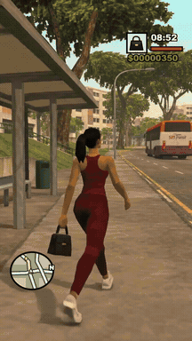

# Goji reel — revision 7

[**Watch or download the 30.3s cut**](https://raw.githubusercontent.com/gojiphysio/goji/codex/goji-reel-mobile-handoff/marketing/assets/goji-reel-prototype/animation-v7/goji-v7-ui-sfx.mp4) · [Silent version](https://raw.githubusercontent.com/gojiphysio/goji/codex/goji-reel-mobile-handoff/marketing/assets/goji-reel-prototype/animation-v7/goji-v7-ui-silent.mp4) · [Editing pack](https://raw.githubusercontent.com/gojiphysio/goji/codex/goji-reel-mobile-handoff/marketing/assets/goji-reel-prototype/animation-v7/goji-v7-editing-pack.zip)

1080 × 1920 · 30 fps · original game-style sound effects · no music. The GIF is a lightweight 8 fps preview; use the MP4 to judge motion.

## Changes

- **Exact jump cut:** stop the arrival at v6 **00:12.000**, then resume with the player running at v6 **00:16.000**. The four-second jump/stumble/recovery section is removed.
- **All Goji team outfits:** fitted black crew-neck tops and black leggings; small Goji logo, no name tags. Updated in reception, mat work, squat and the mirror reflection.
- **Mobility popup, exact requested copy:** “Mobility – Upgraded. Cops will now find it harder to arrest you.”
- The four-second walk, handbag HUD, five-second mat scene, spotted squat and Body Muscle popup remain. No reformer scene.

## Timing

| Time | Action |
|---|---|
| 0.0–4.3s | Extended walking swagger |
| 4.3–7.1s | Wrench open taxi door; driver falls out |
| 7.1–11.1s | Fast driving, trimmed before orientation glitch |
| 11.1–12.0s | Arrival, cut at original 00:12 |
| 12.0–14.4s | Running, resumed at original 00:16 |
| 14.4–16.4s | Yellow entrance cone |
| 16.4–16.8s | Loading transition |
| 16.8–19.3s | Seated Goji welcome |
| 19.3–24.3s | Assisted stretch + Mobility popup |
| 24.3–30.3s | Spotted squat + Body Muscle popup |

## Clips for editing

- [Extended walking swagger](https://raw.githubusercontent.com/gojiphysio/goji/codex/goji-reel-mobile-handoff/marketing/assets/goji-reel-prototype/animation-v7/clips/01-swagger.mp4)
- [Wrench open taxi door; driver falls out](https://raw.githubusercontent.com/gojiphysio/goji/codex/goji-reel-mobile-handoff/marketing/assets/goji-reel-prototype/animation-v7/clips/02-takeover.mp4)
- [Fast driving, trimmed before orientation glitch](https://raw.githubusercontent.com/gojiphysio/goji/codex/goji-reel-mobile-handoff/marketing/assets/goji-reel-prototype/animation-v7/clips/03-drive.mp4)
- [Arrival, cut at original 00:12](https://raw.githubusercontent.com/gojiphysio/goji/codex/goji-reel-mobile-handoff/marketing/assets/goji-reel-prototype/animation-v7/clips/04-arrival.mp4)
- [Running, resumed at original 00:16](https://raw.githubusercontent.com/gojiphysio/goji/codex/goji-reel-mobile-handoff/marketing/assets/goji-reel-prototype/animation-v7/clips/05-run.mp4)
- [Yellow entrance cone](https://raw.githubusercontent.com/gojiphysio/goji/codex/goji-reel-mobile-handoff/marketing/assets/goji-reel-prototype/animation-v7/clips/06-marker.mp4)
- [Seated Goji welcome](https://raw.githubusercontent.com/gojiphysio/goji/codex/goji-reel-mobile-handoff/marketing/assets/goji-reel-prototype/animation-v7/clips/07-entry.mp4)
- [Assisted stretch + Mobility popup](https://raw.githubusercontent.com/gojiphysio/goji/codex/goji-reel-mobile-handoff/marketing/assets/goji-reel-prototype/animation-v7/clips/08b-mat.mp4)
- [Spotted squat + Body Muscle popup](https://raw.githubusercontent.com/gojiphysio/goji/codex/goji-reel-mobile-handoff/marketing/assets/goji-reel-prototype/animation-v7/clips/09-squat.mp4)

## Uniform reference

The black fitted top and leggings follow the therapist's clothing in Goji's [official website treatment photo](https://www.gojiphysio.com/photos/services/prenatal-physiotherapy-warm.webp), linked from the [Goji homepage](https://www.gojiphysio.com/). The small chest mark uses Goji's supplied brand logo. The reference is used for clothing, not to replace the existing character's face or haircut.

[Welcome keyframe](assets/07-entry.png) · [Mat keyframe](assets/08b-mat-start.png) · [Squat keyframe](assets/09-squat.png)

## Editable sources

[Prompts](jobs.json) · [Keyframe prompts](assets/image-prompts.json) · [PNG/SVG overlays](overlays) · [Sound stems](audio) · [Timing](edit-timeline.json) · [Continuity record](continuity.json) · [LTX playbook](research/LTX_PLAYBOOK.md) · [Validation](validation.json)

Generated clips are 576 × 1024 at 24 fps. The precisely trimmed arrival and running excerpts are 1080 × 1920 at 30 fps, extracted from the previous edit. The final master is 1080 × 1920 at 30 fps. The pack contains clips, keyframes, separate overlays, ready-to-use SFX stems and editing scripts. Scripts retain Tidepool's local engine paths; audio conformation reads the previous v6 workspace. Original reference photographs stay local.

Animation uses the installed local LTX-2.5 distilled Q8 MLX model. Keyframes use the built-in image generator. No music or sampled GTA sound files are included; the short effects are original game-style approximations.

The action remains a stylised game parody; the popups are fictional game stats. This is a review cut, not an Instagram publication.

## Motion review

The source-clock edit is an intentional hard cut: v6 00:12.000 goes directly to v6 00:16.000. The player is already running at the resumed frame; no jump, stumble or get-up sequence remains in that interval.

All three interior scenes were reviewed for black crew-neck tops, fitted black leggings, removal of name tags, the Goji logo and the retained short hairstyle. The squat reflection uses the same black outfit. The motion remains an AI-generated prototype, so the small moving logo is a generated texture rather than a tracked vector graphic.
