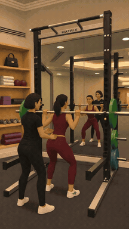

# Goji — corrected final squat clip

[**Watch or download the final clip**](https://raw.githubusercontent.com/gojiphysio/goji/codex/goji-reel-mobile-handoff/marketing/assets/goji-reel-prototype/final-scene-v9/goji-final-squat-plain-black.mp4)

6 seconds · 1080 × 1920 · 30 fps. The therapist's back is plain black. Existing Body Muscle popup and original sound effects retained; no music.

Only the final scene was rendered. The full v8 reel is unchanged. Replace its final six seconds (24.8–30.8s) with this clip.

[Corrected keyframe](assets/09-squat-plain-back.png) · [Image edit specification](assets/image-edit.txt) · [Animation prompt](jobs.json) · [Validation](validation.json)

Keyframe corrected using the built-in image generator; this scene animated using the existing local LTX-2.5 Q8 MLX installation. The front chest logo in the mirror remains. All outputs passed full video decoding and duration checks, and the back of the shirt was inspected throughout the shot.
