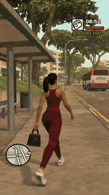
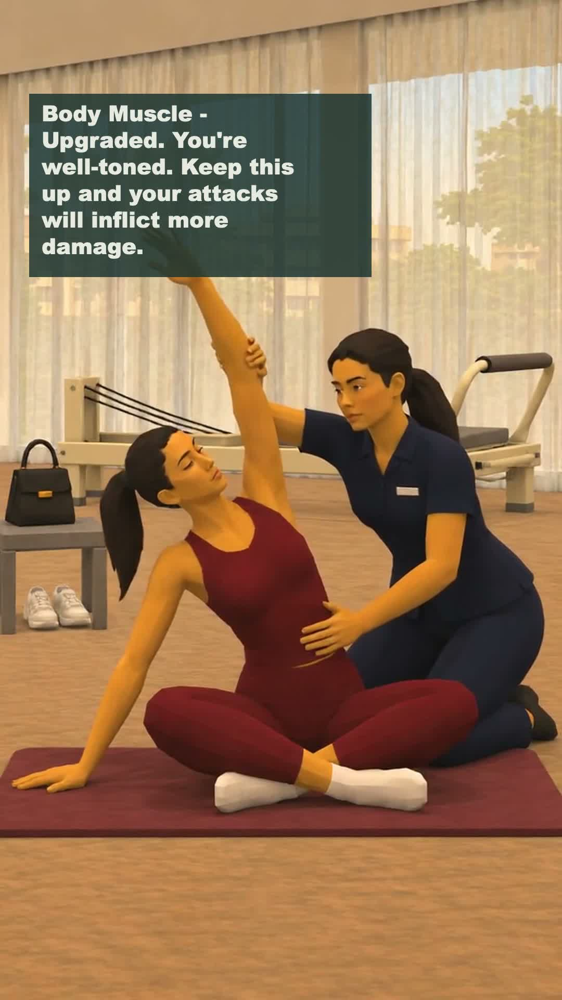
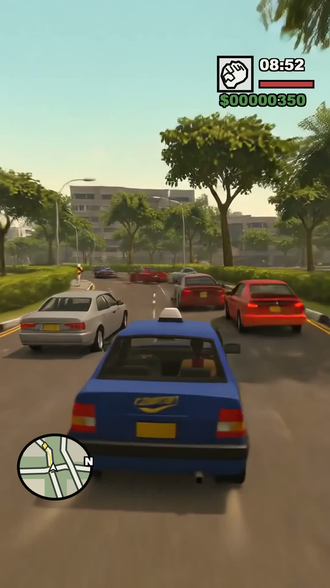

# Goji reel — GTA SA-style UI pass

[**Watch / download the UI cut with SFX**](https://raw.githubusercontent.com/gojiphysio/goji/codex/goji-reel-mobile-handoff/marketing/assets/goji-reel-prototype/ui-v3/goji-v3-ui-sfx.mp4) · [Silent UI cut](https://raw.githubusercontent.com/gojiphysio/goji/codex/goji-reel-mobile-handoff/marketing/assets/goji-reel-prototype/ui-v3/goji-v3-ui-silent.mp4) · [Download editable overlay pack](https://raw.githubusercontent.com/gojiphysio/goji/codex/goji-reel-mobile-handoff/marketing/assets/goji-reel-prototype/ui-v3/goji-ui-overlays.zip)

29.5 seconds · 1080 × 1920 · 30 fps · no music. The animation is the v2 cut; this pass adds separate UI layers without regenerating the scenes.

## Add now, finish timing later

The HUD is composited in the edit, so its text stays sharp and its placement and timing can change independently of the animation. Transparent full-canvas PNGs and editable SVGs are included. Keep the source clips clean; burn in the UI only on review and final exports.

During exterior gameplay, the upper right shows an original vector fist icon, outlined clock, red health bar and green cash counter. A lower-left radar shows an illustrative street layout, player arrow, north and yellow destination blip. The clock advances from 08:52 to 08:53. The layout and fonts are a recreation inspired by the supplied screenshots, not extracted GTA UI assets. The radar is static prototype artwork rather than route-tracked navigation; final movement can be keyed after the edit is locked.

The gameplay HUD disappears at 15.6 seconds for the loading transition and indoor cutscenes. The final upgrade popup appears at 24 seconds and stays for 5.5 seconds, replacing both previous labels and their two chimes with one notification.

## Popup wording

> Body Muscle - Upgraded. You're well-toned. Keep this up and your attacks will inflict more damage.

This is the full wording from the supplied top-left reference. It uses chunky off-white type on a translucent dark panel.

## Gameplay HUD

## Overlay layers

| Layer | Timing in this cut | Files |
|---|---|---|
| HUD, 08:52 | 0–10s | [PNG](overlays/gameplay-hud-0852.png) · [SVG](overlays/gameplay-hud-0852.svg) |
| HUD, 08:53 | 10–15.6s | [PNG](overlays/gameplay-hud-0853.png) · [SVG](overlays/gameplay-hud-0853.svg) |
| Body Muscle popup | 24–29.5s | [PNG](overlays/body-muscle-popup.png) · [SVG](overlays/body-muscle-popup.svg) |

Drop each PNG onto a 1080 × 1920 timeline at its native size. [Timing manifest](overlay-timing.json). [Revised audio mix and stems](audio). [Original individual animation clips and editing pack](../animation-v2/README.md). Fonts used for this editable recreation: Arial Black; fonts are not bundled. Native AppKit rendering code and FFmpeg assembly scripts are included in the overlay pack.
