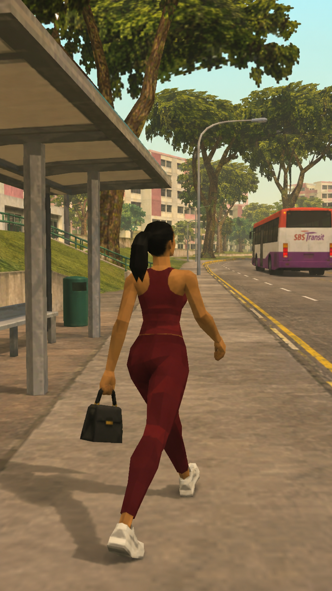
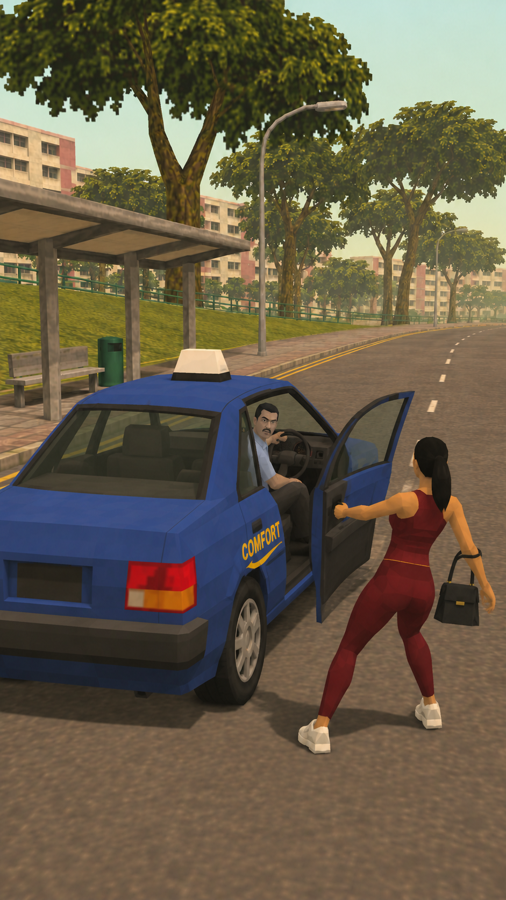
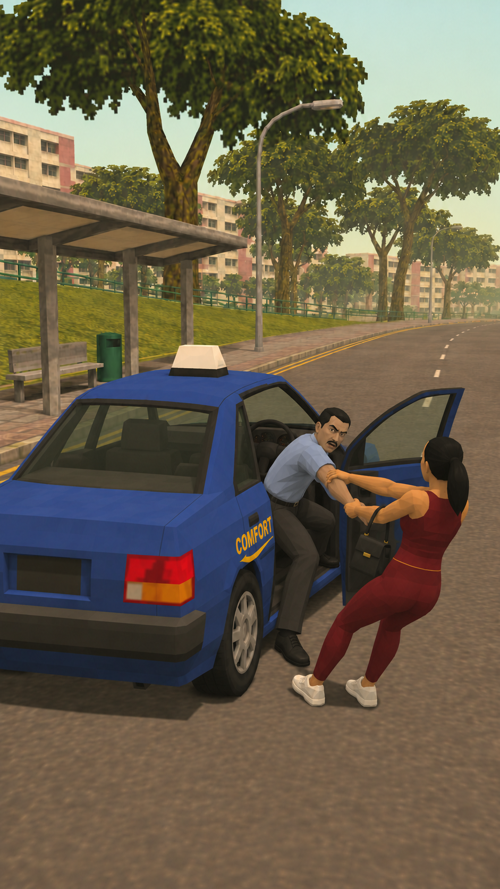
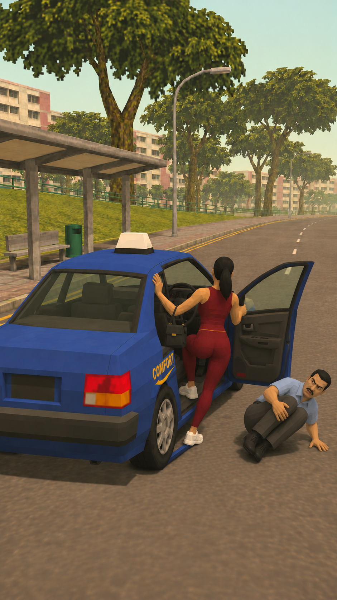
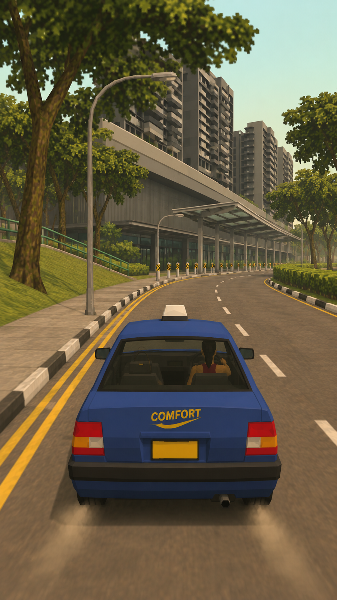
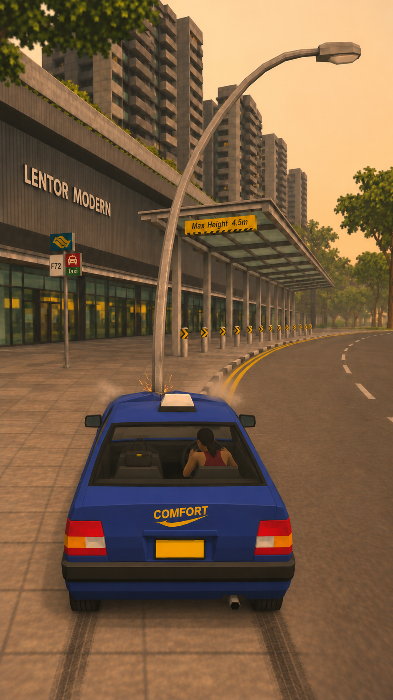
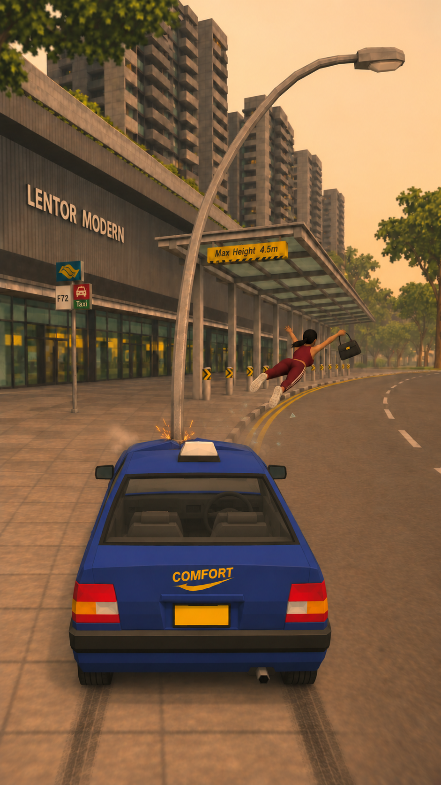
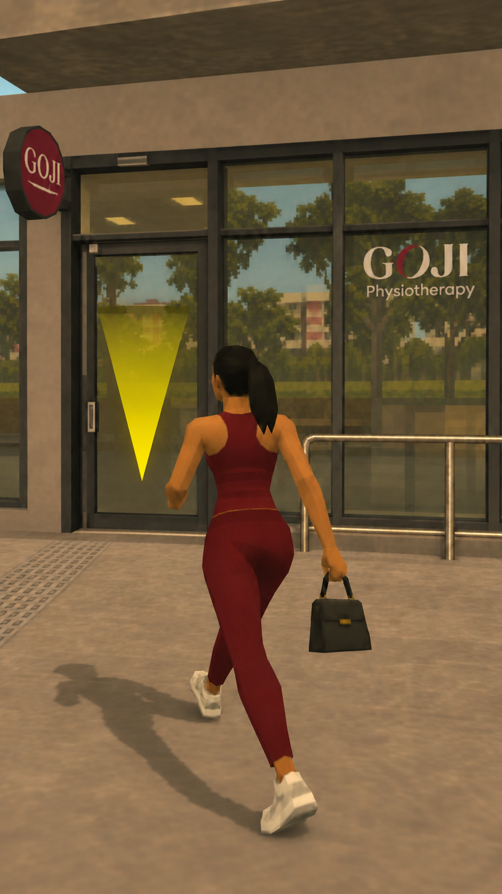
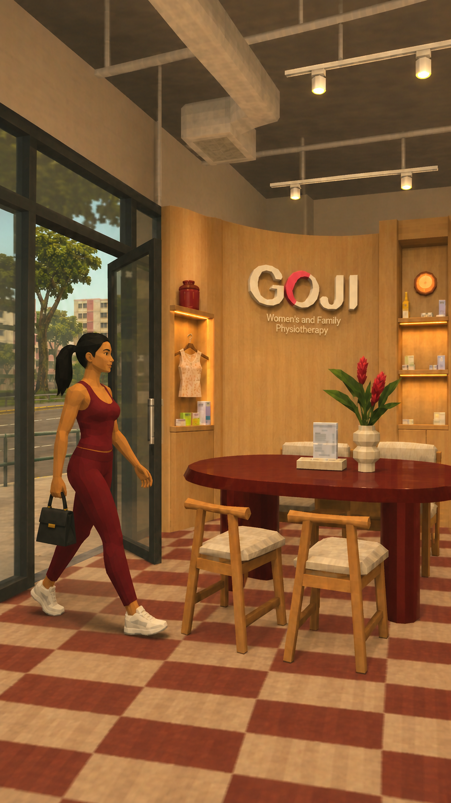
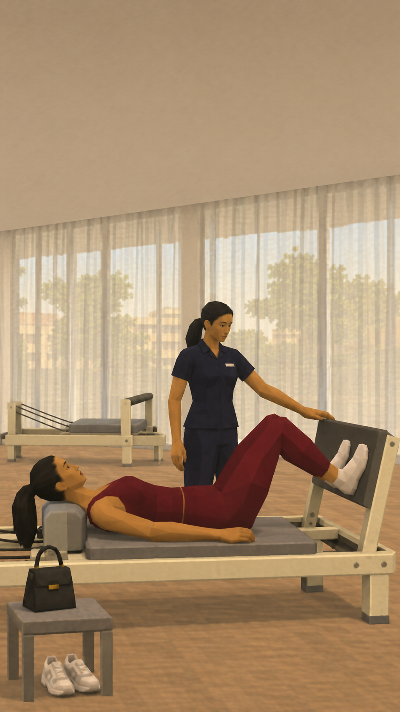

# Goji: chaos to calm — storyboard V4

20 seconds · Instagram 9:16 · GTA San Andreas / PS2 look.

Scroll down to review all ten frames directly on your phone. Tap a frame to open the full image.

**Latest corrections:** she opens the taxi door, pulls the driver out, then he rolls clear unharmed. The crash and ejection use compact damage within the taxi’s normal silhouette. The rear window remains intact.

[Overview image](contact-sheet.png) · [Shot list](shot-list.csv) · [Motion prompts](motion-prompts.txt) · [Latest image prompts](revision-4-prompts.json)

All exterior action uses the classic third-person player / rear chase camera. Only the Goji interior uses cutscenes. Maroon outfit, black purse, yellow downward entry cone; no blood or deaths.

## 01 · Already on the move

**0.0–1.8s** — Player already walking with loose CJ-style swagger, maroon athleisure and a black purse. SBS bus recedes behind her.

No separate alighting shot. Keep the opening readable for nearly two seconds.

## 02a · Rip the door open

**1.8–2.3s** — Player grips and yanks the front-right door open. Driver remains seated inside.

Animate the three takeover beats in causal order: open, pull, roll. Use adjacent keyframes for continuity; trim to the allocated time. Preserve the purse within each take.

## 02b · Pull the driver out

**2.3–3.0s** — Player visibly grips the driver’s arm and pulls him from the seat.

Animate the three takeover beats in causal order: open, pull, roll. Use adjacent keyframes for continuity; trim to the allocated time. Preserve the purse within each take.

## 02c · Roll clear, climb in

**3.0–3.6s** — Driver finishes a harmless shoulder roll beside the doorway as the player steps into the empty right-hand driver seat.

Animate the three takeover beats in causal order: open, pull, roll. Use adjacent keyframes for continuity; trim to the allocated time. Preserve the purse within each take.

## 03 · Tear through Lentor

**3.6–5.5s** — Blue Comfort cab speeds along a stylised Lentor approach.

Speed can increase while camera remains behind the vehicle. Match the chase framing into shot 04. Street layout is illustrative, not a surveyed route.

## 04 · Lamp-post impact

**5.5–6.4s** — Taxi mounts the kerb and comes to a hard stop with its front bumper pressed against the lamp post.

Preserve scale between approach, impact and ejection. Do not morph extra metal into view. Most front damage is naturally occluded by the rear chase camera. Use crunch sound and a short camera jolt for force. Exact pole placement is fictional staging.

## 05 · Still has the purse

**6.4–7.4s** — Player flies forward through the windscreen, seen from behind by the gameplay camera; still holding the black purse, unharmed.

Match the corrected compact-crash frame exactly. Midair keyframe: player has already passed through the front windscreen, travelling away from camera. Follow her landing and recovery. Rear glass remains intact, and only one purse exists.

## 06 · Yellow doorway marker

**7.4–9.4s** — Player runs to Goji and enters beneath the tall translucent yellow entrance cone, matched to the supplied San Andreas reference.

Use references/user-yellow-cone-reference.jpg as the marker appearance source. The reference-matched cone is baked into this keyframe. It disappears when the fade begins.

## T · Fade to black

**9.4–9.8s** — Short black loading transition.

At 30fps: fade down for 6 frames, hold black for 6 frames.

## 07 · A very different arrival

**9.8–11.5s** — Player enters reception calmly, facing into the room.

Use the v2 frame: walking direction has been corrected. Keep the same PS2 style after the transition.

## 08 · Let the quiet linger

**11.5–18.3s** — One uninterrupted peaceful therapist-supervised reformer movement.

Let the shot last. For the still-image rough cut hold the frame; for motion use a continuous take or a subtle repeat without an obvious jump.

## 09 · Quiet gains

**18.3–20.0s** — Same shot continues; small black box shows + Strength, then + Mobility.

18.3s: strength overlay. 19.1s: replace with both-stats overlay. Hold to 20.0s. Labels are game fiction, not a numerical or guaranteed treatment result.

## Stat overlays

[+ Strength PNG](overlays/strength-1080x1920.png) · [+ Strength and + Mobility PNG](overlays/strength-mobility-1080x1920.png)

Add Strength at 18.3s, replace with both at 19.1s, and hold until 20s. The quiet physio shot continues uninterrupted from 11.5s.

## Production notes

This is a storyboard and image pack, not an animated video. Images were created with the built-in image generation tool. No paid video generation or local model installation was performed. Animate one short shot at a time, then trim to the shot list. Use an abrupt stop, a brief camera jolt and a metal crunch to sell the crash without expanding the car body.

Lentor Modern arrival architecture, Goji frontage and interiors are grounded in existing Goji photos. The bus stop and driving road are illustrative Singapore/Lentor scenes, not a verified continuous route. Exact lamp-post placement is fictional staging. The people and game-style stat gains are fictional.
