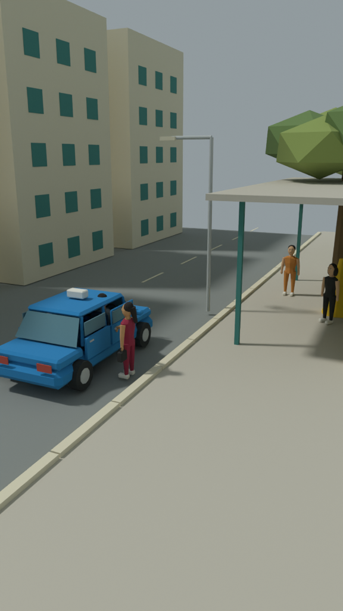
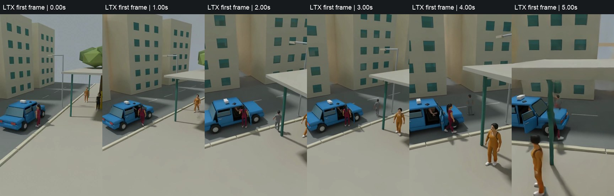

# Goji: Blender versus local video models

**Pilot in progress — 24 November 2026.** This page will be updated with the
remaining renders. The first completed take already fails the required action;
there is no production winner yet.

## The scene

Goji Girl opens a parked taxi's front door; a separate driver gets out and walks
away. The physiotherapist and a pedestrian remain in the scene. This tests
two-person interaction, rigid geometry, occlusion, a fixed camera, and the
shared PS2 look. These are **procedural blockout characters**, not final cast.

[Watch the eight-second Blender guide](https://github.com/gojiphysio/goji/raw/refs/heads/codex/goji-video-workflow/marketing/video-production/local-benchmark/staging/guide.mp4)

## LTX 2.5 — first frame only

**142 seconds generation time. Required action rejected.** The camera moves,
the grey driver appears away from the door while the seated figure remains,
and the orange pedestrian duplicates near the end. The broad low-poly look
survives in sampled frames.

[Watch Blender and LTX side by side](https://github.com/gojiphysio/goji/raw/refs/heads/codex/goji-video-workflow/marketing/video-production/local-benchmark/results/ltx-first-01/with-guide.mp4)
· [Unedited LTX output](https://github.com/gojiphysio/goji/raw/refs/heads/codex/goji-video-workflow/marketing/video-production/local-benchmark/results/ltx-first-01/raw.mp4)

## Remaining tests

| Recipe | Status |
|---|---|
| Wan 2.2 I2V 14B + Lightning | Rendering; one earlier path-resolution failure retained |
| LTX 2.5 + six Blender keyframes | Queued |
| Wan 2.2 TI2V 5B | Queued |
| MiniMax H3 Turbo 544p, mixed q4/q6 | Downloading; output will remain outside this public repository |

The first-frame tests share a prompt and opening image. The guided LTX test
gets more information and is evaluated separately. Five-second comparison
exports retain source speed, repeat frames onto a 48-fps display cadence, and
do not use motion interpolation. Raw takes preserve native cadence and length.

## Review limits and reproducibility

Current observations come from exact-frame inspection and full-file decode
checks. Human normal-speed acceptance is still pending. No canonical face
likeness, long-scene reliability or overall model ranking is established by
this single proxy scene.

Read the [experiment and pinned recipes](experiment.md),
[model provenance](model-provenance.json), and per-take JSON/logs in `results/`.
The [Blender source](scripts/build_scene.py) and [scene file](staging/taxi-stage.blend)
are included. All generation is local on an M5 Pro with 64 GB memory; no paid
generation API is used.
