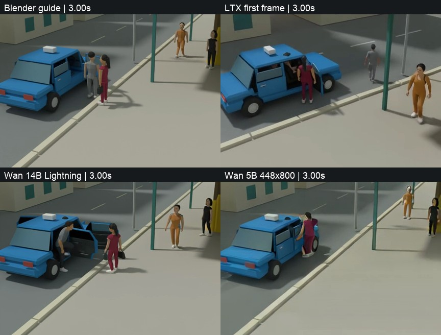
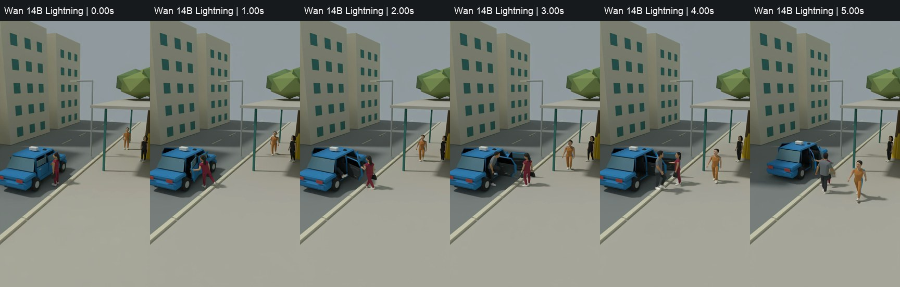
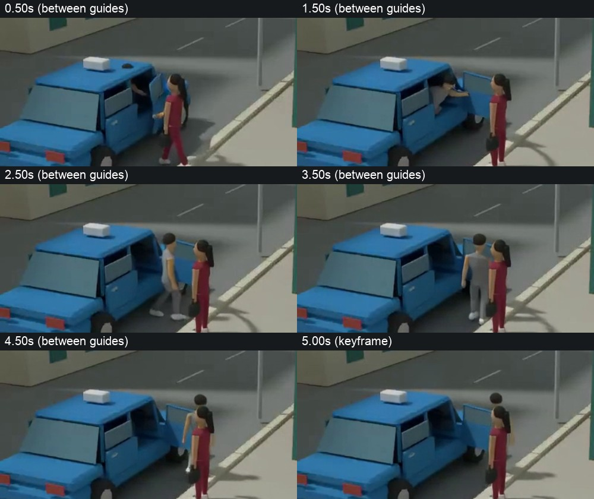
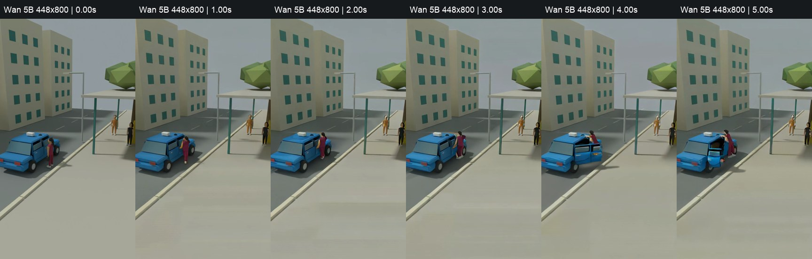

# Goji: Blender versus local video models

**Superseded as a production comparison.** The user rejected this proxy look
and the presentation of unmatched controls. These records diagnose the local
runtimes; they do not establish Episode 1 visual quality or a model winner.
See the [corrected Episode 1 comparison](episode1/README.md): same actual episode
image, same prompt, same 576×1024 canvas, one frame per model.

| Recipe | Native output | Wall time | Frame-review finding |
|---|---|---:|---|
| LTX 2.5 distilled, first frame | 576×1024, 121 @ 24 fps | 2m 22s | Camera drift, duplicated NPC, failed driver exit |
| Wan 2.2 14B Lightning | 480×848, 81 @ 16 fps | 16m 19s | Recognisable exit; door/prop changes and taxi moves |
| Wan 2.2 5B, lower-res | 448×800, 121 @ 24 fps | 12m 05s | Wrong action; driver does not exit |
| LTX 2.5, six Blender frames | 576×1024, 121 @ 24 fps | 2m 38s | Best layout control; imperfect contacts/interpolation |
| MiniMax H3 Turbo, mixed q4/q6 | 544×960, 124 @ 24 fps | 12m 40s | Recognisable action in sampled proxy frames; private Page now available |

These are practical local recipes, not equal-compute or maximum-quality runs.
The guided LTX row has extra information. Total successful generation wall time
was about **46 minutes**, excluding download/setup; both failed launches are
retained. No paid generation API was used.

[Watch the simultaneous four-panel comparison](https://github.com/gojiphysio/goji/raw/refs/heads/codex/goji-video-workflow/marketing/video-production/local-benchmark/results/comparison/side-by-side.mp4)

## The scene

Goji Girl opens a parked taxi's front door; a separate driver gets out and walks
away. The physiotherapist and a pedestrian remain in the scene. This tests
two-person interaction, rigid geometry, occlusion, a fixed camera, and the
shared PS2 look. These are **procedural blockout characters**, not final cast.

[Watch the eight-second Blender guide](https://github.com/gojiphysio/goji/raw/refs/heads/codex/goji-video-workflow/marketing/video-production/local-benchmark/staging/guide.mp4)

## LTX 2.5 — first frame only

**142 seconds generation time. Required action rejected.** The camera moves,
the grey driver appears away from the door while the seated figure remains,
and the orange pedestrian duplicates near the end. The broad low-poly look
survives in sampled frames.

[Watch Blender and LTX side by side](https://github.com/gojiphysio/goji/raw/refs/heads/codex/goji-video-workflow/marketing/video-production/local-benchmark/results/ltx-first-01/with-guide.mp4)
· [Unedited LTX output](https://github.com/gojiphysio/goji/raw/refs/heads/codex/goji-video-workflow/marketing/video-production/local-benchmark/results/ltx-first-01/raw.mp4)

## Wan 2.2 14B — Lightning, first frame only

**16 minutes 19 seconds generation time. Required action rejected.** The camera
is much steadier and the driver exit is recognisable. However, extra vehicle
panels appear, the door changes shape, bag ownership is ambiguous, and the
parked taxi moves away near the end. This is better action organisation in this
seed, not a production pass.

[Watch Blender and Wan side by side](https://github.com/gojiphysio/goji/raw/refs/heads/codex/goji-video-workflow/marketing/video-production/local-benchmark/results/wan14-lightning-02/with-guide.mp4)
· [Unedited Wan output](https://github.com/gojiphysio/goji/raw/refs/heads/codex/goji-video-workflow/marketing/video-production/local-benchmark/results/wan14-lightning-02/raw.mp4)

[Inspect the door and bag detail sheet](results/wan14-lightning-02/interaction-detail.jpg).

## LTX 2.5 — six Blender keyframes

**158 seconds generation time. Most faithful layout so far, with extra input.**
Camera, car placement and character separation stay close to the guide. This
also holds in inspected frames **between** the supplied images, not just at
conditioning timestamps. The driver still stretches during emergence and the
feet interpolate imperfectly; the source animation itself needs better contact
mechanics. This is a promising control test, not final footage.

[Watch Blender and guided LTX side by side](https://github.com/gojiphysio/goji/raw/refs/heads/codex/goji-video-workflow/marketing/video-production/local-benchmark/results/ltx-guided-01/with-guide.mp4)
· [Unedited guided LTX](https://github.com/gojiphysio/goji/raw/refs/heads/codex/goji-video-workflow/marketing/video-production/local-benchmark/results/ltx-guided-01/raw.mp4)

[Compare guide and generated contact frames](results/ltx-guided-01/guide-contact-comparison.jpg).

## Wan 2.2 5B — lower-resolution feasibility take

**12 minutes 5 seconds generation time. Required action rejected.** Camera and
low-poly style are relatively stable, but the woman climbs into/over the car,
vehicle panels change, and the driver does not complete the exit. The runtime
resolved the target to **448×800**, below its recommended 480×832 quality
setting; do not generalise this result to the model's quality ceiling.

[Watch Blender and Wan 5B side by side](https://github.com/gojiphysio/goji/raw/refs/heads/codex/goji-video-workflow/marketing/video-production/local-benchmark/results/wan5-01/with-guide.mp4)
· [Unedited Wan 5B](https://github.com/gojiphysio/goji/raw/refs/heads/codex/goji-video-workflow/marketing/video-production/local-benchmark/results/wan5-01/raw.mp4)

## MiniMax H3 — private test result

**12 minutes 40 seconds. Strongest common-first-frame result in this pilot.**
Inspected frames show a stable camera and parked taxi, one handbag, separate
characters, and a recognisable door-open → driver-exit → departure sequence.
The driver follows different timing/direction from the guide; a single opening
image does not lock choreography. Canonical likeness and full normal-speed
contact quality have not been signed off. Only **5.17 seconds** was tested;
this is not evidence for long-scene reliability.

H3's footage and the six-panel comparison including it stay outside this public
repository because its license restricts territories for outputs. They are
now available on the [private review page](https://chatgpt.com/space/page_99413c931d68819185504b2519a8cca0),
alongside the corrected Episode 1 test. The original local preview was not
accessible to the user; the Page provides an authenticated remote handoff. The public
[summary record](results/summary.json) contains timing and test settings.

The runtime warned that the video was nearly static. The action is visible in
foreground samples; the intentionally fixed background dominates the whole-frame
motion average. Review the action region before treating that warning as failure.

One initial H3 launch failed at adapter-cache lookup, before inference; the
successful retry used the explicit pinned adapter file. The model access and
local authentication now work.

## Correction after user review

The common first-frame rows used the same image and prompt, but different
resolved canvases. The six-frame LTX row received much more information and
should never have appeared as a competing model-quality result. The primitive
cast could not answer whether a model preserves the textured Episode 1 look.
The local-only H3 preview also failed the remote handoff requirement.

The [Episode 1 rerun](episode1/README.md) replaces those claims with a matched
visual-input comparison. Do not use this proxy pilot's relative findings to
select the production renderer. Keep the extra-control experiment separate.

## Review limits and reproducibility

Current observations come from exact-frame inspection and full-file decode
checks. Human normal-speed acceptance is still pending. No canonical face
likeness, long-scene reliability or overall model ranking is established by
this single proxy scene.

Read the [experiment and pinned recipes](experiment.md),
[model provenance](model-provenance.json), and per-take JSON/logs in `results/`.
The [Blender source](scripts/build_scene.py) and [scene file](staging/taxi-stage.blend)
are included. All generation is local on an M5 Pro with 64 GB memory; no paid
generation API is used.
