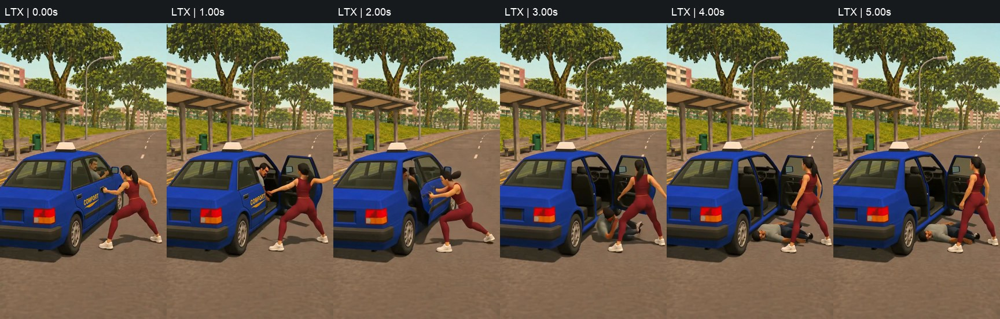
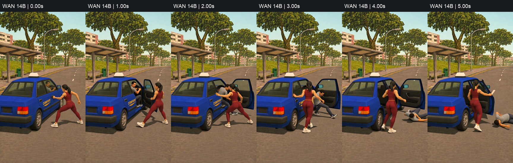
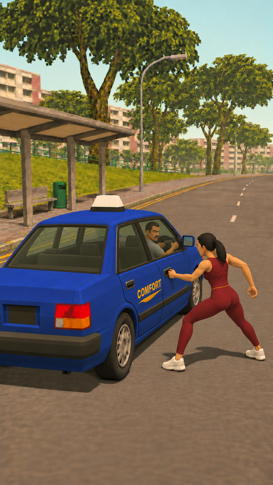

# Episode 1 taxi takeover: matched input comparison

This corrects the earlier proxy pilot. The earlier blockout did not represent
Episode 1's appearance, resolutions differed, and presenting six-frame LTX next
to single-frame models obscured the extra control it received. It cannot support
a production model ranking. Its raw records remain available for diagnosis.

## Completed comparison

| Route | Time | Appearance in sampled frames | Action finding |
|---|---:|---|---|
| LTX 2.5 | 127 s | Episode 1 street, textures and two identities retained | Repeated opening/closing; driver finishes lying down. Rejected endpoint. |
| H3 Turbo | 880 s | Episode 1 street, textures and two identities retained | One opening; driver falls and recovers to a seated/reclined pose. Contact/foot motion still needs playback review. |
| Wan 14B Lightning | 1406 s | Episode 1 street, textures and two identities retained | Single opening; driver remains lying down; woman starts closing door. Rejected endpoint. |

All three routes resolved to 576×1024. Findings use exact-frame inspection
at 0.25-second intervals and complete decode checks; human normal-speed acceptance
is pending. One seed is not a model ranking. H3 video and frames remain private;
the [private review page](https://chatgpt.com/space/page_99413c931d68819185504b2519a8cca0)
now contains H3, its Episode 1 comparison and the earlier proxy output. Uploads
and owner access are confirmed. Browser/player rendering has not been visually
verified; the app queued opening the page in the inactive chat.

[Watch Episode 1 beside the new LTX take](https://raw.githubusercontent.com/gojiphysio/goji/codex/goji-episode1-model-comparison/marketing/video-production/local-benchmark/episode1/results/ltx-first-01/with-episode1.mp4)
· [Full unedited LTX take](https://raw.githubusercontent.com/gojiphysio/goji/codex/goji-episode1-model-comparison/marketing/video-production/local-benchmark/episode1/results/ltx-first-01/raw.mp4)

[Open the private four-panel comparison, including H3](https://chatgpt.com/space/page_99413c931d68819185504b2519a8cca0)

[Watch LTX and Wan side by side](https://raw.githubusercontent.com/gojiphysio/goji/codex/goji-episode1-model-comparison/marketing/video-production/local-benchmark/episode1/comparison/ltx-wan.mp4)
· [Wan beside Episode 1](https://raw.githubusercontent.com/gojiphysio/goji/codex/goji-episode1-model-comparison/marketing/video-production/local-benchmark/episode1/results/wan14-lightning-01/with-episode1.mp4)
· [Unedited Wan take](https://raw.githubusercontent.com/gojiphysio/goji/codex/goji-episode1-model-comparison/marketing/video-production/local-benchmark/episode1/results/wan14-lightning-01/raw.mp4)

All three completed on their first launch. Total local generation wall time was
**40 minutes 13 seconds**, excluding review/export; no paid generation API was
used. H3 is closest to the requested broad action **on this seed**. This is not
an episode production pass or evidence for longer-scene reliability.

## The shared input

This is Episode 1 v8's actual `02-four-door-seated.png`, resized once to
576×1024. No image model restyled it. All three routes receive this exact PNG
(SHA-256 `77f05c4247f1cbf45d99390f6c63a9f24d0ae1f91ace0c367ffad6600054dfaf`)
and the same [action prompt](prompt.txt). The woman opens the front driver door;
the grey-shirt driver falls out and ends seated on the road, unharmed.

The original image already has the textured taxi, foliage, HDB street,
recognisable faces, adult proportions, clothing and warm Episode 1 treatment.
It has no handbag in this particular shot. Adding one only in the prompt would
change the test and create an identity/prop conflict, so this test preserves it.

[Original Episode 1 takeover clip](https://raw.githubusercontent.com/gojiphysio/goji/codex/goji-episode1-model-comparison/marketing/video-production/local-benchmark/episode1/inputs/episode1-takeover.mp4) is a visual
reference, **not another baseline entry**: that selected take used first and
last images and benefited from the episode's previous iteration.

## Controlled comparison

| Variable | LTX 2.5 distilled Q8 | Wan 2.2 I2V 14B Q8 + Lightning | H3 Turbo mixed Q4/Q6 |
|---|---|---|---|
| Conditioning images | Same opening PNG only | Same opening PNG only | Same opening PNG only |
| Main prompt | Same | Same | Same |
| Canvas | 576×1024 | 576×1024, exact-resize | 576×1024 |
| Native frames / cadence | 121 / 24 fps | 81 / 16 fps | 124 / 24 fps |
| Comparison interval | First 5 seconds | First 5 seconds | First 5 seconds |
| Recipe | Distilled defaults | 4 steps, CFG 1 | 8-step Turbo |
| Extra keyframes / guide | None | None | None |

All jobs run serially on the same M5 Pro / 64 GB Mac. Seeds are recorded, not
claimed to be equivalent random noise across architectures. This compares
these practical local recipes with matched visual information, not equal
compute, full-precision model ceilings or long-form reliability. Wan uses an
empty negative prompt; H3's native audio conditioning remains recorded in its
command although the delivered visual test is silent. Native frame rates stay
intact; comparison exports repeat frames at 48 fps without interpolation or
retiming. Comparison panels retain the full 576×1024 source resolution; use the raw
clips for native-rate playback. No paid generation API is used.

## Review criteria

Review appearance against Episode 1 independently of action success: faces,
human proportions, maroon/grey clothing, surface texture, palette and foliage.
Then inspect fixed camera, rigid car and front hinge, rear door staying closed,
woman/driver separation, hand contact, completed fall, and grounded final pose.
The driver's trousers are hidden in the shared first image and unspecified in
the prompt. H3 reveals darker/bluer trousers than Episode 1: record that as an
unseen-wardrobe limitation, not a violation of supplied pixels. Production
shot prompts and textured cast assets must carry those hidden details too.
Preserve the entire take, including failures. Do not use a clever cut to pass a
failed action. One seed is an initial screen, not a general model ranking.

## Where Blender fits

Blender should specify camera, scale, paths, occlusion, door hinge and poses.
Its proxy materials and primitive people are not the visual target. A future
controlled guide must first be rendered with reviewed textured character and
environment assets, or translated into a reviewed Episode 1 look frame while
preserving its structure. This comparison deliberately starts with the known
episode frame to isolate appearance retention and acting.

Sparse six-keyframe control is a separate experiment. The installed Wan I2V
route and H3 route cannot ingest LTX's arbitrary timed image list. Wan video/
VACE controls require a compatible pipeline; consecutive context frames are
not interchangeable with six sparse timestamps. Do not label unsupported
controls as supplied or compare a guided row as if its inputs were equal.

Commands, input hashes, timings, logs and actual resolved output probes are
retained in each take directory. H3 footage remains private; a verified private
HTTPS handoff is required before declaring the full comparison deliverable.
