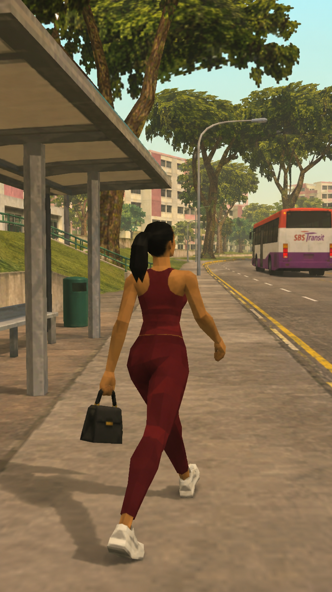
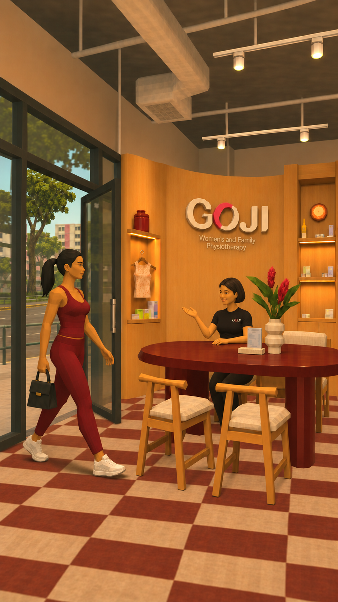
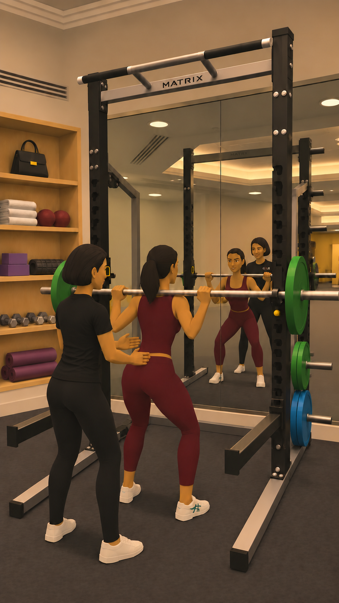

# Goji GTA series bible

Prepared 24 November 2026. Existing choices below come from Episode 1 assets;
camera numbers and stricter rendering guidance are proposed production defaults.
This pack contains recovered references, not newly approved turnaround sheets.
For actual game footage and behaviour evidence, use the
[San Andreas reference pack](san-andreas-reference.md). Its PS2 source windows
complement the Goji identity images below; they do not replace the cast.

## Visual standard

The user's series requirement is **PS2-era GTA San Andreas humans throughout**:
hero, therapist, drivers, passers-by, background NPCs and mirror images share
the same rendering language. Singapore is the setting, not a photoreal backdrop
with a game character pasted on it.

Use angular low-poly silhouettes, simple joint deformation, economical facial
geometry, painted low-resolution texture detail, broad diffuse lighting and
restrained material highlights. Preserve readable adult proportions. Avoid
photographic skin, pores, individual hair strands, glossy modern game materials,
soft toy-like faces or realistic extras. Low-poly is not voxel or pixel art.
Do not request “cinematic photorealism,” “Unreal Engine 5,” or face beautification.

The street reference is the stronger inherited style anchor. The existing
interiors are smoother: use them for identities, clothing and layout, then bring
their people/materials toward the street standard. A warm filter cannot repair
different character topology. A new neutral-light lineup must prove that the
girl, therapist and NPCs belong to one game before becoming the style master.
“PS2-style” is not satisfied by low polygon count alone. Review painted detail,
joint animation, vehicle response and camera behaviour against the game pack.
Do not use remaster footage, a constant orange filter or generic toy figures as
substitutes for those checks. Capture blur and frame-rate drops are not mandatory
effects in the finished Goji video.

## Recovered cast

### GG-01 — Goji girl

- Fictional adult player; dark hair in one long ponytail; preserve the selected
  face, skin tone and athletic proportions rather than recasting each shot.
- Maroon sleeveless athletic top and matching fitted leggings; white trainers.
- One structured black handbag with a small gold clasp. Track its state per shot:
  held, put down, on shelf or offscreen. Never duplicate it or silently teleport it.
  The street keyframe shows it in her left hand; earlier prompts conflict on hand
  and prop presence, so the selected shot image and continuity record take precedence.
- Confident swagger outdoors, calm attention indoors. The behaviour is recurring;
  the exact gait can vary with the episode's action.

### GP-01 — Goji physiotherapist

- Fictional adult therapist; short chin-length black bob with visible short nape,
  tucked behind ears; gentle expression. No ponytail or bun.
- Fitted black short-sleeve crew-neck top, black full-length leggings, white shoes.
- Small Goji mark on wearer's left chest only; plain black back, no name badge,
  collar or navy scrubs. Mirrors must respect front/back and handedness.
- Calm, attentive interaction. Any exercise contact needs a plausible guide,
  not text alone. Do not copy a real staff member's identity from outfit references.

### NPCs

Create a small reusable roster as the script requires: e.g. NPC-01 commuter,
NPC-02 taxi driver, NPC-03 passer-by. Assign each a silhouette, outfit palette
and reference. They need not share the hero's face; they must share mesh detail,
texture scale, shading and animation style. Distant people remain simple game
NPCs. A scene containing realistic extras fails the style gate even if GG-01 passes.

## Assets to establish before Episode 2 motion

For each recurring lead: front, rear, side and three-quarter full-body views;
neutral face close-up; walking/rest pose. Derive them from the recovered identity,
inspect for cross-view contradictions, then save each view separately. Add a
two-character scale lineup and one three-person hero/therapist/NPC style test.
Keep a single primary face authority; resolve conflicting sheet panels instead
of feeding contradictory faces into the renderer. No such new sheets exist yet.

For each reused place: empty set master, useful reverse angle, simple top-down
layout, entrances, furniture, prop positions, sun/light direction, and camera
marks. Define what is actual-photo-derived and what is fictional staging.
The [Blender staging contract](blender-staging.md) records these as reusable,
versioned assets and separates motion proxies from reviewed appearance references.

## Singapore world and colour

Recurring exterior cues: sheltered walkways and bus stops, HDB surroundings,
tropical roadside trees, concrete kerbs, warm humid haze, SOS Transit buses and
blue CONFRONT taxis and green/white GRIP private-hire cars where needed. Traffic travels on the left; cars have
right-hand driving positions. Distinguish vehicle/world direction from screen
direction. Check signage deliberately; don't invent a claim of surveyed geography.

Lentor Modern and Goji interiors should follow the existing photo-derived
references. Maintain the reception's warm timber, red/cream floor and table
layout. A reverse angle is a different view of the same set, not a newly invented room.

Proposed shared look: muted tropical greens, warm ochre concrete, maroon hero
accents, cyan-leaning sky, moderate contrast and slight atmospheric haze.
Interior light may be warmer while retaining the same material/rendering rules.
Pick a neutral-light reference, match exposure/white balance per shot, then use
one documented final grade. Do not repeatedly colour-match generated tails into
new source images. Retain ungraded originals. Grain is optional and subtle.

## Approved recurring vehicles

User-approved on 25 November 2026 for reuse in the next episode. Use these
selected appearance references when any of these vehicles appears; do not regenerate
their design from a text description or use superseded versions.

- **SOS Transit bus — SOS-BUS-01 v1:** user-approved orange-red/purple/white
  double-decker with three axles (one front, tandem rear), rounded body/roof,
  inset glazing, fitted lamps/bumpers and italic SOS Transit wordmark/swoosh.
  [Approved image](https://github.com/gojiphysio/goji/blob/codex/save-sos-transit-reference/marketing/assets/goji-girl/references/sos-bus-01/canonical.png).
  Local authority: `marketing/assets/goji-girl/references/sos-bus-01/`,
  including the original approval quote and image SHA-256 in `reference.json`.
  Preserve left-front passenger entry, dark charcoal door frames without a
  yellow outline and an intact front corner. Blender controls pose, camera and
  contacts; the canonical image controls appearance, not extra approved views.
- **CONFRONT cab — v3:** blue unbadged sedan; 2006-style red open-ring emblem,
  orange underline and narrow italic white Confront lettering on the front door
  and taxi roof sign. Fictional plate **S7K9X2Q**.
  [Approved image](https://github.com/gojiphysio/goji/blob/7e563f0/marketing/assets/goji-girl/vehicle-references/confront-cab-v3.png).
- **GRIP private-hire car — v2:** white unbadged compact liftback; green side
  wrap, white double-line GRIP lettering, green bonnet logo, plain roof and blue
  private-hire windscreen decal. Fictional plate **S4N8V6R**.
  [Approved image](https://github.com/gojiphysio/goji/blob/7e563f0/marketing/assets/goji-girl/vehicle-references/grip-car-v2.png).

The two cars have plain wheel caps and no real manufacturer/model badges. Preserve
the exact plates, logos, paint, silhouettes and shared SOS Transit game look
across new angles and motion. Keep left-side traffic and right-hand driving.
These are approved appearance stills, not validated rigs: stage doors, seats
and motion in Blender and review newly derived angles against these masters.

In a Goji checkout, find the files and full prompts under
`marketing/assets/goji-girl/vehicle-references/`. The image links above pin
the exact approved bytes so an installed skill can recover them before a PR
is merged. The folder README records approval, provenance and archived versions.

## Camera language

Inherited grammar: exterior third-person player/rear chase; interiors staged
cutscenes. Exact numeric presets below are starting proposals, not recovered
camera metadata. Measure and revise against the chosen vertical look frame.

| Preset | Proposed blockout settings | Continuity rule |
|---|---|---|
| PLAYER-A | 9:16, 50° horizontal FOV; 3 m behind, 1.6 m high, aim at upper torso | Fixed follow distance and horizon; no spontaneous orbit or zoom |
| CAR-A | 9:16, 55° horizontal FOV; 6 m behind, 2.2 m high | Hold rear three-quarter side and road heading through action |
| CLINIC-A | 9:16, 40° horizontal FOV; 1.45 m high, static medium two-shot | Record subject marks, eyelines and camera side of action axis |

FOV is horizontal; do not silently reinterpret it as vertical or lens millimetres.
Text prompts approximate these settings. Use a 3D camera/reference motion for
repeatable projection. Record any deliberate change in camera/lens or screen
direction. A cut across the action axis needs an establishing/neutral view or
clear on-screen movement so the viewer can track it.

Keep generation resolution and frame rate stable within a test/scene. Episode 1
generated at 576×1024/24 fps and delivered at 1080×1920/30 fps; that conversion
is history, not a mandatory generation setting. Pick the episode timeline rate
deliberately; check cadence after conforming. Avoid optical-flow smearing of
low-poly hands/limbs. Place HUD and critical action within reviewed IG-safe space.

## Provenance and precedence

Recovered from `gojiphysio/goji` commit
`779152daf04317c762331d19827d62da3e0e2315`, in the still-open Episode 1 PR #256
as inspected on 24 November 2026. The source material is not assumed merged.

- `ep01-street.png`: `marketing/assets/goji-reel-prototype/animation-v6/assets/01-swagger.png`.
- `ep01-reception.png`: `.../animation-v8/assets/07-entry.png`.
- `ep01-therapist-back.png`: `.../final-scene-v9/assets/09-squat-plain-back.png`.
- [Full v8 cut and records](https://github.com/gojiphysio/goji/blob/779152daf04317c762331d19827d62da3e0e2315/marketing/assets/goji-reel-prototype/animation-v8/README.md).
- [v9 final-scene correction](https://github.com/gojiphysio/goji/blob/779152daf04317c762331d19827d62da3e0e2315/marketing/assets/goji-reel-prototype/final-scene-v9/README.md).
- [Prior motion-control lessons](https://github.com/gojiphysio/goji/blob/779152daf04317c762331d19827d62da3e0e2315/marketing/assets/goji-reel-prototype/animation-v6/research/LTX_PLAYBOOK.md).

v9 corrects the therapist's back only in the final clip; it does not create a new
full episode. These three PNGs are byte-for-byte copies, included so the skill
can be installed without depending on another worktree. Hashes are in
[asset-provenance.json](asset-provenance.json).
